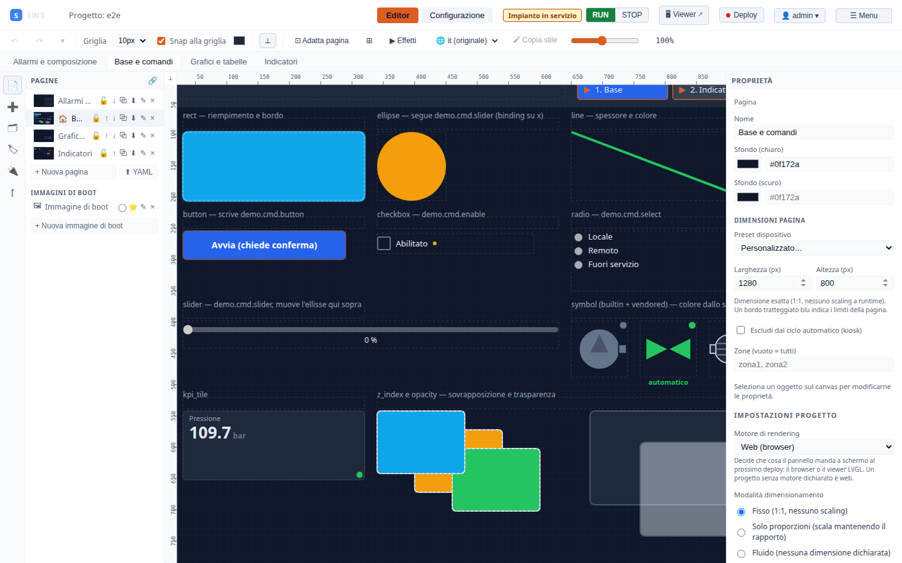
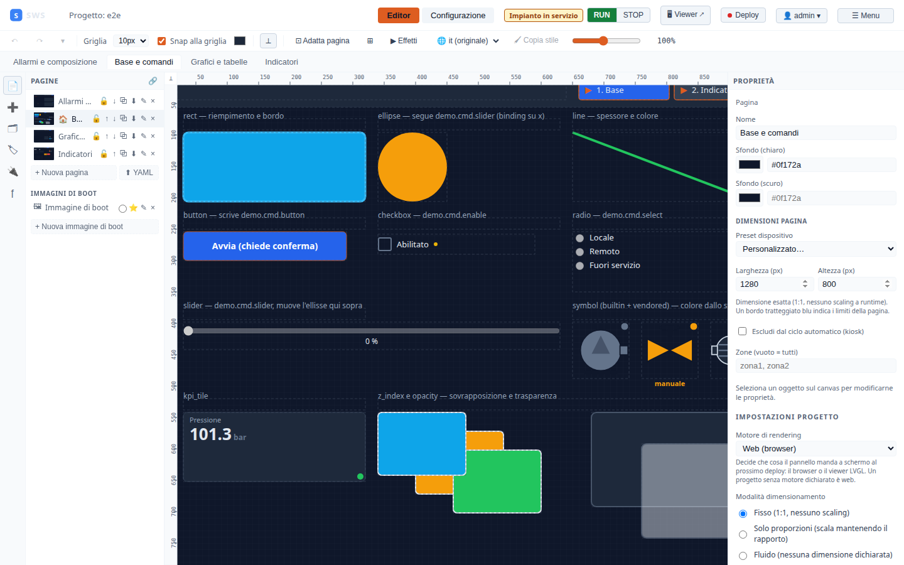
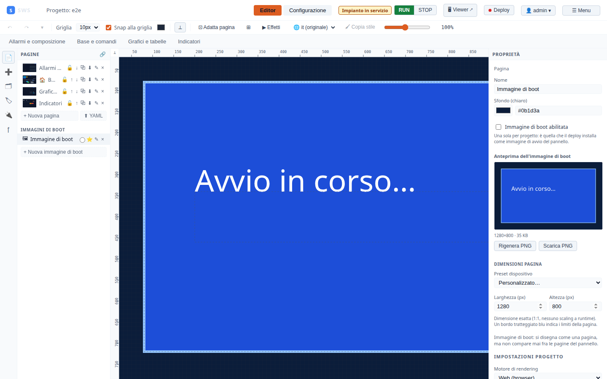

← [Indice](MAIN.md) | [← Architettura](03_architecture.md) | [Successivo → Widget](05_widget_reference.md) →

---

# 04 — Guida all'Editor WYSIWYG

> L'interfaccia dell'IDE: barra in alto, albero a sinistra, canvas, pannello proprietà, e le operazioni sulle
> pagine e sul progetto. Per chi disegna le pagine. I singoli oggetti sono nel [capitolo 05](05_widget_reference.md),
> le procedure passo per passo nel tutorial (Parte II).
>
> Misurato sul codice il 19-10-2026.

L'editor SWS permette di creare sinottici industriali WYSIWYG direttamente nel browser,
senza installare software. Questa guida descrive l'interfaccia e il workflow di lavoro.

---

## Layout dell'interfaccia



L'interfaccia è divisa in quattro aree:

| Area | Posizione | Funzione |
|------|-----------|---------|
| **Toolbar** | In alto | Modalità, navigazione, azioni progetto |
| **Pannello sinistro** | A sinistra | Palette widget, pagine, oggetti, tag |
| **Canvas** | Al centro | Sinottico in costruzione |
| **Pannello proprietà** | A destra | Configurazione dell'oggetto selezionato |

---

## Toolbar

La barra in alto ha due parti: la **testata** dell'IDE, sempre presente, e la **barra dell'editor**, sopra il
canvas.

**Testata** (`App.tsx`, `components/RuntimeCtrl.tsx`, `MainMenu.tsx`):

| Elemento | Funzione |
|----------|---------|
| **🖥 Viewer ↗** | Apre il viewer degli operatori in una scheda nuova, dopo aver controllato che risponda; con il TLS non ancora accettato propone **Accetta cert ↗**. **Nel cloud**, con l'IDE collegato a un pannello, apre lo **schermo del pannello**: la sua pagina operatore attraverso il tunnel, coi valori veri ([capitolo 18](18_container_e_comunicazione.md), «Lo schermo del pannello dal cloud») |
| **RUN / STOP** | Avvia o ferma l'acquisizione dal campo — vedi sotto |
| **⚠ (contatore)** | Avvisi del runtime: compare solo se c'è qualcosa che non va |
| **⚠ Aggiorna progetto** | Compare se il progetto è stato salvato da una versione di SWS più vecchia — vedi [sotto](#-aggiorna-progetto) |
| **Impianto in servizio** | Compare quando l'istanza ha un viewer operatori: si sta modificando il progetto che l'impianto usa |
| **Deploy** | Collegamento al runtime remoto: **Invia ora**, **al salvataggio** (invia a ogni salvataggio riuscito), **Utenti e segreti** (invia anche quelli, con conferma). Se sul pannello c'è un progetto con un **altro nome**, prima chiede conferma: il deploy lo cancella, storico compreso, e la domanda dice quale e quanto pesa |
| **Utente** | Il menu dell'utente: tema, lingua dell'interfaccia, preferenze, Esci |
| **☰ Menu** | Salva tutto, Salva come…, Rinomina, Chiudi progetto, copia sul PC, log, assistente IA, Reboot, Esci. Il pulsante fa anche da esito dell'ultimo salvataggio (⟳ / ✓ / ⚠) |

**Barra dell'editor** (`editor/EditorToolbar.tsx`): annulla e ripristina con la **cronologia** a tendina, zoom
(100 % con `Ctrl+0`, **Adatta pagina** con `Ctrl+Shift+0`, adatta agli oggetti), **Griglia** (dimensione, colore,
snap), **Copia stile** / **Applica stile**, **Effetti** (l'anteprima di lampeggi, rotazioni, flusso delle pipe e
bordi d'allarme, spenta di default) e la lingua in cui il canvas mostra i testi tradotti.

### RUN e STOP: fermare l'acquisizione

Due pulsanti e non un interruttore, di proposito: su un impianto chi preme deve vedere **lo stato
che c'è**, non l'azione che farebbe. Quello acceso dice se l'acquisizione sta girando.

Con l'acquisizione ferma il runtime **resta fermo anche se salvi**. Prima non era così: salvare la
sezione Sorgenti faceva ripartire tutto, perché il salvataggio ricarica le sorgenti — e chi aveva
fermato l'impianto per lavorarci se lo ritrovava in marcia senza aver premuto niente. Adesso
«fermo» è uno stato, e ci vuole un RUN esplicito per uscirne.

### Gli avvisi in testata

Il triangolo con un contatore compare **solo quando c'è qualcosa che non va**, e cliccandolo si apre
un pannello che per ogni voce dice **dove**, **cosa** e **come rimediare**. Serve per i guasti che
altrimenti vivrebbero solo nel log: uno script globale con una schedulazione illeggibile, per
esempio, che non partirà mai e prima non lo diceva nessuno.

Un avviso che si accende anche quando va tutto bene insegna a ignorarlo: per questo qui non c'è
nessun indicatore verde.

---

## Due modalità operative

L'IDE ha due modalità, **Editor** e **Configurazione**, ma dal 2026-09-25 non c'è più un pulsante per
passare dall'una all'altra: lo decide l'ultimo clic nell'albero del pannello sinistro. Una pagina, uno
strumento, un oggetto della pagina o una funzione portano all'editor; una foglia di configurazione porta
alla sua scheda.

### Modalità Editor

La modalità di progettazione del sinottico. Permette:
- Trascinare nuovi widget dalla palette sul canvas
- Selezionare, spostare, ridimensionare oggetti
- Configurare le proprietà nel pannello destro
- Aggiungere, rinominare, riordinare pagine
- Undo/Redo fino a 200 step

### Modalità Configurazione

Tutta la configurazione non grafica del progetto. Dal 2026-09-24 non ha più una barra di schede:
le schede si scelgono dalla vista **⚙ Configurazione** del pannello sinistro, che resta visibile
anche qui (vedi sotto). In cima all'area un'intestazione dice dove si è: *Progetto › Protocolli ›
plc1*. La scheda **Variabili** mostra anche il *valore live* di ogni tag in tempo reale.

I link del tipo `#config/<scheda>` e `#config/<scheda>/<elemento>` (per esempio
`#config/protocols/plc1`) aprono direttamente quella scheda, o quell'elemento.

> **Anteprima live del sinottico**: **🖥 Viewer ↗** in testata apre il viewer degli operatori. Mostra le
> pagine con i valori aggiornati via WebSocket, come le vedrà l'operatore.

---

## Pannello sinistro



Il pannello sinistro è **un albero solo**, lo stesso in editor e in Configurazione. Ogni ramo si apre e si
chiude col suo triangolo, e lo stato si ricorda; scorre l'albero intero. Dall'alto:

- **📄 Pagine**, **▭ Cornici**, **🧩 Faceplate** e **🖼 Immagini di boot**
- **🧰 Strumenti** — gli oggetti da mettere nella pagina, in dieci gruppi (vedi sotto)
- **🗂 Oggetti della pagina**, **ƒ Funzioni**, **🏷 Tag**
- i rami di configurazione: **Progetto**, **Dati**, **Sicurezza**, **Istanza**, **IDE**

Fino al 2026-09-25 c'erano una colonna di icone che sceglieva una vista alla volta, e il blocco delle pagine
fisso in cima: le icone non ci sono più, e le pagine sono il primo ramo.

### PAGINE — l'albero delle pagine

Le pagine formano un **albero**: una pagina può stare sotto un'altra, e l'ordine dell'albero è l'ordine in cui si mostrano ovunque (barra del
viewer, schede, rotazione automatica, pagina iniziale). Prima del 2026-09-20 l'ordine non veniva salvato e a ogni ricarica tornava alfabetico.
- **Trascinare** una pagina su un'altra: nel quarto alto della riga → prima, nel quarto basso → dopo, nel mezzo → diventa sua figlia. Un nodo non
  può andare dentro un suo discendente.
- ▸/▾ espande e comprime un ramo (lo stato si ricorda).
- Passando col mouse su una riga compaiono le azioni: 🔒 blocca, **＋** aggiunge una pagina figlia, ⧉ duplica (la copia sta subito dopo), ⬇ esporta,
  ✎ rinomina (o doppio click), × elimina (i figli salgono di un livello).
- **+ Nuova pagina** — aggiunge una pagina in radice. **⬆ YAML** — importa una pagina da file YAML.
- L'albero è salvato in `project.yaml` (`page_layout.page_tree`), subito, senza aspettare «Salva»; una pagina non ancora salvata sparisce dall'albero
  se ricarichi senza salvarla.

### 🧰 STRUMENTI — gli oggetti da mettere nella pagina

Un clic su un oggetto lo aggiunge alla pagina corrente; se sei in Configurazione, prima torna all'editor.
La **L** in fondo alla riga indica gli oggetti che il motore LVGL sa disegnare.

#### I gruppi

Dal 14-10-2026 gli strumenti sono in **dieci gruppi** (`PALETTE_GROUPS`, `editor/LeftPanel.tsx`); prima erano
cinque, e «Display» ne teneva diciotto. I tipi sono gli stessi, 39:

| Gruppo | Strumenti |
|---|---|
| **Forme** | Rettangolo, Ellisse, Linea, Polilinea, Poligono |
| **Testo e immagini** | Testo, Immagine |
| **Comandi** | Bottone, Checkbox, Radio, Slider, Setpoint |
| **Indicatori** | LED, Lampada multi-stato, Gauge, Progress, Valore in evidenza, Data e ora |
| **Grafici** | Trend, Sparkline, Grafico XY, Bar Chart, Pie Chart |
| **Tabelle e registri** | Tabella, Storico valori, Lista testi, Ricette |
| **Allarmi** | Allarmi, Barra allarmi, Campanella allarmi, Storico allarmi |
| **Navigazione e lingua** | Nav pagina, Navigatore pagine, Lingua ▾, Lingua btn |
| **Impianto** | Tubazione, Griglia (i faceplate si trascinano dal loro ramo, vedi sotto) |
| **Simboli** | il riquadro di scelta, e sotto la libreria per famiglia — vedi [Simboli](#simboli-svg-industriali) |

### Il limite della pagina

Quando la pagina ha delle dimensioni (modalità **Fisso** o **Solo proporzioni**),
il rettangolo tratteggiato blu è il foglio. Attorno c'è un **tavolo** neutro: il
colore di sfondo che imposti riempie il foglio e si ferma lì, così si vede dove
finisce quello che l'operatore vedrà.

Il bordo del foglio **trattiene ma non imprigiona**. Trascinando un oggetto verso
il bordo si sente una resistenza: l'oggetto si incolla al limite mentre il
cursore lo supera, e si stacca solo se si continua a trascinare con decisione
(una ventina di pixel oltre). Non serve nessun tasto. I due assi sono
indipendenti: un oggetto può scivolare lungo il bordo inferiore mentre esce a
destra.

**Un oggetto portato interamente fuori dal foglio è parcheggiato.** Resta nel
progetto e lo si continua a vedere in editor, grigio e attenuato, ma **non viene
disegnato a runtime**: né nel viewer del browser, né sul pannello, e il
validatore smette di segnalarne i difetti. È il modo di togliere qualcosa dalla
grafica senza cancellarlo — utile per mettere da parte un widget mentre si
riorganizza una pagina, o per tenere pronta una variante.

Basta che l'oggetto tocchi il bordo, anche di un pixel, perché resti attivo: si
spegne solo ciò che è stato portato via del tutto. Le pipe con i capi agganciati
a un altro oggetto fanno eccezione e non si parcheggiano mai — la loro
geometria è dove stanno i capi; per metterne una da parte si staccano prima.

Quando una pagina ha oggetti parcheggiati, il pannello proprietà lo dice col
numero. Vale la pena leggerlo dopo aver **rimpicciolito** una pagina: tutto
quello che resta fuori dalle nuove misure si spegne, e l'avviso è il modo di
accorgersene senza aprire il viewer.

In modalità **Fluida** la pagina non ha dimensioni dichiarate, quindi non ha un
bordo: niente tavolo, niente resistenza, niente parcheggio.

### 🗂 OGGETTI DELLA PAGINA

Lista degli oggetti presenti nella pagina corrente.
Click → seleziona l'oggetto nel canvas.
Icone: elimina, blocca (impedisce selezione accidentale).

### ƒ FUNZIONI

Funzioni Python riutilizzabili del progetto.
Crea funzioni che i widget richiamano su `on_press`/`on_release`.

### 🏷 TAG

Elenco dei tag definiti nel progetto con valore live, con i decimali e l'unità dichiarati.

Un **tipo** (Configurazione → Variabili → Tipi) da solo non produce variabili: le sue parti esistono solo in una
variabile di quel tipo, un'**istanza**. Nella scheda Tipi, sotto il tipo scelto, «Crea istanza» la crea col nome proposto
(modificabile) e porta alla sua riga fra le Variabili; da lì le sue parti (`sistema.cpu_pct`) compaiono nell'albero e nei
selettori dei tag. Il template «TC620 — sistema» ne è un esempio completo.

### I rami di configurazione

Tutte le schede di configurazione, divise in rami (`sws-editor/src/config/schede.ts`):

| Ramo | Schede |
|---|---|
| **Progetto** | Variabili, Tipi, Protocolli, Allarmi, Python, Ricette, **Notifiche** (SMTP, Telegram, Cosa e dove), Stile, Lingue, Git |
| **Dati** | Datastore |
| **Sicurezza** | Utenti |
| **Istanza** | Risorse, Backup, **Device** (Stato, Dispositivi, Connessione, Installazione, Container), **Sviluppatore** (Pacchetto runtime, solo da un checkout) |
| **IDE** | Preferenze IDE |

Le schede da amministratore compaiono solo all'Admin.

- Un clic su una scheda la apre, anche partendo dall'editor.
- Protocolli, Python, Ricette, Datastore e Utenti hanno accanto il numero di elementi e una freccia ▶ che li mostra: una foglia per
  sorgente, script, ricetta, datastore o utente. Un clic su un elemento apre la scheda **su quell'elemento solo** (per le sorgenti:
  solo la sua card); un clic sulla scheda torna all'elenco intero.
- Gli elementi vengono dalla **bozza**: una sorgente aggiunta e non ancora salvata compare subito. Aggiungendone una mentre ne è scelta un'altra,
  la nuova prende il suo posto.
- **Tipi** è una foglia sua, ma condivide con **Variabili** la bozza, il pulsante Salva e l'export/import CSV.

Fino al 2026-09-24 qui c'era la vista **Sorgenti**, un elenco con «Vai alla configurazione →»: la sostituisce il ramo Progetto.

---

## Operazioni base sul canvas

### Aggiungere un widget

1. Nell'albero, ramo **🧰 Strumenti**, clicca il tipo di oggetto desiderato
2. L'oggetto appare al centro del canvas con dimensioni di default
3. Configuralo nel pannello proprietà a destra

### Selezionare e spostare

- **Click** → seleziona un oggetto
- **Click + trascinamento** → sposta l'oggetto
- **Click su area vuota** → deseleziona tutto
- **Ctrl+A** → seleziona tutti
- **Shift+Click** → selezione multipla

### Ridimensionare

Con un oggetto selezionato, trascina le maniglie bianche agli angoli e ai bordi.
Tieni **Shift** per mantenere le proporzioni.

### Proprietà nel pannello destro

Il pannello destro è **una colonna sola**, come l'albero a sinistra. Le sezioni stanno sotto quattro rami, che
si chiudono e lo ricordano:

- **🎛 il tipo** (per esempio «Gauge», «Testo»): le impostazioni proprie dell'oggetto — *Parametri*, o *Testo*
  su un testo. Non c'è sulle forme (rettangolo, ellisse, linea), che non ne hanno;
- **📐 Posizione e aspetto**: Identità e posizione, Aspetto, Trasformazione, Livello e visibilità;
- **🔗 Dati e collegamenti**: Dato (tag), Binding attivi, Indicatore di qualità;
- **⚡ Animazione e interazione**: Movimento su percorso, Eventi, Sicurezza.

- **Una sezione aperta alla volta**: aprendone una si chiude la precedente, così non si scorre.
- **📌 Appunta** una sezione per tenerla aperta insieme alle altre (per esempio Aspetto mentre si lavora sulla
  Trasformazione). Le sezioni appuntate valgono per tutti gli oggetti.
- **Cambiando oggetto** la sezione aperta resta quella, se il tipo nuovo ce l'ha; altrimenti si apre quella
  del tipo (Parametri su uno strumento, Testo su un testo, Aspetto su una forma). Tornando su un oggetto che
  ce l'ha, si ritrova la sezione scelta.

Fino al 2026-09-25 il pannello aveva una colonna di icone che mostrava un gruppo per volta, e i gruppi erano
Oggetto, Testo, Dato, Comportamento e Resa — con Parametri dentro Dato.

Ogni tipo di widget ha proprietà specifiche (vedi [05 — Widget Reference](05_widget_reference.md)).
Le proprietà comuni a tutti gli oggetti sono:

| Proprietà | Descrizione |
|-----------|-------------|
| **X, Y** | Posizione in pixel dall'angolo in alto a sinistra del canvas |
| **Larghezza, Altezza** | Dimensioni in pixel |
| **Z-index** | Ordine di disegno (valore maggiore = davanti) |
| **Visibile** | On/Off statico |
| **Tag visibilità** | Tag che controlla la visibilità dinamicamente |
| **Rotazione** | Gradi, applicata attorno al centro dell'oggetto |
| **Flip H / V** | Specchio orizzontale/verticale |
| **Opacità** | 0.0 (trasparente) → 1.0 (opaco) |
| **Ruolo minimo per operare** | Sotto quel ruolo l'oggetto si nasconde o si disabilita (sezione Sicurezza) |
| **Durata transizione (ms)** | Anima il cambio di colore, opacità e trasformazione |

**Chi può comandare: il tag e l'oggetto, e vince il più severo.** Per scrivere un tag serve il suo *Ruolo min.
scrittura* (Configurazione → Tag; vuoto = Operator). È l'unico vincolo che il runtime fa rispettare, per
qualunque pulsante, script o chiamata API. Con **«Chiunque, anche senza login»** il tag si comanda anche dal
viewer senza aver fatto login: la luce della stanza. Il *Ruolo minimo per operare* dell'oggetto può solo
restringere: due pulsanti sullo stesso tag aperto possono essere uno libero e uno da Operator. Ricorda però che
la restrizione del secondo vale per quel pulsante: il tag resta comandabile da chiunque attraverso il primo. La
sezione Sicurezza del pannello proprietà mostra cosa chiede il tag che l'oggetto scrive.

Le **zone** non sono una proprietà dell'oggetto ma della pagina: vedi [Zone di accesso](#zone-di-accesso-abac).

---

## Binding tag

Il binding è il collegamento tra un widget e un tag PLC.
Quasi tutti i widget hanno un campo **Tag** nel pannello proprietà.

Quando imposti un tag:
1. Il widget mostra il valore live del tag nel Viewer operatori (porta 7443)
2. Il quality dot (•), se acceso nella sezione **Indicatore di qualità**, dice la qualità del dato: Good, Bad,
   Uncertain, ognuna col suo colore configurabile
3. I widget di controllo (button, slider, checkbox) scrivono sul tag quando l'operatore interagisce

**Formato visualizzazione**: il campo **Formato** è un testo con il segnaposto `{value}`, uguale sul web e su
LVGL (`formatValue`, `canvas/SvgCanvas.tsx`; casi in `tests/fixtures/formattazione-valori.json`):

| Formato | Valore | Risultato |
|---|---|---|
| `{value:.1f} bar` | 12.34 | `12.3 bar` |
| `{value:+.1f}` | 2 | `+2.0` |
| `{value:,.0f}` | 12345 | `12.345` (separatore delle migliaia della lingua del browser) |
| `{value:.0%}` | 0.75 | `75%` |
| `{value:hms}` | durata in secondi | ore, minuti, secondi (anche `hm`, `dhms`) |
| `{value:datetime}` | istante in ms | data e ora UTC (anche `date`, `time`) |

Un formato senza `{value}` resta testo fisso.

### Binding attivi

Oltre al tag principale, molte proprietà si legano a un tag nella sezione **🔗 Dati e collegamenti → Binding
attivi**. Esempio: legare il colore di riempimento a un tag booleano per cambiarlo dinamicamente.

---

## Gestione pagine

### Pagine multiple e navigazione

Un progetto può avere più pagine (sinottici). La navigazione tra pagine avviene:
- **NavButton** — widget pulsante con azione navigazione
- **Grid cell** — ogni cella della griglia può navigare a una pagina

### Auto-rotate (kiosk)

Nella configurazione della pagina (click su area vuota del canvas → pannello proprietà):
- **Escludi dal ciclo automatico** — esclude questa pagina dalla rotazione kiosk
- Utile per pagine di dettaglio o allarme che non devono apparire nella rotazione

### Zone di accesso (ABAC)

Ogni pagina può specificare le **Zone** (es. `zona1, zona2`).
Solo gli utenti con quelle zone nel profilo possono visualizzare la pagina.
Lascia vuoto = nessuna restrizione.

---

## Immagini di boot

Un'**immagine di boot** è ciò che un pannello Pixsys mostra mentre parte. Nell'IDE è una pagina come le altre
— stesso canvas, stessi strumenti — ma vive a parte (`boot/`) e **nessun viewer la vede mai**.

- **Dove.** Pannello sinistro → **PAGINE**, sezione **Immagini di boot** (🖼) sotto le pagine. Ogni progetto
  nasce con una, vuota, 1280×800; «+ Nuova immagine di boot» ne aggiunge altre. Non compaiono fra le tab in alto.
- **Cosa ci puoi mettere.** Solo oggetti statici: forme, linee, tubi, testo, immagini, simboli. L'immagine diventa
  un PNG al salvataggio, quindi tag ed eventi non avrebbero effetto.
- **Abilitarla.** Una sola per progetto, col radio ⭐ nell'elenco o con «Immagine di boot abilitata» nel pannello
  della pagina. È quella che il deploy installa; senza nessuna abilitata il deploy non tocca l'immagine.
- **Il PNG.** Si genera nel browser al salvataggio. Nel pannello della pagina c'è l'anteprima del PNG che sta
  sul server, con «Rigenera PNG» e «Scarica PNG». I font sono quelli del browser con cui salvi.
- **Formato del progetto.** La prima pagina a cui imposti misure o sfondo dà il formato alle altre (Impostazioni
  pagine → «Formato predefinito», con «Applica alle pagine senza formato proprio»).
- **Sul pannello.** L'immagine compare al **prossimo avvio**. Lo stato si legge in Configurazione → Istanza →
  Device → Connessione, riga «Immagine di boot». Vedi `HOWTO.md` §17.



## Cornici (testata e piede comuni a più pagine)

Una **cornice** è la parte che resta uguale su tutte le pagine che la usano, come intestazione e piè di pagina di un
documento: una testata con titolo, data e ora, un piede con la barra di navigazione. Si modifica una volta e cambia
ovunque.

- **La proposta.** In un progetto che ha pagine ma nessuna cornice, il ramo Cornici propone un modello: sceglierlo
  crea la cornice e la rende la predefinita; «No, grazie» non la ripropone più in quel progetto, in questo browser
  (`cornici/PropostaCornice.tsx`).
- **Dove.** Pannello sinistro → **CORNICI** (▭). «+ Nuova cornice…» propone quattro modelli: testata con titolo,
  data e ora più navigazione in basso; solo navigazione in basso; solo testata; vuota. La cornice nasce con le
  misure della pagina aperta e si apre sul canvas come una pagina.
- **Le fasce.** Testata e piede hanno un'altezza e un fondo (Proprietà della cornice). Sul canvas sono segnate da
  una riga tratteggiata: gli oggetti della cornice vanno dentro le due fasce, il validatore segnala quelli fuori.
- **La cornice predefinita.** Nelle proprietà della cornice, «Cornice predefinita del progetto» (⭐ nell'albero):
  la usano tutte le pagine che non ne scelgono un'altra.
- **Pagina per pagina.** Nelle proprietà della pagina, «Cornice»: la predefinita del progetto, un'altra cornice, o
  nessuna. Sotto la pagina la cornice si vede attenuata e non si seleziona; «Modifica la cornice» la apre.
- **Immagine di sfondo dell'area attiva.** Nelle proprietà della pagina, «Immagine di sfondo dell'area attiva»:
  «⬆ Carica…» o una delle immagini del progetto. Riempie la parte **fra testata e piede** (tutta la pagina se non
  ha cornice), sotto gli oggetti e senza coprire le fasce; l'immagine si adatta senza deformarsi e ritaglia i bordi
  in eccesso. La compone il server (`cornici::sfondo_area`), quindi il viewer web la vede uguale all'editor. Dalla
  2.23.3 il pannello LVGL disegna anche PNG e JPEG (prima solo SVG), quindi uno sfondo generato da una planimetria
  si vede anche lì.
- **Sotto, non sopra.** La cornice si disegna sotto il contenuto della pagina. Un oggetto della pagina nello spazio
  libero di una fascia va bene (il titolo della pagina accanto all'orologio); il validatore avvisa solo quando un
  oggetto della pagina copre un oggetto della cornice.
- **Segnaposti.** Nei testi della cornice: `{{pagina.nome}}`, `{{pagina.id}}`, `{{progetto.nome}}`. Il nome della
  pagina non si traduce: un titolo tradotto resta sulla pagina, come nel template `tc620-sistema`.
- **Dove arriva.** Le cornici viaggiano con il progetto (esportazione, deploy, istantanea) e si vedono uguali nel
  viewer web e sul pannello LVGL. Le immagini di boot e le finestre non hanno cornice.
- **Esempi.** `homeassistant-pro` (il navigatore in fondo alle sei pagine) e `tc620-sistema` (la testata con ora,
  data e identità del pannello).

## Planimetrie (dal 29-10-2026)

Una **planimetria** è la pianta di un ambiente — una casa, un reparto, un garage — disegnata nell'IDE e resa in 3D,
da cui si genera con un clic l'**immagine di sfondo** di una pagina. Sopra lo sfondo si mettono gli oggetti del
sinottico come sempre (lampade, sensori, pulsanti), dove si vedono nella vista. Il pannello non sa che le planimetrie
esistono: riceve un'immagine, uguale sul viewer web e su quello LVGL.

**Dove.** Nel pannello sinistro, ramo **Planimetrie** → **+ Nuova planimetria**. Scelta una pianta, l'editor prende il
posto del canvas; scegliere una pagina lo richiude.

**Disegnare.** Le misure sono in **metri**; la griglia aggancia al passo scelto in barra (da 5 cm a 1 m).

| Strumento | Come |
|---|---|
| ↖ Seleziona | clic per scegliere; trascina un blocco o i vertici del muro scelto; trascina il fondo per spostare la vista, rotella per lo zoom; **Canc** elimina |
| ▬ Muro | clic per ogni punto; doppio clic o **Invio** per finire, **Esc** per lasciar perdere |
| 🚪 Porta, 🪟 Finestra | un clic vicino a un muro: l'apertura si aggancia lì e segue il muro |
| ▦ Area | clic per ogni vertice (almeno tre), doppio clic o Invio per chiuderla: una zona colorata a pavimento, con etichetta (una stanza, un reparto) |
| ⬛ Blocco | un clic: una macchina o un arredo, con misure, rotazione, colore ed etichetta |

A destra le proprietà dell'elemento scelto — spessore e altezza di un muro, larghezza e altezza di un'apertura (e il
davanzale di una finestra), colore ed etichetta — o, senza niente di scelto, il nome e il colore di fondo della
pianta. **Salva** salva la pianta; anche il Salva generale la trova.

**La vista 3D.** **🧊 Vista 3D** apre accanto alla pianta la stessa planimetria in 3D: i muri con i vani delle
aperture (sopra una porta resta l'architrave, una finestra ha davanzale e architrave), le aree a pavimento, i blocchi.
Si gira col mouse, e l'inquadratura si salva con la pianta. La vista si carica solo quando la si apre: l'IDE non la
scarica all'avvio.

**Lo sfondo.** **🖼 Genera sfondo…** rende la vista 3D com'è inquadrata adesso, alla misura della pagina aperta (si
può cambiare), e la salva fra le immagini del progetto come `planimetria-<id>.png`. Se è aperta una pagina, propone
di metterla subito come suo sfondo (Proprietà pagina → Immagine di sfondo). Rigenerarla sovrascrive lo stesso file, e
le pagine che la usano si aggiornano da sole.

**Dove vive.** `planimetrie/<id>.yaml` nel progetto: viaggia con l'export, il deploy, i backup e git; l'immagine
generata sta in `images/`. Eliminare una planimetria lascia l'immagine, perché può essere lo sfondo di una pagina.

## Finestre (una pagina aperta sopra l'altra)

Una **finestra** è una pagina che si apre sopra quella corrente, da un bottone: il dettaglio di una pompa, i
comandi di una valvola, una conferma.

- **Fare di una pagina una finestra.** Proprietà della pagina → **«Si apre come finestra»**. La pagina esce da
  navigatori, tab e rotazione kiosk, e nell'albero ha il segno 🪟.
- **Modale o non modale.** La modale copre la pagina sotto finché non la chiudi (✕, `Esc` o clic fuori). La non
  modale lascia usabile la pagina sotto e si sposta trascinando il titolo. Se ne apre una alla volta: aprirne
  un'altra sostituisce la prima.
- **Titolo e parametri.** Il titolo è libero (vuoto = il nome della pagina). I **parametri** si dichiarano con un
  nome e un predefinito; nei campi della pagina si scrive `{nome}`, come nei faceplate. Così la stessa finestra
  serve per la pompa 1 e la pompa 2.
- **Aprirla.** Su un bottone, «Azione predefinita» → **«Apri finestra»**: si sceglie la pagina-finestra e si danno i
  valori dei suoi parametri. **«Chiudi finestra»** è l'azione di un bottone «Chiudi» dentro la finestra.
- **Sul pannello LVGL** la finestra si apre davvero come finestra (dalla 2.17.0): velo scuro dietro, barra del
  titolo col ✕, parametri sostituiti, e la pagina sotto che resta viva e ricompare chiudendo. Si chiude col ✕ o
  con un bottone «Chiudi finestra». **Due differenze dal browser, e sono volute**: una pagina dichiarata *non
  modale* sul pannello si apre modale lo stesso — il velo c'è sempre, e il validatore lo ricorda — e il tocco
  **fuori** dalla finestra non chiude, perché su un vetro si chiuderebbe per sbaglio con un dito appoggiato male.
  `Esc` non c'è, perché non c'è una tastiera. Una finestra più grande dello schermo viene tagliata, non
  rimpicciolita.

## Cambiare risoluzione del progetto

Per portare un progetto su uno schermo diverso (per esempio da Full HD a un pannello 1280×800) senza
riposizionare tutto a mano: pannello proprietà, con nessun oggetto selezionato → **Impostazioni progetto** →
**«Cambia risoluzione del progetto…»**.

- **Da / A.** «Da» propone la misura più frequente fra le pagine; «A» si sceglie da un preset o scrivendo
  larghezza e altezza.
- **Cosa convertire.** L'elenco delle pagine, delle cornici e delle immagini di boot, con la loro misura: sono
  già spuntate quelle che hanno la misura «Da».
- **Come si trasforma.** Un fattore solo, il minore fra i due assi, così niente si deforma. Il disegno si centra e,
  se le proporzioni cambiano, resta una fascia libera: il dialogo dice quanta. Testi e spessori seguono la scala
  ma non scendono sotto 9 px e 1 px. Le cornici tengono testata e piede attaccati ai bordi.
- **Annullare.** La conversione è un passo solo di cronologia: `Ctrl+Z` la toglie tutta. Diventa definitiva
  quando salvi.
- **Un limite.** Un oggetto che non dichiara una dimensione del testo usa quella predefinita del suo tipo, che
  non cambia: dopo una riduzione forte può servire ritoccarla a mano.

## Salvataggio e versioning

### Salva manuale

**☰ Menu → Salva tutto** (o `Ctrl+S`): salva il progetto corrente sul runtime.

### Salva come, Rinomina, Chiudi

Nel **☰ Menu** (`components/MainMenu.tsx`):

- **Salva come…** crea una copia del progetto con un nome nuovo e continua a lavorare **sulla copia**. Con modifiche
  non salvate avvisa: la copia parte dal progetto com'è sul disco.
- **Rinomina progetto…** e **Chiudi progetto** (che torna alla schermata dei progetti).

### Quando il salvataggio viene rifiutato

Può comparire una banda arancione: **«Il salvataggio è stato rifiutato: qualcun altro ha modificato
il progetto mentre lavoravi, e le sue modifiche non sono state cancellate.»**

Non è un errore: è una protezione. Ogni sezione della Configurazione salva l'elenco **intero** —
tutte le variabili, tutti gli allarmi — quindi due schede aperte sullo stesso progetto, che salvano
una dopo l'altra, si cancellerebbero il lavoro a vicenda senza che nessuno se ne accorga. Il
runtime tiene una versione del file e rifiuta chi parte da una versione vecchia.

Il rimedio è il pulsante **Ricarica** nella banda: rilegge il progetto e riparte da quello che c'è
adesso. **Le modifiche non salvate di quella sezione si perdono**, quindi se hai testo a cui tieni
— un pezzo di codice Python, per esempio — copialo prima di ricaricare.

I casi in cui capita davvero:

- **due schede del browser** aperte sulla stessa Configurazione;
- **un deploy o un pull GitOps** arrivato mentre lavoravi;
- qualcuno che ha modificato i file sul dispositivo.

C'è anche una banda simile, senza rifiuto, che dice «il progetto sul runtime è cambiato: questa
pagina mostra ancora la versione precedente». Quella compare **prima** che tu provi a salvare, e
l'IDE non ricarica da solo di proposito: se avessi del lavoro non salvato, sovrascriverlo senza
chiedere sarebbe peggio che mostrarti dati vecchi.

### ⚠ Aggiorna progetto

Se il progetto è stato salvato da una versione di SWS più vecchia di quella che lo sta servendo,
in testata compare **⚠ Aggiorna progetto**. Il pulsante riscrive i file nel formato corrente,
**senza perdere niente**: le chiavi che questa versione non conosce vengono conservate così come
sono, di proposito, perché «normalizzare il formato» non deve mai voler dire «cancellare ciò che
una versione più nuova ha scritto».

Va premuto una volta sola, e da lì l'avviso sparisce. È l'operazione tipica dopo aver importato un
progetto vecchio o aver aggiornato il runtime di un dispositivo.

### Export / Import

- **☰ Menu → 💾 Salva copia sul PC…** → scarica un `.zip` con tutti i YAML
- **☰ Menu → 📂 Sostituisci da copia sul PC…** → carica un `.zip` e **sostituisce** il progetto corrente: le pagine
  che lo `.zip` non porta vengono eliminate
- **Includi le credenziali (password, token)**: con la spunta lo `.zip` porta anche `secrets.yaml`, e all'import
  sostituisce quello del progetto

### GitOps (versioning avanzato)

- **Configurazione → Progetto → Git**: aggancio a un repository, commit, push, pull, rollback, storia, prova di una
  versione, fork, tag
- Un salvataggio non crea un commit: va fatto esplicitamente

Vedi [12 — GitOps](12_gitops.md) per i dettagli.

---

## La miniatura nell'elenco dei progetti

Dal 29-10-2026 ogni scheda della schermata dei progetti mostra la **miniatura della pagina iniziale** del progetto,
con la sua cornice, al posto dell'icona. La disegna l'IDE **a ogni salvataggio** in cui la pagina iniziale (o la sua
cornice) è cambiata, coi valori che l'editor mostra in quel momento: larga 400 pixel, al massimo 256 KB. Sta nella
cartella del progetto come `anteprima.png`, quindi segue il progetto quando lo si rinomina, lo si duplica o lo si
archivia; non va in Git e non va al pannello. Un progetto mai salvato da questa versione mostra l'icona.

## Archiviare un progetto

Dalla schermata dei progetti, sulla scheda di un progetto chiuso: **🗄 Archivia**, con gli stessi permessi di
eliminare un progetto (è meno distruttivo, non chiede di più). Il progetto **resta al
suo posto**, con storico, backup e git intatti, ma sparisce dall'elenco e non si apre per sbaglio. Nel cloud non
occupa il tetto dei progetti aperti, ma **conta nella quota di spazio**: i suoi file ci sono ancora.

In fondo all'elenco, **Archiviati (N)** li mostra con la data e chi li ha archiviati: **Ripristina** lo rimette fra i
progetti, **✕** lo cancella. Un progetto aperto non si archivia: va chiuso prima. Duplicando un archiviato, la copia
nasce viva. Archiviare e ripristinare finiscono nell'audit (`project.archive`, `project.unarchive`).

## Scorciatoie da tastiera

`?` sul canvas apre la guida, con le combinazioni in uso. Si cambiano in **Configurazione → IDE → Preferenze IDE →
Scorciatoie da tastiera**: «Cambia», poi la combinazione nuova (Esc annulla); «Predefinita» o «Ripristina tutte» per
tornare indietro. Valgono in questo browser, come tema e lingua. La scheda rifiuta le combinazioni che il browser si
tiene — dieci: Ctrl+W, Ctrl+T, Ctrl+N, Ctrl+Q, Ctrl+Shift+W, Ctrl+Shift+T, Ctrl+Shift+N, Ctrl+Tab, Ctrl+PagSu,
Ctrl+PagGiù (`RISERVATE`, `scorciatoie/registro.ts`) — e quelle già usate da un'altra azione, dicendo quale.

| Azione | Predefinita |
|---|---|
| Salva il progetto | Ctrl+S |
| Passa fra editor e Configurazione | Ctrl+, |
| Pagina successiva / precedente | Alt+PagGiù / Alt+PagSu |
| Annulla / Ripristina | Ctrl+Z / Ctrl+Y (o Ctrl+Shift+Z) |
| Copia, taglia, incolla, duplica | Ctrl+C, Ctrl+X, Ctrl+V, Ctrl+D |
| Elimina selezione | Canc (o Backspace) |
| Seleziona tutto, raggruppa | Ctrl+A, Ctrl+G |
| Avanti, primo piano, indietro, in fondo | Ctrl+], Ctrl+Shift+], Ctrl+[, Ctrl+Shift+[ |

Sul Mac Ctrl è ⌘. Frecce (1 px, con Shift un passo di griglia), rotellina, mouse e zoom (Ctrl+0, Ctrl+Shift+0) sono
gesti fissi.

## Undo / Redo

- **Ctrl+Z** — undo (fino a 200 step)
- **Ctrl+Y** o **Ctrl+Shift+Z** — redo
- La **cronologia** a tendina nella barra dell'editor mostra gli step, con il segno «sei qui»
- Click su uno step → torna a quello stato (o lo ripristina, se è dopo)

---

## Simboli SVG industriali

Il gruppo **Simboli** degli strumenti apre il riquadro di scelta; sotto, la libreria si sfoglia per famiglia.
La libreria ha **138 simboli** (`sws-editor/public/symbols/lib/`):

| Famiglia | Simboli | Esempi |
|---|---|---|
| `process` | 68 | valvole (a sfera, a farfalla…), filtri, caldaie, agitatori, scambiatori |
| `machines` | 34 | nastri trasportatori, ventilatori, soffianti, AGV, elevatori |
| `electrical` | 26 | motori, interruttori, quadri, batterie |
| `building` | 10 | UTA, pompe di calore, fan coil, radiatori, tapparelle |

I colori dei simboli seguono lo **stile** del progetto (Configurazione → Progetto → Stile) e lo stato del tag
collegato.

**Simboli del progetto**: si caricano file SVG da **Configurazione → Istanza → Risorse**, con etichetta, licenza e
autore. Restano nel progetto (`custom_symbols` in `project.yaml`) e si usano in tutte le pagine.

---

## Faceplate (componenti parametrici)

Un faceplate è un gruppo di widget riutilizzabile con parametri sostituibili.

**Esempio**: un faceplate "Pompa" con parametri `tag_prefix` e `label`:
- Contiene un LED (tag: `{tag_prefix}.stato`), un gauge (tag: `{tag_prefix}.portata`), un label (`{label}`)
- Ogni istanza sostituisce `{tag_prefix}` con il valore specifico

**Un faceplate si disegna sul canvas, come una pagina** (dal 29-10-2026; prima si scriveva in JSON in una scheda della
Configurazione). Nell'albero delle pagine c'è il ramo **Faceplate**, accanto a Cornici e Immagini di boot: un clic apre
il faceplate sul canvas, **«+ Nuovo faceplate»** ne crea uno. Tutto quello che vale su una pagina vale qui: gli
strumenti, la selezione multipla, copia e incolla, allineamenti, griglia, annulla. Due differenze:

- **i parametri si vedono sostituiti**: un testo `{label}` sul canvas si legge col predefinito del parametro, o
  «label» se non ne ha uno; il pannello proprietà mostra quello che c'è scritto davvero (`{label}`);
- **niente faceplate dentro un faceplate**: lo strumento non c'è, e incollarne uno non fa niente. Il pannello non lo
  disegna.

Senza nessun oggetto scelto, il pannello di destra ha le proprietà del faceplate: **nome** e **misura** (il foglio su cui
si disegna, quella che le istanze usano per scalare), l'**id** in sola lettura — lo citano le istanze —, i
**parametri** (nome, tipo, predefinito, obbligatorio; per il tipo «istanza» anche il tipo di struttura), **dove è
usato**, e il pulsante **{ } JSON** con la definizione intera, da leggere o da scrivere a mano: «Applica» la riscrive
in un passo che si annulla. Il faceplate si salva con **Salva**, insieme al resto.

I tre faceplate che il runtime porta con sé (`motor_basic`, `valve_basic`, `tank_level`) hanno accanto ◇. Si possono
modificare: il progetto ne tiene una versione sua (◆), e dalle proprietà **«Ripristina il predefinito»** la cancella.
Non si eliminano, perché tornerebbero al caricamento.

Un faceplate nasce anche **dagli oggetti già disegnati** (dal 25-10-2026): si selezionano (due o più) e nel pannello
della selezione si preme **«⧉ Crea faceplate dalla selezione»**, dandogli un nome. Le coordinate diventano relative al
riquadro della selezione; **i tag diventano parametri** — se hanno una radice comune (`motore1.velocita`,
`motore1.marcia`) un parametro solo `p` di tipo istanza (`{p}.velocita`), altrimenti uno per tag col tag originale come
predefinito. Il faceplate compare nel ramo Faceplate e la selezione diventa la sua **prima istanza**, con i parametri che
la rifanno com'era; un «annulla» toglie tutti e due.
Per usarlo **lo si trascina dal ramo Faceplate sulla pagina** (o si preme il suo **＋**, che lo mette al centro di ciò
che si vede): l'istanza nasce già col suo faceplate e con la sua misura, e i parametri si danno nelle proprietà. Non
c'è più uno strumento «Faceplate» fra gli strumenti, che creava un riquadro vuoto da riempire dopo. Un faceplate si
mette su una pagina o su una cornice, non dentro un altro faceplate. La cornice delle pagine non compare sotto un
faceplate aperto: il faceplate è un pezzo da mettere nelle pagine, non una pagina. **Le istanze
seguono la definizione**: cambiare il faceplate cambia tutte le sue istanze, sul web e sul pannello LVGL — è il
template d'oggetto del piano prima fascia (P2).

---

## Report programmati (dal 26-10-2026)

**Configurazione → Progetto → Report**. Un report è un PDF e/o un Excel con:

- il **riepilogo** dei tag scelti nel periodo: minimo, massimo, media, numero di campioni;
- l'**andamento**: la media di ogni tag per intervallo («Righe ogni», predefinito 15 minuti per un turno, un'ora per un
  giorno, un giorno per settimana e mese), con le righe che partono dall'inizio del periodo;
- gli **allarmi** del periodo (se spuntato): quando sono scattati, il messaggio, la gravità, il rientro, chi li ha
  riconosciuti.

| Campo | |
|---|---|
| Periodo | turno (8 ore), giorno, settimana, mese (dallo stesso giorno del mese prima) |
| Quando | un cron a cinque campi, nell'ora del pannello; vuoto = alla fine del periodo, alle 6 (turno: 6, 14 e 22). Il report copre il periodo che **finisce** in quel momento |
| Formati | PDF (tabelle, A4 orizzontale; tanti tag si dividono in gruppi di colonne) ed Excel (un foglio per tabella, numeri veri) |
| Manda per email a | destinatari, con l'SMTP di Notifiche; vuoto = solo salvato |
| File da tenere | quante generazioni conservare (predefinito 30) |

I report li genera **il pannello**, dove c'è lo storico: li salva nel progetto, in `reports/<id>/`. Nell'IDE e nel cloud
la scheda mostra le definizioni; con un pannello collegato mostra anche i **suoi** file, da scaricare, e «▶ Genera
ora», che fa partire un report adesso. Il PDF e l'Excel si scrivono senza librerie esterne.

## Configurazione avanzata

### Script Python su oggetti

Un bottone può chiamare una funzione Python alla pressione e al rilascio (`on_press_fn`, `on_release_fn`).
Le funzioni si definiscono nel ramo **ƒ Funzioni** del pannello sinistro: un nome, dei parametri con un valore
predefinito, e il corpo, che vede i parametri come variabili e i tag attraverso `tags`:

```python
# fnc_Inc — parametri: tag (predefinito «counter»), step (predefinito 1)
current = tags.read(tag) or 0
tags.write(tag, current + step)
```

L'esempio viene dal template `grid-playground`. Gli script globali, con i loro trigger, stanno in
Configurazione → Progetto → Python.

### Timer e transizioni

- **Durata transizione (ms)**: anima il cambio di colore/opacità/transform CSS

---

← [Indice](MAIN.md) | [← Architettura](03_architecture.md) | [Successivo → Widget](05_widget_reference.md) →
