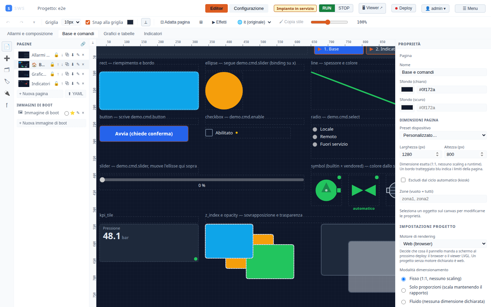

← [Indice](MAIN.md) | [← Editor](04_editor_guide.md) | [Successivo → Protocolli](06_protocols.md) →

---

# 05 — Riferimento Widget

> Ogni oggetto che si mette in una pagina, con le sue proprietà e come si comporta a runtime. Per chi disegna le
> pagine e cerca il nome di un campo. Dove sono nell'albero degli strumenti lo dice il
> [capitolo 04](04_editor_guide.md#i-gruppi); qui sono ordinati per famiglia.
>
> Misurato sul codice il 19-10-2026.

Elenco completo di tutti i widget disponibili nella palette dell'editor, con descrizione,
proprietà configurabili e comportamento in runtime.

Le proprietà **comuni a tutti gli oggetti** sono descritte in [04 — Guida all'Editor](04_editor_guide.md#binding-tag).

---

## FORME

### Rettangolo (`rect`)

Forma geometrica base con bordo e riempimento.

| Proprietà | Descrizione |
|-----------|-------------|
| `fill` | Colore riempimento |
| `stroke` | Colore bordo |
| `stroke_width` | Spessore bordo (px) |
| `tag` | Tag che controlla il colore di riempimento (valore numerico mappato) |

---

### Ellisse (`ellipse`)

Cerchio o ovale. Stesse proprietà del rettangolo.

---

### Linea (`line`)

Segmento con punto iniziale e finale separati.

| Proprietà | Descrizione |
|-----------|-------------|
| `stroke` | Colore |
| `stroke_width` | Spessore (px) |
| `x2, y2` | Coordinate punto finale |

---

### Polilinea (`polyline`)

Spezzata di quanti punti si vuole, aperta o chiusa. Si disegna **a clic**: dalla palette si entra in
modalità disegno, ogni clic aggiunge un punto, doppio clic o Invio finisce, Esc annulla. Sul canvas i punti
si trascinano; un clic su un segmento offre «Dividi qui» e «Aggiungi in coda»; Canc toglie il punto scelto
(mai sotto i due).

| Proprietà | Descrizione |
|-----------|-------------|
| `points` | I punti, in coordinate pagina (`[{x, y}, …]`, almeno due) |
| `closed` | Chiusa: l'ultimo punto torna al primo, e si può riempire |
| `fill` | Riempimento, solo da chiusa |
| `stroke`, `stroke_width`, `stroke_dasharray` | Tratto |

---

### Poligono (`polygon`)

Poligono regolare (3…24 lati) o stella, inscritto nel suo riquadro. La rotazione e lo specchio stanno nei
vertici, quindi valgono uguali sul web e sul pannello LVGL.

| Proprietà | Descrizione |
|-----------|-------------|
| `sides` | Numero di lati, 3…24 (default 6) |
| `star` | Stella: i vertici raddoppiano, alternati fra esterno e interno |
| `star_inner` | Raggio interno della stella, in % (default 50) |
| `fill`, `stroke`, `stroke_width`, `stroke_dasharray` | Come il rettangolo |
| `rotation`, `flip_h`, `flip_v` | Rotazione e specchio |

Su LVGL polilinea e poligono si disegnano come un SVG rasterizzato (resvg): stesse forme, bordi e tratteggi
del browser, anche quando sono concavi.

### Lo specchio sul pannello LVGL

`flip_h` e `flip_v` funzionano sul pannello per gli oggetti in cui lo specchio si vede: **simboli** (quelli
della libreria e quelli caricati nel progetto), **immagini**, **polilinee e poligoni**, il **gauge** — dove
l'arco si ribalta e il valore cresce dall'altra parte — e la **barra di avanzamento**, che si riempie dal lato
opposto. Su rettangoli, ellissi e led non cambia niente, perché specchiati sono identici a sé stessi.

**Non** si specchiano, e questa è una differenza voluta rispetto al browser: **testo, tabella, pulsanti,
selettore lingua e navigatore pagine**. Specchiare quei widget vorrebbe dire ribaltarne anche le scritte, e
un'etichetta allo specchio su un impianto non serve a nessuno; farlo costerebbe un secondo motore tipografico
nel pannello accanto a quello che già disegna tutti gli altri testi.

---

### Testo (`text`)

Etichetta statica o dinamica.

| Proprietà | Descrizione |
|-----------|-------------|
| `text` | Testo statico |
| `tag` | Tag il cui valore sovrascrive il testo |
| `format` | Formato col segnaposto `{value}` (`{value:.1f} bar`, `{value:hms}`…) — vedi [04](04_editor_guide.md#binding-tag) |
| `font_size` | Dimensione font (px) |
| `font_family` | Famiglia font, dall'elenco qui sotto |
| `font_weight` | Peso: `normal`, `bold`, 100-900 (grassetto da 600) |
| `font_style` | `normal`, `italic` |
| `text_anchor` | Allineamento: `start`, `middle`, `end` |
| `color` | Colore testo |

#### I font (dal 18-10-2026)

Sei famiglie, **uguali nel browser e sul pannello LVGL**, con grassetto vero:

| `font_family` | Nel menu | File | Grassetto |
|---|---|---|---|
| `sans` | Sans | DejaVu Sans | sì |
| `mono` | Mono (larghezza fissa) | DejaVu Sans Mono | sì |
| `serif` | Serif | DejaVu Serif | sì |
| `segmenti7` | Display a 7 segmenti | DSEG7 Classic | sì |
| `segmenti14` | Display a 14 segmenti | DSEG14 Classic | sì |
| `matrice` | Matrice di punti | DotGothic16 | no: resta normale in entrambi i motori |

- I caratteri che un font non ha (le accentate e µ nei display a segmenti) si disegnano in Sans.
- Vuoto (Predefinito) vuol dire il font dell'interfaccia nel browser e Sans sul pannello.
- I nomi scritti a mano nei progetti di prima (`monospace`, `Arial`, `Times New Roman`…) all'apertura diventano la
  famiglia corrispondente. Un nome che non corrisponde a niente resta, compare nel menu come «(solo browser)» e il
  validatore lo segnala: sul pannello esce in Sans.
- Le immagini di accensione restano in Sans: un SVG trasformato in immagine non carica font esterni.
- L'elenco è `tests/fixtures/font.json`; `scripts/check_font.sh` controlla che browser, pannello e licenze non si
  separino.

---

### Immagine (`image`)

Immagine statica (PNG, JPG, SVG) caricata come risorsa del progetto.

| Proprietà | Descrizione |
|-----------|-------------|
| `src` | URL dell'immagine (relativo alle risorse del progetto) |

---

## CONTROLLI

### Pulsante (`button`)

Elemento interattivo che scrive sui tag, o fa un'azione, al click (`sws-editor/src/types/index.ts`).

| Proprietà | Descrizione |
|-----------|-------------|
| `label` | Testo del pulsante |
| `tag` | Tag da scrivere |
| `button_mode` | Cosa scrive — vedi sotto. Predefinito `write` |
| `write_value` | Valore da scrivere (`true`, `false`, numero, stringa) |
| `release_value` | Valore scritto al rilascio, in modalità `momentary` (predefinito `false`) |
| `step`, `min`, `max` | Passo e limiti di `increment`/`decrement` |
| `assegnazioni` | Elenco di coppie tag → valore: se non è vuoto, il clic le scrive tutte, in ordine, **al posto di** `button_mode` e `write_value` |
| `on_press_fn`, `on_release_fn` | Funzione Python da chiamare alla pressione e al rilascio |
| `button_action` | Azione built-in, al posto della scrittura — vedi sotto |
| `require_confirm`, `confirm_message` | Una conferma prima di scrivere (una sola per tutte le assegnazioni) |
| `critical`, `require_reason` | Comando critico: chiede di nuovo la password e, se richiesto, un motivo che finisce nell'audit |
| `min_role`, `min_role_effect` | Ruolo minimo per usarlo; sotto, il pulsante si disabilita (`disable`, predefinito) o sparisce (`hide`) |

**`button_mode`**:

| Valore | Cosa scrive |
|---|---|
| `write` | `write_value` |
| `momentary` | `write_value` alla pressione, `release_value` al rilascio |
| `toggle` | il contrario del valore attuale |
| `set` / `reset` | `true` / `false` |
| `increment` / `decrement` | il valore attuale ± `step`, entro `min` e `max` |

**Azioni built-in** (`button_action`):
- `login` — apre il form di autenticazione sovrapposto al sinottico
- `logout` — disconnette l'utente
- `navigate` — apre un URL: in una scheda nuova (predefinito, il sinottico resta aperto sotto) o al suo posto
- `open_faceplate` — apre un faceplate come finestra, con i suoi parametri
- `open_popup` — apre una pagina-finestra con i suoi parametri; `close_popup` la chiude

Modalità, assegnazioni e conferma valgono uguali sul pannello LVGL.

---

### NavButton (`navbutton`)

Pulsante di navigazione tra pagine del sinottico.

| Proprietà | Descrizione |
|-----------|-------------|
| `label` | Testo del pulsante |
| `target_page` | ID della pagina di destinazione |

---

### Navigatore di pagine (`page_navigator`)

Un bottone per pagina, **generato dall'albero delle pagine**: aggiungendo una pagina il bottone compare da solo, senza rieditare le altre.
Quello della pagina corrente è evidenziato. Si mette su uno dei quattro lati della pagina (barra in alto/in basso, colonna a destra/sinistra).
Disponibile su web e LVGL, con le stesse voci e gli stessi pixel.

| Proprietà | Descrizione |
|-----------|-------------|
| `nav_orientation` | `horizontal` (predefinito) o `vertical` |
| `nav_source` | Da dove vengono le voci: `all` (tutte, nell'ordine dell'albero), `roots` (primo livello), `children_of` (figli di `nav_node`), `children_of_current` (figli della pagina in cui ci si trova; se è una foglia, le sue sorelle) |
| `nav_node` | Id della pagina di cui mostrare i figli (con `children_of`) |
| `nav_breadcrumb` | Con `children_of*`, mostra prima il percorso dalla radice al genitore delle voci |
| `nav_fill` | `true` (predefinito): i bottoni si dividono lo spazio e si restringono; `false`: misura fissa `nav_btn_size` |
| `nav_btn_size`, `nav_align`, `nav_gap` | Misura fissa, allineamento del blocco (`start`/`center`/`end`), spazio fra i bottoni |
| `nav_active_fill`, `nav_active_color` | Sfondo e testo della pagina corrente (`fill`, `color`, `stroke` valgono per gli altri) |
| `nav_items` | Eccezioni per pagina: `{ page_id, label?, order?, hidden? }` — etichetta (accetta `{{token}}`), posizione fra le voci visibili, esclusione da **questo** navigatore |

Con `children_of_current` si costruisce un menù a livelli: le pagine di un ramo compaiono solo quando si è nel ramo. Una pagina nascosta a un
navigatore resta raggiungibile da un altro. Il nome mostrato è quello della pagina (anche `{{token}}`) salvo etichetta propria.

> **Quando la barra del viewer non c'è.** In due casi sul pannello resta **solo la pagina**, e
> l'unico modo di cambiarla è ciò che hai messo tu *dentro* la pagina: un `page_navigator`, dei
> `navbutton`, o la rotazione automatica.
>
> - **Viewer a schermo pieno** (`hide_viewer_chrome`): il viewer nasconde la propria barra e la
>   fascia allarmi. È una scelta, e si disfa togliendo la spunta.
> - **Progetto per LVGL** (`target` = LVGL): non è una scelta, è il motore. Il viewer LVGL disegna
>   la pagina e basta, a schermo pieno o no, e non esiste una barra indirizzi da cui rimediare.
>
> Una pagina senza nessuna delle tre vie d'uscita, in uno di questi due casi, è una pagina da cui
> non si esce più — e il validatore lo dice, ma solo dopo il salvataggio. Il posto naturale per il
> navigatore è uno dei quattro bordi; tieni libera la sua fascia, perché un banner allarmi che ci
> finisce sopra copre i bottoni proprio quando servono.

---

### Checkbox (`checkbox`)

Toggle binario che scrive un valore al tag.

| Proprietà | Descrizione |
|-----------|-------------|
| `tag` | Tag da scrivere |
| `checked_value` | Valore scritto quando selezionato (default `true`) |
| `unchecked_value` | Valore scritto quando deselezionato (default `false`) |
| `label` | Etichetta a fianco |

---

### Radio (`radio`)

Selezione singola tra opzioni predefinite.

| Proprietà | Descrizione |
|-----------|-------------|
| `tag` | Tag da scrivere |
| `options` | Lista `{label, value}` delle opzioni |

---

### Slider (`slider`)

Cursore per impostare un valore numerico trascinandolo. Lo stesso tag è letto e scritto.

| Proprietà | Descrizione |
|-----------|-------------|
| `tag` | Tag da leggere e scrivere |
| `min`, `max` | Estremi; se mancano, `range_lo` e `range_hi` del tag. `min` deve stare sotto `max` |
| `step` | Passo (predefinito 1, maggiore di zero). Con un passo frazionario, o un `min` frazionario, si scrive un numero con la virgola; altrimenti un intero |
| `orientation` | `horizontal` (predefinito) o `vertical`, col minimo in basso |
| `label` | Etichetta sopra la traccia |
| `font_size`, `label_font_size` | Corpo del valore (12) e dell'etichetta (11) |
| `show_value` | Il valore sotto la traccia, centrato; mostrato salvo `false` |
| `unit`, `decimals` | Unità e decimali del valore; se mancano, quelli del tag. Decimali predefiniti: 2 con un passo sotto l'unità, altrimenti 0 |
| `fill` | Colore della parte piena e del cursore |
| `slider_track_color` | Colore della parte vuota della traccia. Se manca, il colore di `fill` al 20 %, che lascia vedere lo sfondo |
| `slider_track_thickness` | Spessore della traccia in px (predefinito 16). Il cursore tondo sborda di 5 px per lato |
| `slider_value_position` | Dove sta il valore: `sotto` (predefinito), `sopra`, `dentro` la traccia (con una traccia spessa), `cursore` (un fumetto che segue il cursore mentre lo si trascina) |
| `read_only` | Il cursore mostra il valore ma non si muove |
| `write_on_release` | Scrive solo quando si lascia il cursore (predefinito). `false` scrive durante il trascinamento |
| `write_deadband` | Non scrive se il valore è cambiato meno di così dall'ultima scrittura (0 o più) |
| `slider_style` | `classico` (predefinito), `pillola` (traccia spessa, cursore bianco dentro), `piastra` (la traccia è tutto il riquadro, senza cursore, con icona, etichetta e valore dentro: per la domotica) o `isa` (ISA-101: grigi, traccia sottile, cursore rettangolare, nessun colore acceso) |
| `slider_icon` | Con `piastra`: `lampadina`, `tapparella`, `termometro`, `ventola`, `presa`, `volume`, `goccia` o `sole` |
| `slider_track_opacity` | Opacità della parte vuota della traccia, 0–100 |
| `slider_tick_major`, `slider_tick_minor` | Una tacca marcata e una di divisione ogni tanto, nelle unità del valore: «marcata ogni 10, divisione ogni 2». Stanno sui multipli: 15..30 con la marcata ogni 5 dà 15, 20, 25, 30 |
| `slider_tick_labels` | I numeri sotto le tacche marcate (predefinito: sì, se ci sono) |
| `slider_snap_ticks` | Il cursore si aggancia alla divisione, o alla marcata se c'è solo quella |
| `slider_bands` | Le bande dei limiti sotto la traccia: `mai` (predefinito), `sempre`, `in_allarme` (solo quando il valore è fuori). I limiti sono `warn_low`, `warn_high`, `alarm_low`, `alarm_high`, o quelli del tag; rosso per gli allarmi, giallo per gli avvisi |
| `bg_color`, `bg_image` | Sfondo dietro tutto il riquadro, come per gli altri oggetti. `bg_image_opacity` (0–100, per tutti gli oggetti) la mette in trasparenza |
| `require_confirm`, `critical` | Chiede conferma prima di scrivere, come i bottoni. Con `write_on_release: false` la chiede a ogni passo: si usano insieme alla scrittura al rilascio |

Dopo una scrittura il cursore resta dove l'ha lasciato l'operatore, col bordo tratteggiato, finché il tag non riporta quel valore (al massimo 3 secondi). Un valore non numerico si mostra come «—».

Si muove col dito, col mouse e con la tastiera: le frecce di un passo, Pag↑ e Pag↓ di un decimo dell'intervallo, Inizio e Fine agli estremi. L'area di tocco è tutto il riquadro, mai meno di 44 px di spessore.

Sul pannello LVGL il disegno è lo stesso, con gli stessi numeri: traccia, cursore, posizione del valore. `critical` chiede conferma ma non la password, come per i bottoni.

---

### Setpoint (`setpoint`)

Campo numerico con incremento e decremento: l'operatore **imposta** un valore invece di leggerlo. Scrive sul tag a ogni conferma.

| Proprietà | Descrizione |
|-----------|-------------|
| `tag` | Tag scritto (e riletto, per mostrare il valore corrente) |
| `label` | Etichetta sopra il campo |
| `min` / `max` | Estremi ammessi |
| `step` | Passo dei pulsanti + e − |

```yaml
id: o_setpoint
type: setpoint
x: 960.0
y: 254.0
width: 290.0
height: 48.0
label: Consegna
tag: demo.cmd.setpoint
min: 0.0
max: 200.0
step: 5.0
```

---
### Pulsante lingua (`lang_button`)

Cambia la lingua dell'interfaccia con un clic. Serve su un pannello, dove l'operatore non ha un menu di sistema a cui rivolgersi.

| Proprietà | Descrizione |
|-----------|-------------|
| `target_lang` | Codice della lingua da attivare (`it`, `en`, …) |
| `label` | Testo del pulsante |

```yaml
id: o_langbtn_it
type: lang_button
x: 960.0
y: 202.0
width: 90.0
height: 36.0
label: IT
target_lang: it
```

---
### Selettore lingua (`lang_selector`)

Come il pulsante lingua ma a tendina, con tutte le lingue dichiarate nel progetto. Non ha proprietà proprie: l'elenco lo prende dalla tabella lingue.

| Proprietà | Descrizione |
|-----------|-------------|
| `—` | Nessuna proprietà specifica |

---

## DISPLAY

### Gauge (`gauge`)

Manometro analogico a semicerchio.

| Proprietà | Descrizione |
|-----------|-------------|
| `tag` | Tag da visualizzare |
| `min, max` | Range |
| `unit` | Unità di misura visualizzata |
| `warn_low/high` | Soglie warning (giallo) |
| `alarm_low/high` | Soglie allarme (rosso) |
| `format` | Formato valore centrale |

---

### LED (`led`)

Spia di stato binaria (accesa/spenta).

| Proprietà | Descrizione |
|-----------|-------------|
| `tag` | Tag che controlla lo stato |
| `on_value` | Valore del tag che indica "acceso" (default `true`) |
| `on_color` | Colore stato acceso (default verde) |
| `off_color` | Colore stato spento (default grigio) |

---

### Progress Bar (`progress_bar`)

Barra di avanzamento proporzionale.

| Proprietà | Descrizione |
|-----------|-------------|
| `tag` | Tag da visualizzare |
| `min, max` | Range completo |
| `fill` | Colore barra |
| `orientation` | `horizontal` o `vertical` |
| `show_value` | Mostra percentuale |
| `warn_high, alarm_high` | Soglie colore |

---

### Tabella (`table`)

Griglia di valori multi-tag.

| Proprietà | Descrizione |
|-----------|-------------|
| `table_rows` | Array `{label, tag, format}` — una riga per tag |

Ogni riga mostra l'etichetta nella colonna sinistra e il valore live nella destra.

---

### Trend (`trend`)

Grafico storico multi-traccia. Stesso disegno sul web e sul pannello LVGL (dal 30-09-2026).

| Proprietà | Descrizione |
|-----------|-------------|
| `trend_tags[]` | Tracce: `tag`, `label` (nome in legenda), `color`, `width`, `dash` (`solid`/`dashed`/`dotted`), `fill` + `fill_opacity`, `smooth`, `own_scale` (asse Y proprio a sinistra), `hidden` (spenta alla partenza) |
| `window_s` | Finestra temporale in secondi; oltre 15 minuti i dati arrivano aggregati, con la banda min/max |
| `y_min, y_max` | Range Y fisso (autofit se assenti o entrambi 0) |
| `trend_log_scale` | Scala Y logaritmica (solo scala condivisa, valori > 0) |
| `unit` | Unità sulla tacca più alta dell'asse Y |
| `trend_show_thresholds` | Linee di `warn_low/high` (ambra) e `alarm_low/high` (rosso) |
| `trend_show_alarm_markers` | Marcatori degli allarmi scattati nella finestra |
| `trend_dt_*` | Formato di data e ora dell'asse dei tempi |
| `bg_color`, `bg_image`, `axis_color`, `grid_color` | Aspetto (su LVGL `bg_image` solo SVG) |
| `pan_step_s` | Passo di ◀/▶ (default un quarto della finestra) |
| `opcua_backfill` | Backfill dallo storico OPC-UA al primo caricamento |

Uso: toccare/cliccare una voce della legenda la nasconde o la mostra; ◀/▶ spostano la finestra nel
passato. Sul web il passaggio del mouse legge i valori e il trascinamento seleziona uno zoom (⟲ lo
annulla). **Sul pannello** trascinare il dito legge i valori; per lo zoom si tiene il dito fermo mezzo
secondo e poi si trascina. Solo web: scarico CSV, vista espansa, cursori di misura.

---

### Valore

Non è un tipo a parte: un valore si mostra con un [Testo](#testo-text) con `tag` e `format`, o con un
[Riquadro KPI](#riquadro-kpi-kpi_tile) quando deve spiccare.

---

### Text List (`text_list`)

Mappa valori numerici a etichette testuali (lookup table).
Utile per stati macchina: `0 → "Fermo"`, `1 → "Avvio"`, `2 → "In marcia"`.

| Proprietà | Descrizione |
|-----------|-------------|
| `tag` | Tag da leggere |
| `text_list_entries` | Array `{value, label, color?}` |
| `text_list_default` | Testo mostrato se il valore non è nella lista |
| `text_list_default_color` | Colore testo di default |

**Esempio entries**:
```yaml
- value: 0
  label: "Fermo"
  color: "#94a3b8"
- value: 1
  label: "Avvio"
  color: "#fbbf24"
- value: 2
  label: "In marcia"
  color: "#22c55e"
- value: 99
  label: "Errore"
  color: "#ef4444"
```

---

### Bar Chart (`bar_chart`)

Istogramma SVG multi-serie con linee di soglia.



| Proprietà | Descrizione |
|-----------|-------------|
| `bar_series` | Array `{tag, label, color, min?, max?}` — una barra per serie |
| `bar_orientation` | `vertical` (default) o `horizontal` |
| `bar_show_values` | Mostra il valore sopra ogni barra |
| `bar_show_labels` | Mostra le etichette sotto ogni barra |
| `bar_show_thresholds` | Mostra linee warn/alarm dal tag principale |
| `bar_gap` | Spaziatura tra barre (px) |
| `bar_y_label` | Etichetta asse Y |
| `warn_high, alarm_high` | Soglie visualizzate come linee orizzontali |

Se `min`/`max` non sono impostati per una serie, il range viene calcolato su tutti i valori correnti.

---

### Pie / Donut Chart (`pie_chart`)

Grafico a torta o ciambella con valori live da tag multipli.

| Proprietà | Descrizione |
|-----------|-------------|
| `pie_slices` | Array `{tag, label, color}` — una fetta per tag |
| `pie_mode` | `pie` (torta) o `donut` (ciambella) |
| `pie_inner_ratio` | Raggio interno della ciambella (0.0-0.9; default 0.55) |
| `pie_show_labels` | Mostra percentuali sulle fette |
| `pie_show_legend` | Mostra legenda laterale |
| `pie_center_text` | Testo statico al centro (solo donut) |
| `pie_center_tag` | Tag il cui valore appare al centro |
| `pie_center_format` | Formato del valore centrale |

**Nota**: se una sola fetta ha valore > 0 (100%), viene disegnato un cerchio pieno
invece di un arco degenere.

---

### Sparkline (`sparkline`)

Mini-trend senza assi per embedding in griglie o dashboard compatte.
Accumula campioni in una finestra mobile e li visualizza come polilinea.

| Proprietà | Descrizione |
|-----------|-------------|
| `tag` | Tag da monitorare |
| `spark_window_s` | Finestra temporale in secondi (default 60) |
| `spark_color` | Colore linea |
| `spark_fill` | Area sotto la curva riempita |
| `spark_fill_opacity` | Opacità riempimento (0.0-1.0) |
| `spark_show_last` | Mostra il valore corrente in angolo |
| `spark_stroke_width` | Spessore linea (px) |

---

### Alarm Viewer (`alarm_viewer`)

Visualizzatore allarmi attivi embedded nel sinottico.
Due modalità: lista scrollabile o banner ticker orizzontale.

| Proprietà | Descrizione |
|-----------|-------------|
| `alarm_viewer_mode` | `list` (tabella) o `banner` (ticker animato) |
| `alarm_viewer_max_rows` | Max righe mostrate in modalità lista |
| `alarm_viewer_id_prefix` | Filtra per prefisso ID allarme (es. `"pompa_"`) |
| `alarm_viewer_severities` | Filtra severità: `["Info","Warning","Critical"]` |
| `alarm_viewer_show_ack` | Pulsante ACK inline (richiede ruolo Operator+) |
| `alarm_viewer_show_ts` | Colonna timestamp |
| `alarm_viewer_show_empty` | Messaggio "Nessun allarme" quando lista vuota |
| `alarm_viewer_bg_color` | Colore sfondo widget |

---

### Spia di stato (`state_lamp`)

Una spia che cambia colore **e testo** secondo il valore del tag: fermo, in marcia, in allarme. È il modo di mostrare uno stato a più valori senza allineare tre LED.

| Proprietà | Descrizione |
|-----------|-------------|
| `tag` | Tag che determina lo stato |
| `text_list_entries` | Elenco valore → testo e colore, nello stesso formato del Text List |

```yaml
id: o_lamp
type: state_lamp
x: 340.0
y: 96.0
width: 90.0
height: 56.0
tag: demo.sim.mode
text_list_entries:
- value: Auto
  label: Auto
  color: '#22c55e'
- value: Manuale
  label: Manuale
  color: '#f59e0b'
- value: Fermo
  label: Fermo
  color: '#64748b'
```

---
### Riquadro KPI (`kpi_tile`)

Un numero grande con etichetta e unità: la grandezza che si deve leggere da lontano, in sala controllo o da un pannello a parete.

| Proprietà | Descrizione |
|-----------|-------------|
| `tag` | Tag mostrato |
| `label` | Etichetta sopra il numero |
| `unit` | Unità di misura accanto al valore |

```yaml
id: o_kpi
type: kpi_tile
x: 30.0
y: 542.0
width: 290.0
height: 110.0
label: Pressione
tag: demo.sim.pressure
unit: bar
```

---
### Data e ora (`clock`)

La data e l'ora **del dispositivo che mostra la pagina**: l'orologio del browser sul viewer web, quello del pannello su LVGL. Si aggiorna ogni secondo e non legge nessuna variabile. I nomi di giorni e mesi seguono la lingua dei contenuti (italiano, inglese, spagnolo; le altre lingue usano l'inglese). È l'oggetto pensato per la testata comune delle pagine.

| Proprietà | Descrizione |
|-----------|-------------|
| `clock_formato` | `ora` (default), `data`, `data_ora`, `giorno` (giovedì 15 ottobre 2026) o `personalizzato` |
| `clock_secondi` | Mostra anche i secondi, nei formati `ora` e `data_ora` |
| `clock_modello` | Il modello del formato personalizzato: `%d` giorno, `%m` mese, `%Y` anno, `%y` anno a due cifre, `%H` ore, `%M` minuti, `%S` secondi, `%A`/`%a` giorno della settimana per esteso/breve, `%B`/`%b` mese per esteso/breve, `%%` il simbolo |
| `font_size`, `color`, `text_anchor`, `bg_color` | Corpo, colore, allineamento nel riquadro (default al centro), sfondo |

```yaml
id: o_clock
type: clock
x: 650.0
y: 600.0
width: 290.0
height: 40.0
clock_formato: data_ora
clock_secondi: true
font_size: 18.0
```

---

### Grafico X-Y (`xy_plot`)

Traccia un tag **contro un altro**, non contro il tempo: portata su pressione, coppia su velocità. La scia mostra dov'è stato il punto di lavoro negli ultimi secondi.

| Proprietà | Descrizione |
|-----------|-------------|
| `tag` / `y_tag` | I due tag: ascissa e ordinata |
| `xy_trail_s` | Durata della scia, in secondi |
| `xy_x_min` … `xy_y_max` | Estremi dei due assi (assenti = automatici) |

```yaml
id: o_xy
type: xy_plot
x: 960.0
y: 96.0
width: 290.0
height: 250.0
tag: demo.sim.pressure
y_tag: demo.sim.flow
xy_x_min: 0.0
xy_x_max: 120.0
xy_y_min: 0.0
xy_y_max: 100.0
xy_trail_s: 60.0
```

---
### Registro dati (`data_log`)

La tabella dei campioni storici di un tag, paginata. Serve a guardare i numeri quando il grafico non basta.

| Proprietà | Descrizione |
|-----------|-------------|
| `tag` | Tag di cui si mostrano i campioni |
| `datalog_page_size` | Righe per pagina |

```yaml
id: o_datalog
type: data_log
x: 30.0
y: 442.0
width: 600.0
height: 320.0
tag: demo.sim.pressure
datalog_page_size: 12.0
```

---

## ALLARMI

Quattro widget per gli allarmi, e conviene sapere quale serve quando: l'**Alarm Viewer** (sopra,
fra i display) è la tabella completa degli allarmi attivi e vuole spazio; la **banda** ne mostra
uno solo e sta in una riga; la **campanella** non mostra niente finché non serve, e suona; lo
**storico** guarda indietro invece che adesso.

### Banda allarmi (`alarm_banner`)

Una riga che mostra l'allarme attivo più grave, col pulsante di riconoscimento. Occupa poco e sta in testa a una pagina.

| Proprietà | Descrizione |
|-----------|-------------|
| `alarm_banner_severities` | Quali gravità mostrare (assente = tutte) |
| `alarm_banner_id_prefix` | Solo gli allarmi il cui id comincia così — per fare una banda per zona |

```yaml
id: cl1_alarm_banner
type: alarm_banner
x: 20.0
y: 590.0
width: 760.0
height: 70.0
```

---
### Campanella allarmi (`alarm_bell`)

L'icona col contatore degli allarmi attivi, e il **suono**. Cliccandola si apre l'elenco.

| Proprietà | Descrizione |
|-----------|-------------|
| `alarm_bell_sound` | Suona quando c'è un allarme non riconosciuto |
| `alarm_bell_sound_severities` | Per quali gravità suonare |
| `alarm_bell_sound_repeat_s` | Ogni quanti secondi ripetere il suono |
| `alarm_bell_severities` | Quali gravità contare |
| `alarm_bell_id_prefix` | Conta solo gli allarmi di una zona |
| `alarm_bell_show_history` | Mostra anche lo storico nel pannello |
| `alarm_bell_show_shelve` | Permette di mettere a tacere un allarme (shelve) |

```yaml
id: cl1_alarm_bell
type: alarm_bell
x: 20.0
y: 536.0
width: 130.0
height: 34.0
alarm_bell_show_history: true
alarm_bell_show_shelve: true
```

---
### Storico allarmi (`alarm_history`)

L'elenco degli allarmi passati: quando sono scattati, quando sono rientrati, chi li ha riconosciuti.

| Proprietà | Descrizione |
|-----------|-------------|
| `alarm_history_id` | Limita a un allarme specifico |
| `alarm_viewer_max_rows` | Righe massime mostrate |

```yaml
id: o_history
type: alarm_history
x: 650.0
y: 182.0
width: 600.0
height: 250.0
alarm_viewer_max_rows: 6.0
```

---

## SCADA

### Simbolo (`symbol`)

Un simbolo SVG industriale dalla libreria, o uno dei simboli del progetto. La libreria ha **138 simboli** in
quattro famiglie (`process` 68, `machines` 34, `electrical` 26, `building` 10), descritti da
`sws-editor/public/symbols/lib/manifest.json` — lo stesso file che legge il pannello LVGL
(`sws-core/src/simboli_lib.rs`). Gli id hanno la forma `lib:<famiglia>/<nome>`, per esempio
`lib:process/ball-valve`.

| Proprietà | Descrizione |
|-----------|-------------|
| `symbol_id` | Il simbolo |
| `state_tag` | Tag dello stato: spento, acceso, o la voce di `symbol_states` che corrisponde |
| `alarm_tag` | Tag che forza lo stato di allarme: vince su tutto |
| `state_off_color`, `state_on_color`, `state_alarm_color` | I colori dei tre stati |
| `symbol_states` | Mappa valore → stato (valore esatto o intervallo, come in `text_list`): ogni voce colora il simbolo, può lampeggiare e mostrare un'etichetta sotto |
| `symbol_parts` | Le **parti vive** del disegno, ognuna col suo tag — vedi sotto |
| `symbol_spin`, `symbol_spin_tag`, `symbol_spin_s` | Rotazione continua: sempre, quando lo stato è acceso, o quando un tag è vero; periodo in secondi (predefinito 2) |
| `symbol_body_color`, `symbol_content_color`, `symbol_volume`, `symbol_outline_color`, `symbol_outline_width`, `symbol_blink_ms`, `symbol_level_transition_ms` | Sovrascrivono, per questo simbolo, lo **stile del progetto** (Configurazione → Progetto → Stile) |
| `command_tag` | Se presente, anche vuoto, il simbolo **comanda** — vedi sotto |

**Tutti i simboli cambiano colore.** Fino al 14-10-2026 la libreria aveva 40 simboli di due specie, e 11 tenevano i
propri colori; quei 40 sono stati ridisegnati, e ognuno ha nella libreria nuova il suo sostituto (`replaces` nel
manifesto). Un progetto vecchio che usa un id di allora apre il simbolo nuovo, sul web e su LVGL. Lo stato si
calcola con una regola sola per tutti i simboli e per i due motori (`symbols/statoSimbolo.ts`, casi in
`tests/fixtures/stato-simbolo.json`).

**Le parti vive.** Molti disegni hanno parti che si muovono con un tag, dichiarate nel manifesto:

| Parte | Cosa fa | Simboli che ce l'hanno |
|---|---|---|
| `lamp` | si accende quando il tag è vero | 27 |
| `rotor` | gira (ventole, giranti, agitatori) | 20 |
| `level` | mostra il livello del contenuto (serbatoi, silos) | 12 |
| `lever` | passa da aperto a chiuso (leve, valvole) | 5 |
| `needle` | la lancetta di uno strumento, fra `min` e `max` (predefiniti 0 e 100) | 3 |

**Le bocche.** 59 simboli dichiarano le bocche dove si aggancia una tubazione: trascinando il capo di una pipe
vicino a una bocca, ci si aggancia.

**«Adatta le proporzioni al disegno»** riporta il riquadro dell'oggetto alle proporzioni del simbolo.

**Il simbolo che comanda.** Con `command_tag` presente (anche vuoto) o con delle `assegnazioni`, un clic sul simbolo
scrive come un [pulsante](#pulsante-button): stesso `button_mode`, stesso `write_value`, stesse assegnazioni e stessa
conferma. `command_tag` è separato da `state_tag` apposta: un pulsante di marcia scrive START e mostra RUNNING.
Funziona anche sul pannello LVGL.

**Simboli del progetto**: SVG caricati da Configurazione → Istanza → Risorse, salvati in `custom_symbols` del
progetto.

---

### Pipe / Tubazione (`pipe`)

Connettore multi-waypoint con animazione di livello fluido.
Ideale per diagrammi P&ID.

| Proprietà | Descrizione |
|-----------|-------------|
| `points` | Array `{x, y}` — waypoint del percorso (min 2) |
| `routing` | `straight`, `orthogonal`, `diagonal`, `bezier` |
| `pipe_style` | `flat`, `tube` (3D), `wire` (linea fine) |
| `pipe_gradient` | Abilita gradiente 3D (auto per `tube`) |
| `stroke` | Colore base della tubazione |
| `stroke_width` | Diametro esterno |
| `fill_level` | Livello fluido statico (0.0-1.0) |
| `fill_level_tag` | Tag che controlla il livello dinamicamente |
| `fill_level_scale` | Scala tag: `0-1` o `0-100` |
| `fill_color` | Colore fluido |
| `fill_direction` | `start-to-end` o `end-to-start` |
| `start_marker / end_marker` | `none`, `arrow`, `dot`, `flange` |
| `pipe_label_tag` | Tag il cui valore appare come etichetta |
| `stroke_dasharray` | Tratteggio SVG (es. `"6,3"`) |
| `from_obj_id / to_obj_id` | Aggancia la pipe a un altro oggetto |
| `from_port / to_port` | Porta di ancoraggio: `top`, `bottom`, `left`, `right`, `center` |

---

### Faceplate (`faceplate`)

Istanza di un faceplate parametrico definito nel progetto. Il faceplate stesso si disegna sul canvas, dal ramo
**Faceplate** dell'albero delle pagine (capitolo 04).

| Proprietà | Descrizione |
|-----------|-------------|
| `faceplate_id` | ID del FaceplateDef da istanziare |
| `faceplate_params` | Mappa `{parametro: valore}` sostituita nel template |
| `faceplate_scale` | Scala i figli al riquadro dell'istanza, rispetto alla misura del faceplate |

La definizione, in `faceplates/<id>.yaml`, ha `id`, `label`, `params`, `objects` e — dal 29-10-2026 — `width` e
`height`, la misura del foglio. Un faceplate che non la dichiara usa il riquadro dei suoi oggetti. Un faceplate dentro
un faceplate il pannello non lo disegna, e il validatore lo dice.

---

### Pannello ricette (`recipe_panel`)

L'elenco delle ricette del progetto col pulsante per applicarle: l'operatore sceglie un formato e i setpoint vanno al campo in un colpo.

| Proprietà | Descrizione |
|-----------|-------------|
| `recipe_panel_id_prefix` | Mostra solo le ricette il cui id comincia così |

```yaml
id: o_recipe
type: recipe_panel
x: 650.0
y: 474.0
width: 600.0
height: 250.0
```

---

## LAYOUT

### Grid (`grid`)

Griglia con celle configurabili individualmente.
Ogni cella può contenere un oggetto, un'immagine di sfondo, una funzione Python,
e può essere suddivisa ricorsivamente.

| Proprietà | Descrizione |
|-----------|-------------|
| `grid_rows / grid_cols` | Dimensioni griglia |
| `col_widths` | Array larghezze colonne (px) |
| `row_heights` | Array altezze righe (px) |
| `grid_cells` | Array `GridCell` — configurazione per ogni cella |
| `grid_show_borders` | Mostra bordi celle |
| `grid_border_color` | Colore bordi |

**Ogni GridCell può avere**:
- `bg_color` — colore sfondo cella
- `bg_image` — immagine sfondo cella
- `visible_tag` — tag che controlla visibilità
- `on_press_fn` — funzione Python al click sulla cella
- `child` — un oggetto SVG al centro della cella
- `sub` — suddivisione della cella in due slot (ricorsivo)

---

## Proprietà cross-cutting

Queste proprietà sono disponibili su quasi tutti gli oggetti:

### Quality dot

Un piccolo indicatore di qualità nell'angolo superiore destro di ogni widget che mostra un tag:

| Colore | Significato |
|--------|-------------|
| Verde (●) | `Good` — dato valido |
| Rosso (●) | `Bad` — errore comunicazione, tag non disponibile |
| Giallo (●) | `Uncertain` — dato di qualità incerta |

I colori sono quelli predefiniti, e si cambiano oggetto per oggetto:

| Proprietà | Descrizione |
|-----------|-------------|
| `quality_dot` | Abilita/disabilita il dot (default: `true`) |
| `quality_dot_good_color` | Override colore Good |
| `quality_dot_bad_color` | Override colore Bad |
| `quality_dot_uncertain_color` | Override colore Uncertain |

### Transizione CSS

Anima il cambio di `fill`, `stroke`, `opacity`, `transform`:

| Proprietà | Descrizione |
|-----------|-------------|
| `transition_duration_ms` | Durata animazione in ms (0 = nessuna) |

### Binding attivi

Permette di legare una proprietà dell'oggetto a un tag (sezione **Binding attivi**). Il valore è il nome del tag,
copiato così com'è, oppure una specifica con scala lineare o espressione (`BindingSpec`, `types/index.ts`):

```yaml
bindings:
  fill: "tag_colore"          # il colore è il valore del tag
  opacity:                    # 0..100 del tag → 0..1 dell'opacità
    tag: livello
    in_min: 0
    in_max: 100
    out_min: 0
    out_max: 1                # clamp: true per default
  rotation:
    expr: "{motore.giri} > 0 ? 45 : 0"   # un'espressione al posto della scala
```

Le espressioni (`sws-editor/src/expr/engine.ts`) citano i tag fra graffe (`{tag.id}`) e hanno aritmetica,
confronti, ternario e funzioni. `tag` ed `expr` si escludono.

### Bad e dato vecchio

| Proprietà | Descrizione |
|-----------|-------------|
| `bad_value_style` | `gray`: con qualità Bad l'oggetto si attenua in grigio, invece di mostrare il valore come valido |
| `stale_after_s` | Se l'ultimo aggiornamento del tag è più vecchio di N secondi, l'oggetto si attenua ed è marcato ⌛ |

---

← [Indice](MAIN.md) | [← Editor](04_editor_guide.md) | [Successivo → Protocolli](06_protocols.md) →
