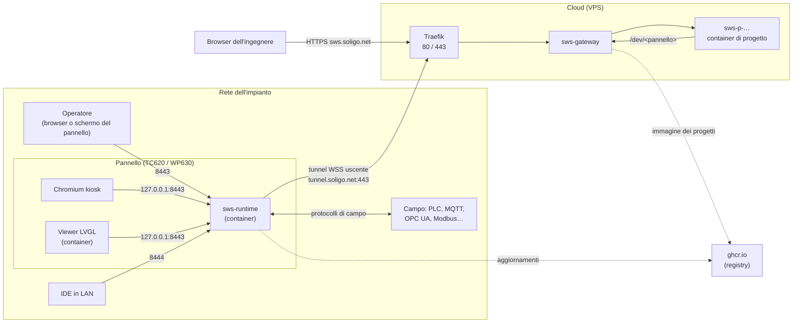
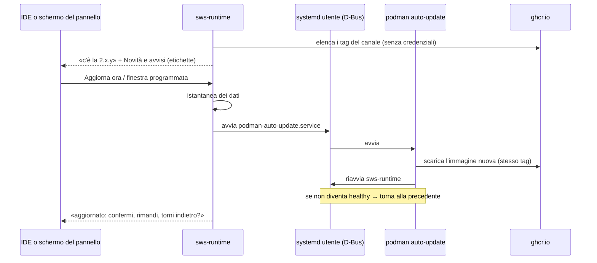
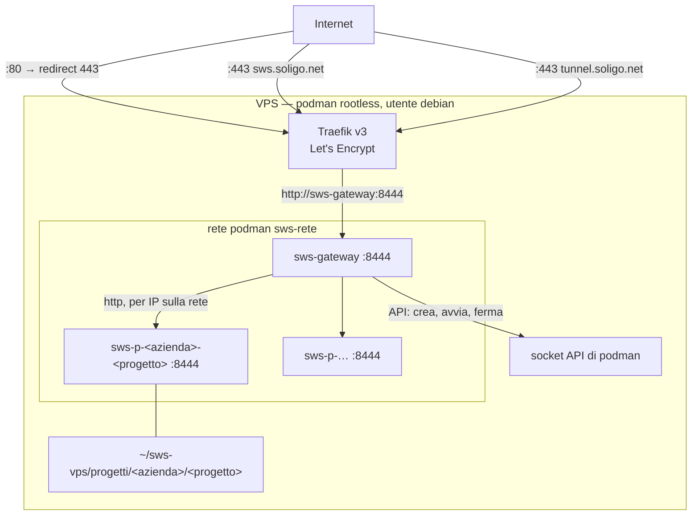
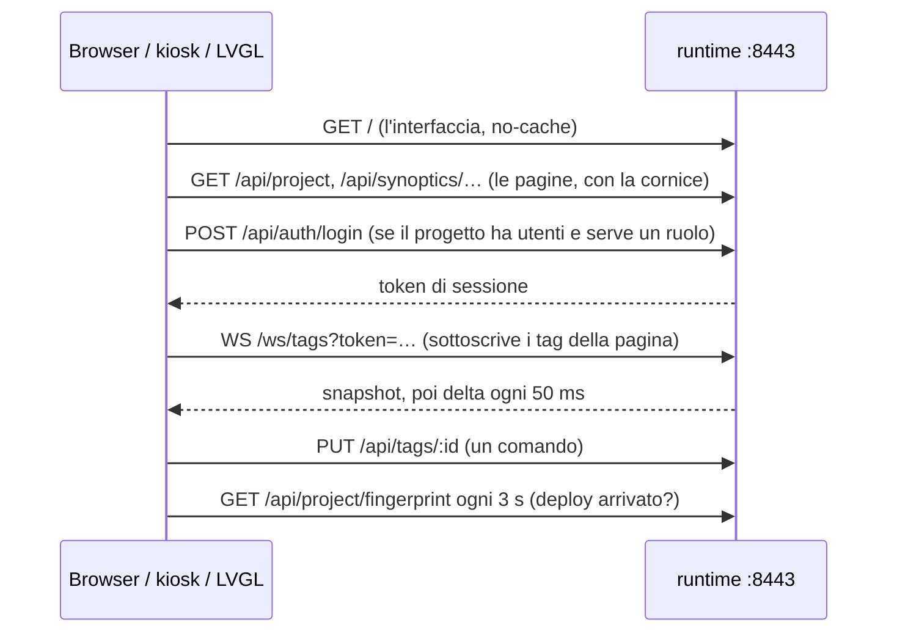
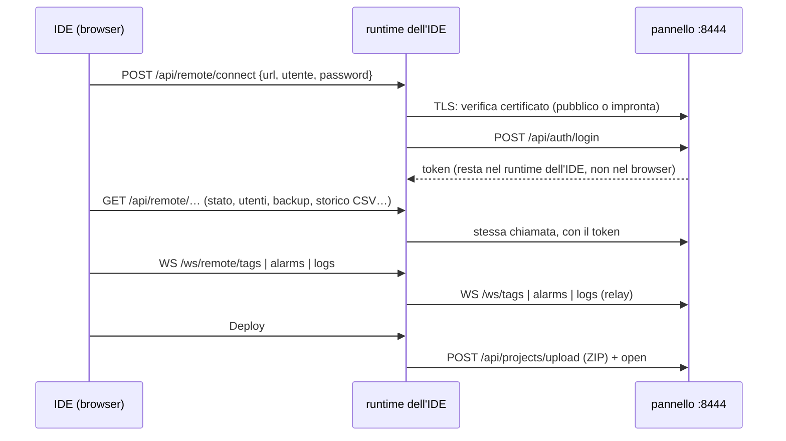
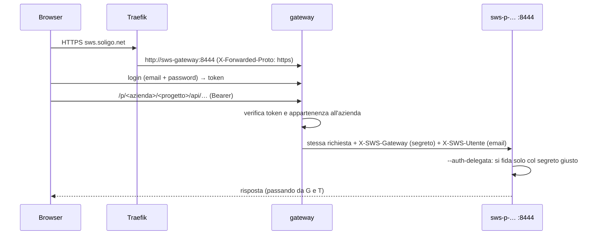

# 18 — Il container e la comunicazione

> Per chi installa SWS in un impianto o in un cloud aziendale: **cosa gira dove, quali porte aprire, cosa passa
> sulla rete, come si diagnostica**. Ogni sezione finisce con i riferimenti al codice, per chi vuole vedere come è
> fatto davvero. Misurato sul codice il 19-10-2026.

---

## In breve

SWS è **un'immagine sola**, `ghcr.io/soligolab/sws-runtime`, che fa tre mestieri diversi a seconda degli argomenti
con cui parte:

| Ruolo | Dove | Cosa fa | Chi la avvia |
|---|---|---|---|
| **Runtime del pannello** | TC620, WP630, un PC in reparto | acquisisce dal campo, calcola allarmi e storico, serve le pagine agli operatori e la gestione all'IDE | `systemd` dell'utente, dal quadlet `sws-runtime.container` |
| **Gateway del cloud** | il VPS (`sws.soligo.net`) | una porta sola davanti a tutti i progetti: login, console, apertura e chiusura dei container di progetto, tunnel dei pannelli | `systemd` dell'utente, dal quadlet `sws-gateway.container` |
| **Container di progetto** | il VPS, uno per progetto aperto | l'IDE di quel progetto, con la sua acquisizione e il suo storico | il gateway, via API di podman |

Sul pannello, accanto al runtime, può girare un secondo container della **stessa immagine**, il **viewer LVGL**, che
disegna le pagine direttamente sullo schermo invece di passare dal browser.



---

## 1. Com'è fatta l'immagine

### 1.1 Base e contenuto

| | aarch64 (pannelli) | x86_64 (server, cloud) |
|---|---|---|
| Base | Ubuntu 24.04 | Ubuntu 24.04 |
| Binari | `sws-runtime`, e con `WITH_LVGL=1` anche `sws-lvgl-viewer` | solo `sws-runtime` |
| Python | `python3` + `RestrictedPython` (la sandbox degli script, obbligatoria) | idem |
| Strumenti | `git`, `openssh-client`, `curl`, `ca-certificates` | idem |
| Grafica (solo con LVGL) | SDL2, EGL/GLES, Mesa, DRM, GBM, FreeType, `fonts-dejavu-core` | — |
| Font extra | `/etc/sws/fonts/`: Noto Emoji, DSEG7/DSEG14, DotGothic16 (licenze OFL accanto) | — |

Le immagini si pubblicano con un tag per architettura: `latest-arm64` / `latest-amd64` (canale stabile),
`rc-arm64` (canale di prova), più un tag per ogni commit (`<hash>-arm64`) e per ogni versione.

### 1.2 Le cartelle

| Percorso nel container | Contenuto | Da dove viene |
|---|---|---|
| `/usr/local/bin/` | `sws-runtime`, `sws-lvgl-viewer` | immagine |
| `/var/sws/www/` | l'interfaccia (viewer e IDE), già compilata | immagine |
| `/var/sws/templates/` | i modelli di progetto | immagine |
| `/var/sws/catalogo/dispositivi/` | il catalogo dei dispositivi di campo | immagine |
| `/usr/share/sws/quadlet/` | i quadlet e l'installer della **stessa versione** (il «quadlet che viaggia») | immagine |
| `/etc/ssh/ssh_known_hosts` | le chiavi di GitHub e GitLab, per git via SSH | immagine |
| `/var/sws/config/` | configurazione dell'istanza: certificati, sessioni, utenti del dispositivo, impronte dei dispositivi conosciuti, `sicurezza.yaml`, stato degli aggiornamenti | **volume** |
| `/var/sws/projects/` | i progetti, ognuno con storico (`history/`), backup e ricette | **volume** |
| `/var/sws/logs/` | il log del runtime, un file JSONL al giorno (`runtime-AAAA-MM-GG.jsonl`) | **volume** |

Sul pannello i volumi stanno in `/data/user/sws/{config,projects,logs}`; nel cloud in `~/sws-vps/`.

### 1.3 Avvio, salute, etichette

- **Entrypoint**: `sws-runtime`. Gli argomenti predefiniti dell'immagine sono quelli del **pannello**: viewer sulla
  8443, gestione sulla 8444 in modalità ristretta (`--no-admin`). Gateway e container di progetto li sostituiscono
  (sezioni 3 e 4).
- **Healthcheck**: ogni 30 s, `curl /health` sulla 8443 o sulla 8444. Con `Notify=healthy` nel quadlet, systemd
  considera il servizio avviato solo quando il container è *healthy*: è quello che permette a un aggiornamento
  difettoso di tornare indietro da solo.
- **Etichette**: versione, licenza, e `net.soligo.sws.novita.{it,en}` / `compat.{it,en}` (le Novità e gli avvisi di
  compatibilità che il pannello mostra **prima** di aggiornare), `net.soligo.sws.quadlet` (la versione dei quadlet).
- **Variabile `SWS_TUNNEL_URL`** già impostata a `wss://tunnel.soligo.net/tunnel/v1`: un pannello nuovo collegato a
  internet sa da sé dove chiamare per farsi abbinare. `install-container.sh --senza-cloud` la spegne.

> Riferimenti: `deploy/container/Containerfile.aarch64`, `Containerfile.x86_64`, `scripts/build_container.sh`.

---

## 2. Sul pannello

### 2.1 Il servizio `sws-runtime`

Il quadlet `~/.config/containers/systemd/sws-runtime.container` (lo scrive `install-container.sh`):

| Riga | Perché |
|---|---|
| `Network=host` (predefinito) | il multicast **mDNS** deve raggiungere la LAN, perché l'IDE trovi il pannello con «Cerca». `--bridge` all'installazione usa invece `PublishPort=8443/8444` |
| `Volume=/data/user/sws/{config,projects,logs}` | i dati sopravvivono a ogni aggiornamento dell'immagine |
| `Volume=/run/dbus/system_bus_socket` e il bus utente `/run/user/1000/bus` | il runtime **commuta lo schermo** (Chromium o LVGL) e **avvia l'aggiornamento** parlando con systemd via D-Bus |
| `AddDevice=-/dev/ttyCOM1…`, `ttyS*`, `ttymxc*`, `ttyUSB*`, `ttyACM*` | le porte seriali per Modbus RTU; il `-` vuol dire «se esiste» |
| `UserNS=keep-id`, `--group-add keep-groups` | il container gira come l'utente del pannello, con i suoi gruppi (`dialout` per le seriali) |
| `AutoUpdate=registry` | `podman auto-update` confronta il tag col registry e scarica l'immagine nuova |
| `Notify=healthy` | il servizio è «partito» solo quando l'healthcheck passa |
| `Environment=SWS_IMAGE=…:latest-arm64` | il runtime sa **quale canale** segue (stabile o prova) |
| `Timezone=local` | l'ora del pannello, non UTC: conta per le finestre di aggiornamento e gli orologi |

### 2.2 Lo schermo: Chromium o LVGL

Il progetto dichiara il motore (`target.kind`: `web`, `lvgl_framebuffer`, `lvgl_wayland`). All'apertura di un
progetto il runtime **commuta da sé** via D-Bus:

- **web**: Chromium in modalità kiosk (`chromium@main-app.service`, unità di sistema) su `http://127.0.0.1:8443`;
- **LVGL**: il container `sws-lvgl-viewer` (unità utente), stessa immagine, `Network=host`, che legge pagine e dati
  da `http://127.0.0.1:8443` come farebbe un browser e disegna con SDL su X11/Wayland.

La modalità di configurazione del pannello (STOP tenuto premuto all'accensione) **non si tocca**: il runtime aspetta
che il launcher si decida e, nel dubbio, non prende lo schermo.

### 2.3 L'installazione

`install-container.sh` (dentro l'immagine e nel repo) installa o aggiorna:

| Opzione | Effetto |
|---|---|
| `--image <archivio>` | installa da un archivio `.tar.gz` (pannello senza internet) |
| `--pull` / `--pull-only` | scarica dal registry |
| `--tag <tag>` | canale o versione (`latest-arm64`, `rc-arm64`, `<versione>-arm64`) |
| `--data <dir>` | dove stanno i volumi (predefinito `/data/user/sws`) |
| `--bridge` | rete bridge con porte pubblicate invece di `Network=host` |
| `--senza-cloud` | il pannello non chiama mai il cloud |
| `--tunnel`, `--tunnel-nome`, `--tunnel-token` | un tunnel configurato a mano (tutti e tre o nessuno) |
| `--solo-unita` | riscrive solo i quadlet, dalla versione dell'immagine (lo lancia il runtime stesso) |
| `--uninstall`, `--purge` | toglie il servizio; con `--purge` anche i dati |

### 2.4 L'aggiornamento



- **Canali**: il tag dell'immagine *è* il canale — `latest-<arch>` stabile, `rc-<arch>` di prova; un tag di
  versione o di commit è «fissato» e non si aggiorna.
- **Finestra**: si può approvare una versione per un giorno e un'ora, o lasciare il pilota automatico.
- **Dopo**: il pannello chiede conferma; «torna indietro» rimette l'immagine precedente (`immagini.sh`, sull'host) e,
  se serve, i dati dell'istantanea.
- **Quadlet**: se la versione nuova porta quadlet più recenti, il pannello lo dice e li riscrive con
  `install-container.sh --solo-unita` (riavvio in più).

> Riferimenti: `deploy/container/sws-runtime.container`, `sws-lvgl-viewer.container`, `install-container.sh`,
> `immagini.sh`; `sws-web/src/display_target.rs`, `aggiornamento.rs`, `aggiornamento_finestra.rs`,
> `conferma_aggiornamento.rs`, `istantanea_dati.rs`, `quadlet.rs`.

---

## 3. Nel cloud

### 3.1 Il VPS



| Pezzo | Quadlet | Cosa espone |
|---|---|---|
| **Traefik** | `traefik.container` | **80** (solo redirect a 443) e **443**; certificati Let's Encrypt (sfida HTTP); un router per `sws.soligo.net` e uno per `tunnel.soligo.net`, entrambi verso `http://sws-gateway:8444` |
| **Rete** | `sws-rete.network` | rete interna dei servizi: nessuna porta pubblicata fuori da Traefik |
| **Gateway** | `sws-gateway.container` | niente verso l'esterno; monta i progetti di tutte le aziende e il socket di podman |
| **Container di progetto** | creati dal gateway | niente verso l'esterno; il gateway li raggiunge per IP sulla rete |

Altre regole del VPS: `net.ipv4.ip_unprivileged_port_start = 80` (Traefik lega 80/443 senza root), fail2ban, gli
aggiornamenti di sicurezza automatici del sistema.

### 3.2 Il gateway

Il gateway è `sws-runtime` con `--gateway --gateway-immagine <immagine> --gateway-rete sws-rete`, solo la porta
8444 e nessun viewer.

- **La pagina la serve lui**: login, elenco dei progetti, console delle aziende, e il «guscio» dell'IDE
  (`index-admin.html` e `/assets/`), che è pubblico perché uguale per tutti.
- **I dati li serve il container**: tutto quello che sta sotto `/p/<azienda>/<progetto>/` e non è il guscio viene
  rigirato al container di quel progetto.
- **Apre su richiesta**: la prima chiamata a un progetto chiuso lo apre e aspetta. Il **tetto** dei progetti aperti
  per azienda **si rifiuta**, non si fa posto chiudendo quello di un altro.
- **Chiude i fermi**: «fermo» vuol dire nessun browser collegato (nessun WebSocket); dopo **20 minuti** il container
  si spegne.
- **Riadotta**: al riavvio ritrova i container lasciati accesi e li riprende in carico.
- **Segreto**: `<config>/segreto_gateway`, generato una volta e tenuto (permessi `0600`): i container riadottati lo
  conoscono, rigenerarlo li renderebbe irraggiungibili.

### 3.3 Il container di progetto

Creato dal gateway via API di podman:

| | |
|---|---|
| Nome | `sws-p-<azienda>-<progetto>` (`-` per l'azienda implicita: `sws-p---CasaDomotica`) |
| Immagine | quella di `--gateway-immagine` |
| Volume | `~/sws-vps/progetti/<azienda>/<progetto>` → `/progetto` (lettura e scrittura) |
| Argomenti | `--project /progetto --admin-port 8444 --auth-delegata` — niente viewer, niente `--no-admin` |
| Ambiente | `SWS_SEGRETO_GATEWAY` (per riconoscere il gateway), `SWS_CHIAVE_RITORNO` (per farsi riconoscere da lui) |
| Rete | `sws-rete`, alias col nome del container |

`--auth-delegata` vuol dire che il container **non fa login**: si fida dell'identità che il gateway gli passa
nelle intestazioni, ma solo se accompagnata dal segreto (sezione 6).

**Quote**: lo spazio di un'azienda è la somma delle cartelle dei suoi progetti (storico compreso, e anche i progetti
archiviati); avvisa avvicinandosi al limite e rifiuta la creazione di progetti nuovi quando è pieno.

> Riferimenti: `deploy/vps/` (quadlet, `traefik/`, `sistema/`), `sws-web/src/gateway/` (`progetti.rs`, `podman.rs`,
> `rotte.rs`, `inoltro.rs`, `ritorno.rs`), `projects.rs` (`quota_spazio`).

---

## 4. Le porte

| Porta | Chi ascolta | Dove | A chi serve | Note |
|---|---|---|---|---|
| **8443** | runtime del pannello | `0.0.0.0` (`127.0.0.1` con `--kiosk`) | operatori: pagine, dati vivi, comandi, login | HTTP, o HTTPS se il TLS è attivo |
| **8444** | runtime del pannello (`--no-admin`) | `0.0.0.0` | l'IDE: deploy, utenti, backup, aggiornamento, storico, log | **API ristretta**, tutto autenticato, nessuna interfaccia |
| **8444** | gateway e container di progetto | rete interna del VPS | Traefik e il gateway | non esposta |
| **8080** | runtime con TLS attivo (`--http-port`) | `0.0.0.0` | browser al primo accesso | pagina per accettare il certificato autofirmato e scaricarlo (`/cert`) |
| **80 / 443** | Traefik | VPS | Internet | `sws.soligo.net` (IDE e console), `tunnel.soligo.net` (pannelli) |
| **5353/udp** | mDNS del runtime | LAN | l'IDE che «Cerca» | servizio `_sws._tcp.local.` |
| 8460 / 8090 | IDE «da cliente» sul PC (`start_editor.sh`) | PC | chi progetta | solo per installazioni dell'IDE su un PC |

**Da aprire su un firewall di impianto**: la **8443** verso chi deve vedere le pagine, la **8444** verso chi usa
l'IDE in LAN, la **8080** solo se si usa il TLS del pannello. **In uscita**, se il pannello deve essere
raggiungibile dal cloud: **443 verso `tunnel.soligo.net`** e verso `ghcr.io` per gli aggiornamenti. Nient'altro in
entrata: il tunnel lo apre il pannello.

---

## 5. La comunicazione, flusso per flusso

### 5.1 L'operatore e il pannello



- **Dati vivi**: un WebSocket per finestra, `/ws/tags`. Il server manda prima uno *snapshot* dei tag sottoscritti,
  poi solo le variazioni, raggruppate ogni **50 ms**. Allarmi su `/ws/alarms`.
- **Comandi**: scritture REST (`PUT /api/tags/:id`) o messaggi sullo stesso WebSocket; servono il ruolo Operator o
  superiore.
- **Deploy**: il viewer si accorge di un progetto cambiato confrontando un'**impronta** (`/api/project/fingerprint`)
  e ricarica le pagine da sé; il viewer LVGL riceve un messaggio `project_changed` sul WebSocket.
- **Anonimo**: senza login si è **Viewer** (vedere, non comandare). Un pannello **senza utenti** è chiuso finché non
  viene abbinato.

### 5.2 L'IDE in rete locale e il pannello



- **Il browser non parla mai col pannello**: parla col runtime dell'IDE, che fa da tramite (`/api/remote/*` per le
  chiamate, `/ws/remote/:canale` per i WebSocket). Così il token del pannello resta sul server e un certificato
  autofirmato non deve essere accettato dal browser.
- **Fiducia nel certificato**: un certificato pubblico valido passa con la verifica dei browser; un autofirmato si
  memorizza **al primo contatto** (`dispositivi_conosciuti.yaml`, come `known_hosts`) e un'impronta **cambiata** è
  rifiutata finché non la si dimentica a mano.
- **Il deploy** è un pacchetto ZIP caricato sulla 8444 (`/api/projects/upload?deploy=true`), che sostituisce i file
  di progettazione e conserva storico e backup; poi l'apertura del progetto.
- **Il log del pannello** (`/ws/remote/logs`) arriva nel log dell'IDE da INFO in su; il DEBUG solo per
  l'amministratore di piattaforma, e solo finché lo chiede.

### 5.3 L'IDE nel cloud e il pannello: il tunnel

Un pannello sta nella rete di un cliente, dietro NAT: dal cloud non lo si raggiunge. **Chiama lui**, e tiene aperta
quella chiamata.

```mermaid
sequenceDiagram
  participant P as pannello
  participant T as Traefik :443
  participant G as gateway
  participant C as container di progetto
  P->>T: WSS tunnel.soligo.net/tunnel/v1 (Bearer token del pannello)
  T->>G: /tunnel/v1
  G-->>P: tunnel aperto (yamux sopra il WebSocket)
  Note over P,G: il pannello riprova da 2 a 60 s se cade; ping ogni 30 s
  C->>G: /dev/<pannello>/api/… (X-SWS-Figlio: chiave di ritorno)
  G->>P: uno stream yamux nuovo
  P->>P: TCP verso la propria :8444
  P-->>G: risposta HTTP
  G-->>C: risposta
```

- **Perché un WebSocket**: nasce da una richiesta HTTPS sulla 443, quindi passa dove passa un browser (proxy,
  firewall che guardano i protocolli). Dentro, **yamux** multiplexa tanti stream su quella connessione sola.
- **Il pannello non interpreta niente**: ogni stream diventa una connessione TCP verso la propria porta di gestione
  (8444) e i byte si copiano nei due versi. Dall'altra parte c'è lo stesso server che risponderebbe a un IDE in LAN.
- **`/dev/<pannello>/…`** è l'indirizzo con cui il container di progetto chiama il pannello: lo strato remoto non sa
  che c'è un tunnel, compone `{base}/api/…` come sempre.
- **Abbinamento**: un pannello nuovo si presenta senza nome; il gateway lo tiene in attesa e, quando qualcuno
  inserisce il suo **codice**, gli dà nome e token. Il token è `HMAC(segreto del gateway, identità hardware)`:
  ripetibile (una scatola riformattata rientra sulla stessa riga) e non indovinabile dal seriale. Un pannello
  **sospeso o bandito** è rifiutato prima ancora di guardare il token.

### 5.4 Il browser, il gateway e il container di progetto



- Il **token** lo dà il gateway e vale per tutti i progetti a cui l'utente ha accesso.
- Il gateway **toglie** le intestazioni `X-SWS-*` arrivate da fuori e mette le sue: nessuno da Internet può
  spacciarsi per il gateway senza il segreto.
- I **WebSocket** dei progetti (`/ws/tags`, `/ws/alarms`, `/ws/ai`…) passano allo stesso modo; finché ce n'è uno
  aperto, il progetto non è «fermo».

### 5.5 Dentro il pannello

- Chromium kiosk e viewer LVGL parlano col runtime su **`127.0.0.1:8443`**: non escono dal pannello.
- Il runtime parla con **systemd** (bus di sistema e bus utente montati nel container) per lo schermo e per gli
  aggiornamenti, e lancia sull'host i soli script previsti (`install-container.sh --solo-unita`, `immagini.sh`) come
  servizi transitori dell'utente.

### 5.6 Il campo

I protocolli di campo partono **dal runtime** del pannello (o dal container di progetto, per un progetto che
acquisisce nel cloud). Dettagli e configurazione nel [capitolo 06](06_protocols.md).

| Protocollo | Verso | Porta tipica | Note |
|---|---|---|---|
| Modbus TCP | PLC, moduli | 502/tcp | anche gateway TCP→RTU |
| Modbus RTU | moduli seriali | `/dev/tty*` | serve il dispositivo nel quadlet (`AddDevice`) |
| OPC UA | server OPC UA | 4840/tcp | certificato del server fidato al primo contatto, poi bloccato se cambia |
| MQTT / Sparkplug B | broker | 1883/tcp, 8883/tcp (TLS) | anche scrittura sui topic |
| Siemens S7 | PLC S7 | 102/tcp | |
| EtherNet/IP | PLC Rockwell | 44818/tcp | |
| Home Assistant | istanza HA | 8123/tcp | API e WebSocket di HA |
| Host | la macchina stessa | — | CPU, memoria, disco, rete, temperature come tag |

### 5.7 Scoperta e aggiornamenti

- **mDNS**: il runtime si annuncia come `_sws._tcp.local.` con le porte; «Cerca» nell'IDE lo trova sulla stessa LAN
  (serve `Network=host` sul pannello).
- **Registry**: il pannello chiede a `ghcr.io` l'elenco dei tag del suo canale (anonimo, senza credenziali) e, quando
  si aggiorna, scarica l'immagine con `podman auto-update`.

---

## 6. Identità, token e intestazioni

| Chi | Come si prova | Dove vive | Durata |
|---|---|---|---|
| **Utente del progetto** (pannello) | nome e password → token | `users.yaml` del progetto; viaggia col deploy | sessione di 8 h (`SWS_SESSION_TTL_SECS`) |
| **Utente dell'IDE** (cloud, installazione) | email e password → token | `identita.db` dell'installazione | idem |
| **Amministratore di piattaforma** | è un utente dell'IDE con una spunta | `identita.db` | — |
| **Amministratore del dispositivo** | creato all'abbinamento col codice | `utenti_dispositivo.yaml` nella config del pannello | permanente |
| **Gateway → container** | `X-SWS-Gateway: <segreto>` + `X-SWS-Utente: <email>` | `segreto_gateway`, passato al container in `SWS_SEGRETO_GATEWAY` | finché non si cambia |
| **Container → gateway** | `X-SWS-Figlio: <azienda>/<progetto>:<HMAC>` | calcolata dal segreto, mai salvata | idem |
| **Pannello → gateway** (tunnel) | `Authorization: Bearer HMAC(segreto, identità hardware)` | config del pannello, ricevuto all'abbinamento | idem |
| **Prometheus → /metrics** | `Authorization: Bearer <SWS_METRICS_TOKEN>` | variabile d'ambiente | — |

**I token di sessione** si mandano come `Authorization: Bearer …`; i WebSocket, che non possono mandare
intestazioni dal browser, come `?token=…`. Il login si blocca dopo **5 tentativi falliti in un minuto** sullo
stesso nome utente (`SWS_LOGIN_RATE_LIMIT`, `SWS_LOGIN_RATE_WINDOW_SECS`); in più valgono i limiti alle richieste per
indirizzo del capitolo 17.

**Ruoli**: Viewer (guarda), Operator (comanda, riconosce allarmi, applica ricette), Supervisor (modifica le pagine),
Admin (tutto il resto). Dettagli nel [capitolo 09](09_auth_rbac.md).

### I canali WebSocket

| Canale | Dove | Cosa porta | Chi |
|---|---|---|---|
| `/ws/tags` | 8443, 8444 | snapshot e variazioni dei tag sottoscritti; comandi | autenticato o anonimo (Viewer) |
| `/ws/alarms` | 8443, 8444 | stato degli allarmi | idem |
| `/ws/logs` | IDE; 8444 del pannello | il log del runtime (pannello: da INFO, DEBUG a richiesta) | Operator nell'IDE; Admin sul pannello |
| `/ws/ai` | IDE | la chat dell'assistente | Admin |
| `/ws/remote/{tags,alarms,logs}` | IDE | relay verso il pannello collegato | Admin |
| `/tunnel/v1` | gateway | il tunnel dei pannelli | token del pannello |

### Le intestazioni di SWS

| Intestazione | Chi la mette | Chi la legge |
|---|---|---|
| `X-SWS-Gateway`, `X-SWS-Utente` | gateway | container di progetto (`--auth-delegata`) |
| `X-SWS-Origine` | gateway | container: l'indirizzo pubblico, per comporre i link |
| `X-SWS-Figlio` | container di progetto | gateway, sulle chiamate `/dev/…` |
| `X-SWS-Conflitto` | runtime | IDE: un salvataggio su un file cambiato nel frattempo |
| `X-Forwarded-Proto`, `X-Forwarded-For` | Traefik | gateway (HSTS; indirizzo del client per i limiti) |

---

## 7. TLS e certificati

| Dove | Come |
|---|---|
| **Cloud** | Traefik con Let's Encrypt; il gateway aggiunge HSTS quando la richiesta arriva in HTTPS |
| **Pannello** | HTTP di base; HTTPS si attiva dall'IDE (genera o carica `tls.crt`/`tls.key` nella config). Con il TLS attivo si accende la **8080** per accettare il certificato autofirmato |
| **IDE → pannello** | certificato pubblico valido: verifica dei browser; autofirmato: impronta memorizzata al primo contatto, rifiuto se cambia |
| **Sorgenti di campo** | MQTT su TLS e il viewer LVGL usano lo stesso meccanismo a impronte dell'IDE; OPC UA ha un trust store suo per sorgente (`opcua-pki/<sorgente>/trusted`), con la stessa regola: fiducia al primo contatto, rifiuto se cambia |

Le intestazioni di sicurezza (CSP, `nosniff`, `Referrer-Policy`, iframe dai soli siti dichiarati) e i limiti alle
richieste per indirizzo valgono su tutte le porte: [capitolo 17](17_sicurezza.md).

---

## 8. Variabili d'ambiente

| Variabile | Effetto |
|---|---|
| `SWS_IMAGE` | l'immagine (e quindi il canale) che il runtime esegue; la scrive l'installer |
| `SWS_TUNNEL_URL` | dove chiamare il cloud (`wss://tunnel.soligo.net/tunnel/v1` nell'immagine) |
| `SWS_TUNNEL_TOKEN` | il token del tunnel configurato a mano |
| `SWS_HOST_CONFIG_DIR` | il percorso **sull'host** della config, per gli script lanciati sull'host |
| `SWS_SEGRETO_GATEWAY`, `SWS_CHIAVE_RITORNO` | il patto fra gateway e container di progetto |
| `SWS_SESSION_TTL_SECS` | durata delle sessioni (8 h) |
| `SWS_LOGIN_RATE_LIMIT`, `SWS_LOGIN_RATE_WINDOW_SECS` | tentativi di login falliti per nome utente prima del blocco (5 in 60 s) |
| `SWS_LIMITE_LETTURE`, `SWS_LIMITE_SCRITTURE` | limiti alle richieste per indirizzo (`<raffica>/<al secondo>`, `0` = spento) |
| `SWS_METRICS_TOKEN` | accesso di Prometheus a `/metrics` |
| `SWS_IP_ALLOWLIST` | da quali reti si può fare login |
| `SWS_LOG_RETENTION_DAYS` | quanti giorni di log JSONL tenere |
| `SWS_SCRIPT_TIMEOUT_MS` | tempo massimo di uno script Python |
| `SWS_SCRIPT_SENZA_SANDBOX` | **solo sviluppo**: script senza sandbox |
| `RUST_LOG` | livello del log (`info` se assente) |
| `DBUS_SESSION_BUS_ADDRESS`, `XDG_RUNTIME_DIR`, `DISPLAY`, `SDL_VIDEODRIVER` | bus utente e schermo (pannello, viewer LVGL) |

---

## 9. Diagnosi

| Sintomo | Dove guardare | Cosa fare |
|---|---|---|
| Il pannello non risponde | sul pannello: `systemctl --user status sws-runtime`, `podman ps`, `podman logs --since 10m sws-runtime` | `curl -fs http://127.0.0.1:8443/health`; se il servizio va in timeout al primo avvio di un'immagine nuova, aspettare il secondo tentativo |
| «Cerca» non trova il pannello | rete: mDNS su 5353/udp | il pannello deve avere `Network=host` e stare nella stessa LAN; altrimenti indirizzo a mano |
| «Connetti» rifiuta il certificato | IDE: messaggio «impronta cambiata» | il pannello ha un certificato nuovo: dimenticare l'impronta (Dispositivi) solo se il cambio è voluto |
| Il pannello non si vede dal cloud | IDE cloud: elenco Pannelli; sul pannello: log `tunnel` | uscita 443 verso `tunnel.soligo.net`; pannello abbinato; non installato con `--senza-cloud` |
| Un progetto nel cloud non si apre | console: tetto dei progetti aperti, spazio | il tetto si rifiuta: chiudere un altro progetto o alzare il tetto dell'azienda |
| Lo schermo non mostra il progetto | `target.kind` del progetto, unità `chromium@main-app` / `sws-lvgl-viewer` | il runtime commuta all'apertura; in modalità configurazione (STOP all'accensione) non tocca lo schermo |
| L'aggiornamento non parte | IDE: Device → Aggiornamento; sul pannello `systemctl --user status podman-auto-update` | canale «fissato» (tag di versione o commit) non si aggiorna; serve accesso a `ghcr.io` |
| Risposte `429` | log del runtime: «troppe richieste» | molti client dietro lo stesso indirizzo: alzare `SWS_LIMITE_LETTURE` |
| Cosa succede adesso | IDE collegato: cassetto log (☰ Menu → Log), righe col nome del dispositivo | per il DEBUG serve l'amministratore di piattaforma |
| Numeri | `/metrics` (con sessione o `SWS_METRICS_TOKEN`) | CPU e memoria del processo, richieste HTTP; [capitolo 16](16_prestazioni.md) per i riferimenti |

---

## Riferimenti nel codice

| Argomento | File |
|---|---|
| Immagine e build | `deploy/container/Containerfile.*`, `scripts/build_container.sh`, `scripts/build_container_x86_64.sh` |
| Pannello | `deploy/container/sws-runtime.container`, `sws-lvgl-viewer.container`, `install-container.sh`, `immagini.sh` |
| Cloud | `deploy/vps/` (quadlet, `traefik/`, `sistema/`), `sws-web/src/gateway/` |
| Avvio, porte, log | `sws-runtime/src/main.rs` (listener, mDNS, filtri del log), `sws-web/src/router.rs` (`build`, `build_runtime_inner`, `deploy_only_app`) |
| Tunnel | `sws-web/src/tunnel/` (`pannello.rs`, `gateway.rs`, `multiplex.rs`, `filo.rs`, `abbinati.rs`) |
| IDE ↔ dispositivo | `sws-web/src/remote.rs`, `remote_relay.rs`, `certificati.rs`, `sws-core/src/pin_tls.rs` |
| Aggiornamento | `sws-web/src/aggiornamento*.rs`, `conferma_aggiornamento.rs`, `quadlet.rs`, `istantanea_dati.rs` |
| Schermo | `sws-web/src/display_target.rs` |
| Protezioni | `sws-web/src/sicurezza_http.rs`, `limiti.rs` |
