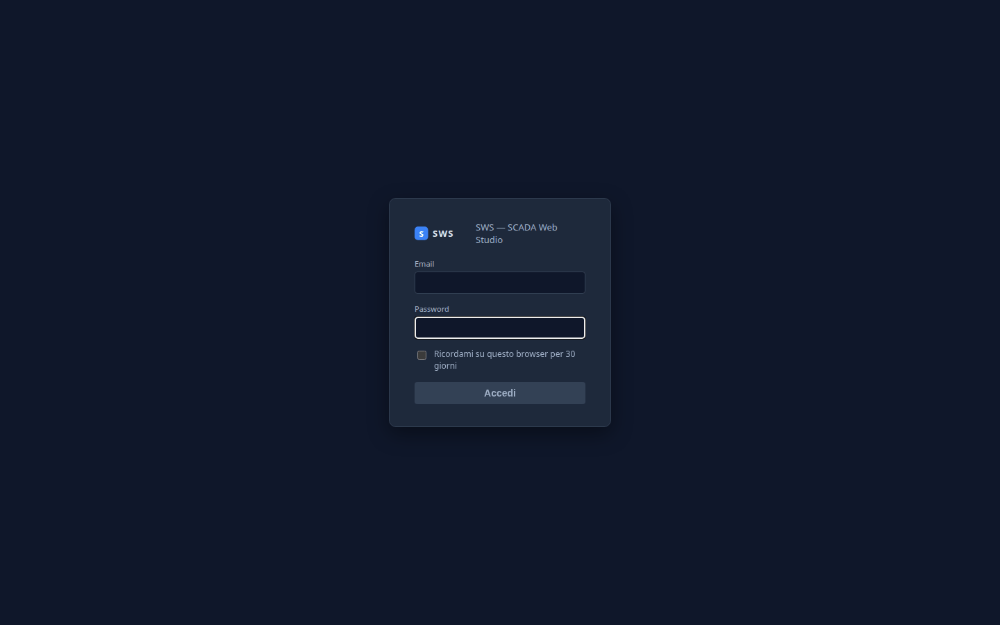
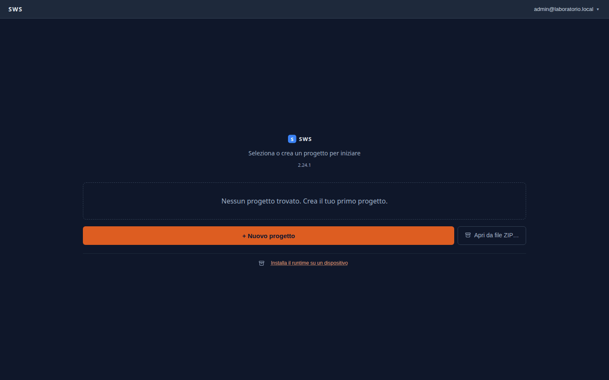
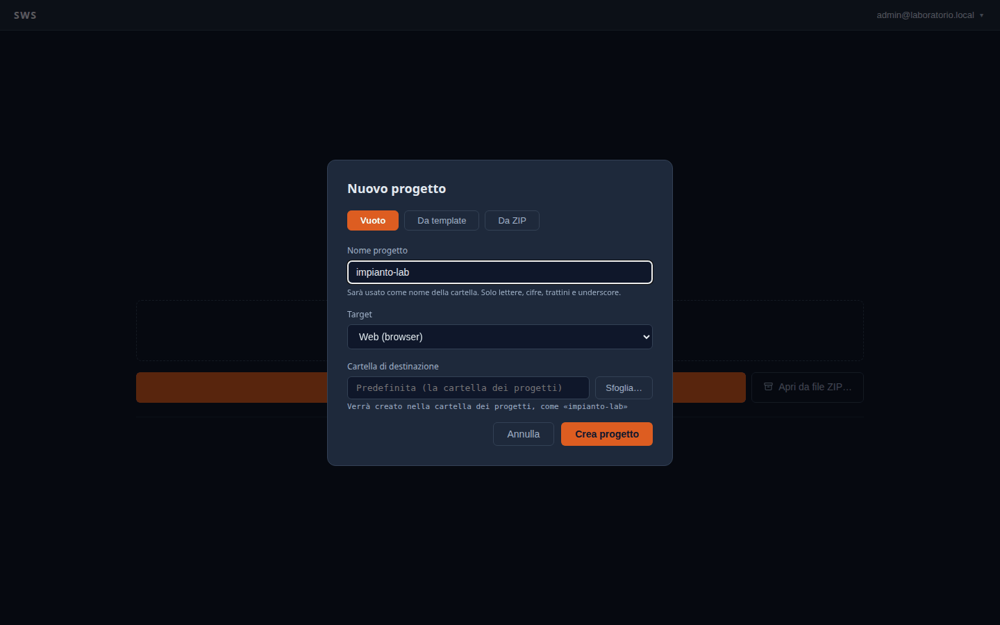
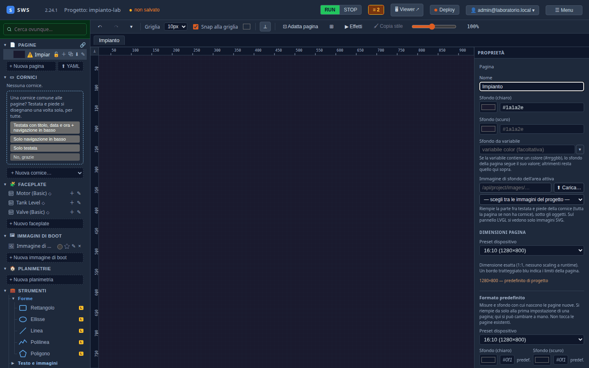
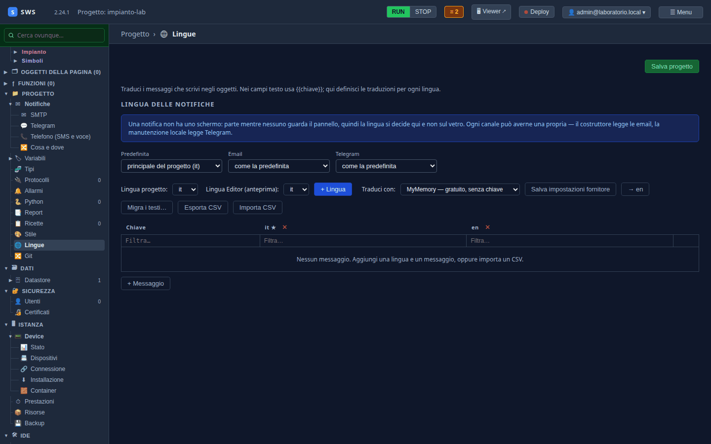

← [Indice](MAIN.md) | [← Il laboratorio](T01_laboratorio.md) | [Tag e tipi →](T03_tag_e_tipi.md)

---

# T02 — Un progetto vuoto, la risoluzione, le lingue

> **Parte II — Tutorial.** Si entra nell'IDE per la prima volta, si crea il progetto che accompagnerà tutto il
> tutorial, e gli si danno le misure dello schermo e le due lingue. Eseguito il 03-11-2026 con SWS 2.24.1.

---

## 1. Avviare l'IDE

Sul PC, da un checkout del repository:

```bash
./scripts/start_editor.sh
```

L'IDE ascolta su **`http://localhost:8460`** e tiene i progetti in `~/sws_projects`. Il primo avvio compila il runtime e
ci mette qualche minuto; come installarlo altrove (o usarlo nel cloud) è nel [02 — Quick Start](02_quickstart.md).

## 2. Il primo accesso

Un'IDE appena installata non ha utenti e non lascia entrare nessuno. All'avvio stampa nel terminale un **codice di primo
accesso**:

```text
  PRIMO ACCESSO — nessun utente in questa installazione.
    codice: 4800929562074535a5458c5b5c6beee8
  Aprilo nell'IDE e crea l'amministratore. Il codice vale
  finche non esiste un utente, poi smette da se.
```

Il browser mostra il modulo per creare l'amministratore. Il codice serve a dimostrare che hai accesso alla macchina, non
solo alla pagina: chi vede l'IDE dalla rete ma non il terminale non può prendersela.



Compila codice, email e una password di almeno 8 caratteri, poi **Crea l'amministratore**. Si torna alla pagina di
accesso: entra con la stessa email e password. «Ricordami» tiene la sessione per 30 giorni su questo browser.

## 3. Il progetto

Senza progetti l'IDE propone di crearne uno:



**+ Nuovo progetto** apre la scelta fra un progetto **vuoto**, uno **da template** e uno **da ZIP**. Per il tutorial:

| Campo | Valore |
|---|---|
| Tipo | **Vuoto** |
| Nome progetto | `impianto-lab` (diventa il nome della cartella: lettere, cifre, `-` e `_`) |
| Target | **Web (browser)**: il pannello mostra le pagine in un browser. L'alternativa è il viewer LVGL, per i pannelli piccoli |
| Cartella di destinazione | vuota: va nella cartella dei progetti |



**Crea progetto** apre l'editor su una pagina vuota, «Page 1».

## 4. La risoluzione

Le pagine di SWS hanno una misura in pixel, quella dello schermo del pannello. Il tutorial usa un pannello **16:10 da
1280×800** (un TC620, per esempio). Con la pagina selezionata, nel pannello **Proprietà** a destra:

- **Dimensioni pagina → Preset dispositivo**: `16:10 (1280×800)`. È la misura di questa pagina.
- **Formato predefinito → Preset dispositivo**: `16:10 (1280×800)`. È la misura con cui nasceranno le pagine nuove.
- **Nome**: `Impianto`.



In alto compare **● non salvato**. Salva con **Ctrl+S** (o col clic su quella scritta): le modifiche del progetto
non vanno su disco finché non le salvi, e un solo salvataggio le porta tutte insieme.

> **Fisso, proporzionale o fluido.** Più in basso, in **Impostazioni progetto**, la *modalità dimensionamento* dice
> cosa succede su uno schermo di misura diversa: **Fisso** (1:1, il default), **Solo proporzioni** (scala mantenendo
> il rapporto) o **Fluido**. Per un pannello di cui conosci lo schermo, Fisso.

## 5. Le lingue

Il pannello mostrerà i testi in italiano e, a richiesta dell'operatore, in inglese. Nell'albero a sinistra, **Progetto
→ Lingue**:



- **Lingua progetto** è `it`: è la lingua in cui scrivi i testi.
- **+ Lingua** chiede il codice della lingua: `en`. Compare la sua colonna.
- **Salva progetto**.

La tabella sotto si riempirà da sola man mano che scriverai testi negli oggetti: ogni testo ha la sua traduzione per
lingua, e **Traduci con** propone le traduzioni mancanti con un servizio automatico (MyMemory, gratuito, è il
predefinito). Come funziona tutto il resto — chiavi, CSV, lingua delle notifiche — è nel
[15 — Multilingua](15_multilingua.md).

---

## Cosa c'è su disco

```text
~/sws_projects/impianto-lab/
├── project.yaml          # variabili, sorgenti, allarmi, lingue… (tutto tranne le pagine)
└── synoptics/
    └── Impianto.yaml     # la pagina, 1280×800
```

```yaml
# project.yaml, la parte delle lingue
languages:
  default: it
  langs:
  - it
  - en
```

Il progetto è una cartella di file YAML: si versiona con git ([12 — GitOps](12_gitops.md)), si copia, si apre con un
editor di testo.

---

← [Indice](MAIN.md) | [← Il laboratorio](T01_laboratorio.md) | [Tag e tipi →](T03_tag_e_tipi.md)
