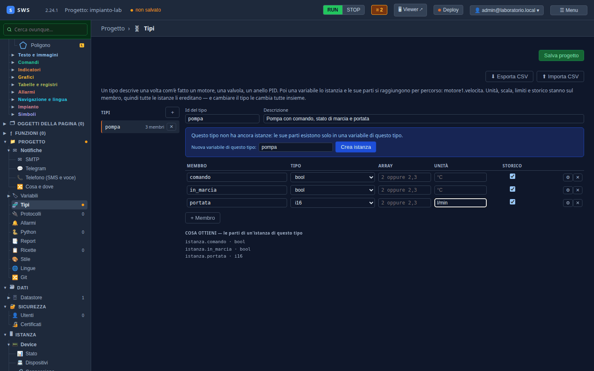
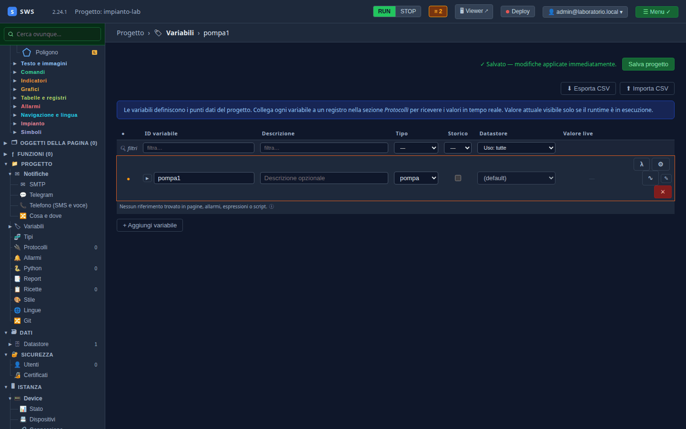
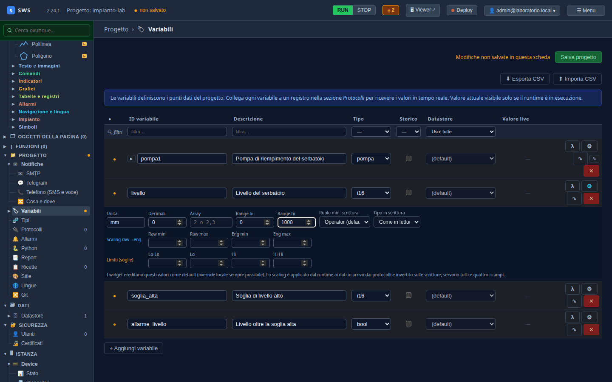

← [Indice](MAIN.md) | [← Un progetto vuoto](T02_progetto_vuoto.md) | [Modbus TCP →](T04_modbus.md)

---

# T03 — Tag e tipi: le variabili dell'impianto

> **Parte II — Tutorial.** Le variabili sono il cuore del progetto: gli oggetti delle pagine le mostrano, i protocolli
> le riempiono, gli allarmi le guardano. Qui si dichiarano le sei dell'impianto del laboratorio, tre delle quali
> raccolte in un **tipo** «pompa». Eseguito il 03-11-2026 con SWS 2.24.1.

---

## Variabili e tipi, in due righe

Una **variabile** (o *tag*) è un valore con un nome: `livello`, `soglia_alta`. Ha un tipo (`bool`, `i16`, `f32`…), e
facoltativamente unità, decimali, intervallo, soglie, storico.

Un **tipo** descrive una volta com'è fatta una cosa che nell'impianto torna più volte — una pompa, un motore, una
valvola — con i suoi **membri**. Una variabile di quel tipo è un'**istanza**, e le sue parti si raggiungono per
percorso: `pompa1.comando`, `pompa1.portata`. Unità, scala e storico stanno sul membro: tutte le istanze li ereditano,
e cambiare il tipo le cambia tutte insieme.

Nell'impianto c'è una pompa sola, ma dichiararla come tipo costa uguale e il giorno che arriva la seconda basta
un'istanza in più.

## 1. Il tipo `pompa`

**Progetto → Tipi**, poi **+** accanto a «Tipi»:

| Campo | Valore |
|---|---|
| Id del tipo | `pompa` |
| Descrizione | `Pompa con comando, stato di marcia e portata` |

Con **+ Membro** si aggiungono le righe. Ogni membro ha nome, tipo, unità e la casella dello storico:

| Membro | Tipo | Unità | Cosa sarà nel PLC |
|---|---|---|---|
| `comando` | `bool` | | `comando_marcia` |
| `in_marcia` | `bool` | | `pompa_in_marcia` |
| `portata` | `i16` | `l/min` | `portata` |



Sotto, **Cosa ottieni** mostra le parti che avrà ogni istanza: `istanza.comando · bool`, `istanza.in_marcia · bool`,
`istanza.portata · i16`.

> **I nomi.** Niente spazi, punti o parentesi quadre: il punto separa le parti di un percorso, le quadre gli elementi
> di un array. Il campo lo dice da sé se ne scrivi uno.

## 2. L'istanza `pompa1`

Nel riquadro blu, **Nuova variabile di questo tipo**: `pompa1`, poi **Crea istanza**. La variabile nasce e l'IDE porta
nella pagina **Variabili**, con la riga di `pompa1` evidenziata e già salvata.



## 3. Le altre variabili

Sempre in **Variabili**, **+ Aggiungi variabile** per tre volte:

| ID variabile | Descrizione | Tipo |
|---|---|---|
| `livello` | Livello del serbatoio | `i16` |
| `soglia_alta` | Soglia di livello alto | `i16` |
| `allarme_livello` | Livello oltre la soglia alta | `bool` |

E una descrizione anche per `pompa1`: `Pompa di riempimento del serbatoio`.

Il pulsante **⚙** di una riga apre unità, decimali, intervallo, scala e soglie. Per `livello`:

| Campo | Valore |
|---|---|
| Unità | `mm` |
| Decimali | `0` |
| Range lo / Range hi | `0` / `1000` |



Gli oggetti che mostreranno `livello` prenderanno da qui unità e decimali, e una barra o un indicatore prenderanno
l'intervallo: si scrive una volta sola. Lo **scaling** (raw → ingegneristico) e le **soglie** Lo/Hi servono quando il
dispositivo manda numeri grezzi o quando si vogliono colori di soglia; qui il PLC manda già millimetri.

**Salva progetto.**

> **E la colonna Storico?** Resta spenta per ora. La si accende al [T09](T09_allarmi_e_storico.md), quando servirà un
> trend: lo storico di un'istanza si accende sulla variabile (`pompa1`), e i membri lo seguono.

---

## Cosa c'è su disco

```yaml
types:
- id: pompa
  description: Pompa con comando, stato di marcia e portata
  members:
  - name: comando
    data_type: bool
    history: true
  - name: in_marcia
    data_type: bool
    history: true
  - name: portata
    data_type: i16
    unit: l/min
    history: true
tags:
- id: pompa1
  description: Pompa di riempimento del serbatoio
  data_type: float
  history: false
  type_ref: pompa
- id: livello
  description: Livello del serbatoio
  data_type: i16
  history: false
  unit: mm
  decimals: 0
  range_lo: 0.0
  range_hi: 1000.0
```

Il `history: true` dei membri vuol dire «questo membro entra nello storico, se l'istanza lo ha acceso»: il
`history: false` di `pompa1` è quello che conta, e per ora dice di no.

Tipi e variabili si possono anche scrivere in un foglio di calcolo e importare: **Esporta CSV** e **Importa CSV** in
testa alle due pagine.

---

← [Indice](MAIN.md) | [← Un progetto vuoto](T02_progetto_vuoto.md) | [Modbus TCP →](T04_modbus.md)
