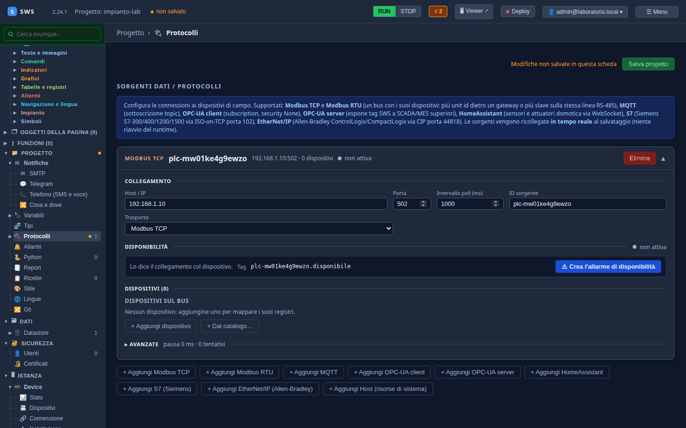
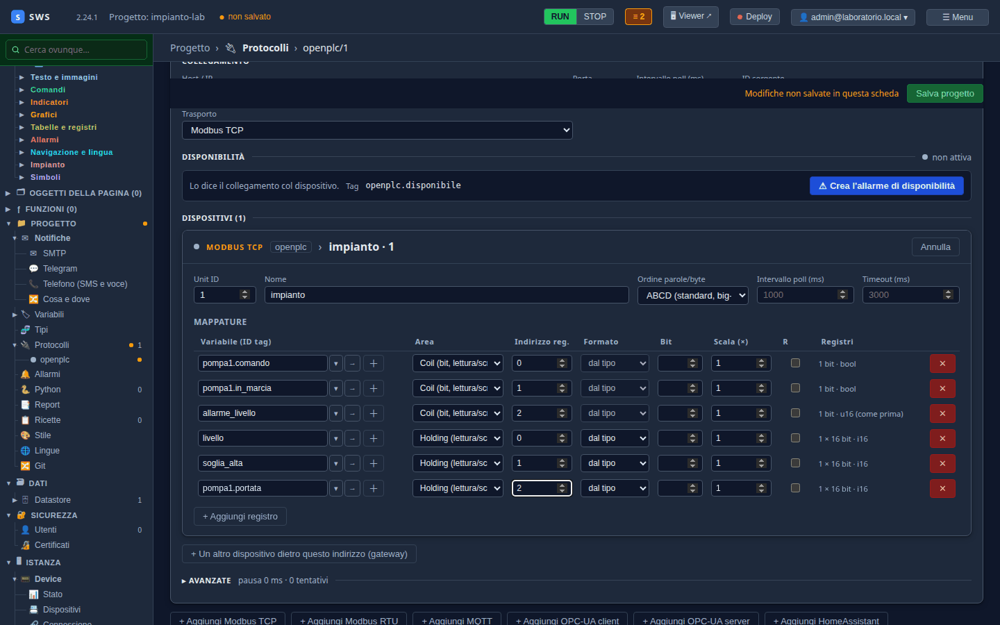
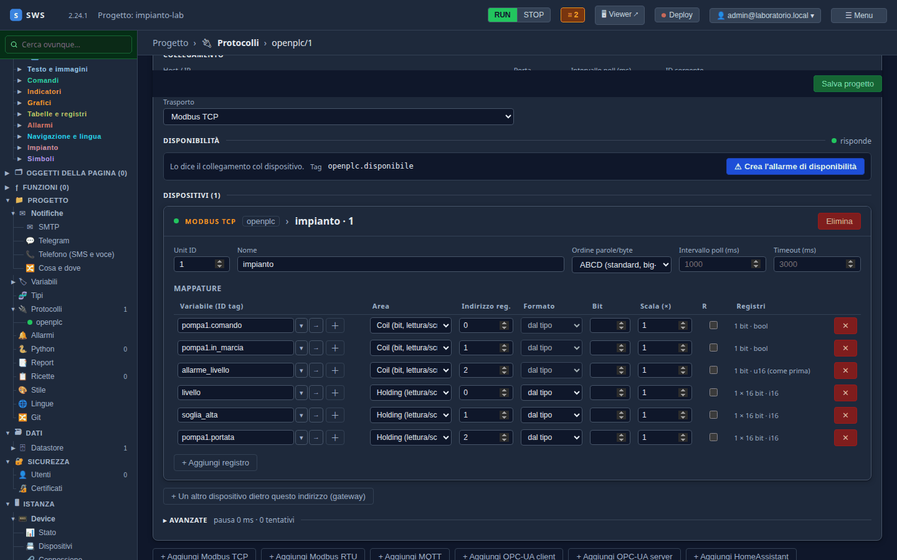
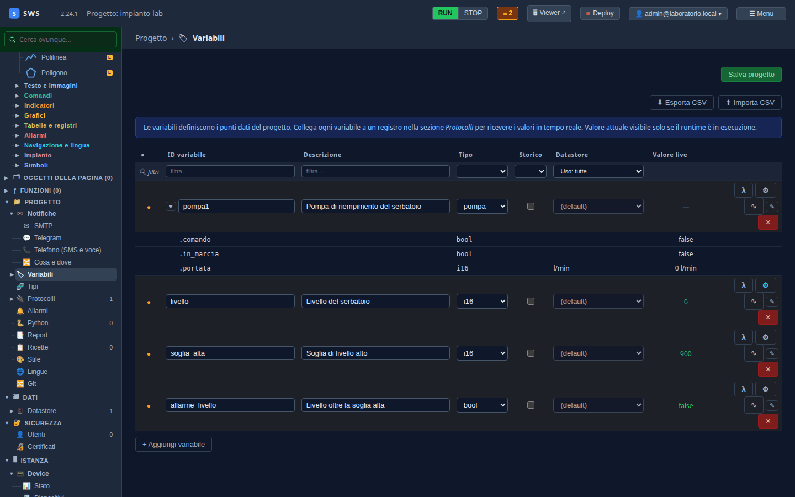

← [Indice](MAIN.md) | [← Tag e tipi](T03_tag_e_tipi.md) | [OPC UA →](T05_opcua.md)

---

# T04 — Modbus TCP verso OpenPLC

> **Parte II — Tutorial.** Le variabili del [T03](T03_tag_e_tipi.md) prendono vita: una sorgente Modbus TCP legge il PLC
> del laboratorio e le riempie. Eseguito il 03-11-2026 con SWS 2.24.1 e OpenPLC Runtime v4.3.1, laboratorio acceso e
> impianto caricato ([T01](T01_laboratorio.md)).

---

## Sorgente, dispositivo, mappatura

In SWS un protocollo è una **sorgente**. Una sorgente Modbus TCP è un collegamento — un indirizzo e una porta — con
sopra uno o più **dispositivi** (le *unit* Modbus: di solito una, più d'una dietro un gateway verso RS-485). Ogni
dispositivo ha le sue **mappature**: questa variabile sta in quel registro.

| Livello | Qui |
|---|---|
| Sorgente | `openplc`, `127.0.0.1:1502` |
| Dispositivo | unit 1, `impianto` |
| Mappature | sei, una per variabile |

## 1. La sorgente

**Progetto → Protocolli → + Aggiungi Modbus TCP**. Nasce una sorgente con valori di esempio:



| Campo | Valore | Perché |
|---|---|---|
| Host / IP | `127.0.0.1` | il laboratorio è sullo stesso PC |
| Porta | `1502` | la porta Modbus di OpenPLC nel laboratorio, come sul pannello |
| Intervallo poll (ms) | `1000` | una lettura al secondo basta per un serbatoio |
| ID sorgente | `openplc` | il nome con cui la sorgente compare ovunque: nei log, nell'albero, nel tag di disponibilità |
| Trasporto | **Modbus TCP** | le altre due voci sono per i gateway seriali e le chiavette Solarman degli inverter |

Il riquadro **Disponibilità** mostra già il tag `openplc.disponibile`: vale vero finché il dispositivo risponde.
**Crea l'allarme di disponibilità** ne fa un allarme in un clic; lo si vedrà al [T09](T09_allarmi_e_storico.md).

## 2. Il dispositivo e le mappature

**+ Aggiungi dispositivo**: Unit ID `1`, Nome `impianto`. Gli altri campi — ordine delle parole, intervallo e timeout
propri — restano vuoti e prendono quelli della sorgente.

Poi **+ Aggiungi registro**, una riga per variabile, con gli indirizzi del [T01](T01_laboratorio.md#limpianto):

| Variabile (ID tag) | Area | Indirizzo reg. |
|---|---|---|
| `pompa1.comando` | Coil | 0 |
| `pompa1.in_marcia` | Coil | 1 |
| `allarme_livello` | Coil | 2 |
| `livello` | Holding | 0 |
| `soglia_alta` | Holding | 1 |
| `pompa1.portata` | Holding | 2 |



Tre cose da notare nella tabella:

- **Le parti di un'istanza si mappano una per una**: `pompa1.comando` e `pompa1.portata` stanno in due aree diverse, e
  ognuna ha la sua riga.
- **Formato «dal tipo»**: quanti registri leggere lo decide il tipo della variabile. La colonna **Registri** lo dice:
  `1 × 16 bit · i16` per le holding, `1 bit · bool` per le coil. Un `f32` ne leggerebbe due, e l'ordine delle parole
  del dispositivo direbbe come metterli insieme.
- **Il ＋ accanto al nome** crea una variabile che non esiste ancora, proponendo il tipo giusto per l'area: `bool` su
  una coil, `i16` su una holding. È la strada più corta quando si parte dalla mappa di un dispositivo invece che dalle
  variabili.

Il campo **R** (sola lettura) rifiuta le scritture su quella riga anche se l'area le permetterebbe. Qui resta spento:
`pompa1.comando` lo scriveremo dal pannello, e le altre il PLC le riscrive a ogni ciclo.

## 3. Salvare e accendere

**Salva progetto**: le sorgenti si ricollegano da sole al salvataggio, senza riavviare niente, e la nuova parte
subito.

I due pulsanti **RUN / STOP** in alto comandano l'acquisizione di tutte le sorgenti. È accesa di default; **STOP** la
ferma — utile per non interrogare un impianto vero mentre si lavora al progetto — e resta ferma, anche dopo un
salvataggio, finché non premi **RUN**.



Il pallino della sorgente diventa verde, **risponde**, e così quello del dispositivo. Il log del runtime dice lo stesso:

```text
Modbus TCP: connessione   source=openplc indirizzo=127.0.0.1:1502 trasporto=Mbap dispositivi=1
Modbus TCP: connesso      source=openplc
Modbus: il dispositivo risponde   source=openplc unit_id=1
```

## 4. I valori dal vivo

**Progetto → Variabili**. La colonna **Valore live** mostra quello che arriva dal PLC; il triangolo accanto a
`pompa1` apre le sue parti:



| Variabile | Valore | Perché |
|---|---|---|
| `livello` | 0 | la pompa non è mai partita |
| `soglia_alta` | 900 | il programma la imposta al primo ciclo |
| `allarme_livello` | false | |
| `pompa1.comando` | false | nessuno ha ancora dato il comando |
| `pompa1.portata` | 0 l/min | l'unità viene dal membro del tipo |

Il comando lo daremo da un pulsante della pagina, al [T08](T08_pagine.md): è lì che si vede la scrittura.

---

## Se non risponde

| Sintomo | Dove guardare |
|---|---|
| Pallino grigio, **non attiva** | l'acquisizione è stata fermata con STOP: **RUN** in alto |
| Pallino rosso, timeout | `./laboratorio.sh stato` dice se la 1502 è aperta; se il PLC è in STOP, `./laboratorio.sh carica` |
| Valori sbagliati di un fattore enorme | il tipo della variabile: un `f64` su una holding legge 4 registri |
| Eccezione «illegal data address» | l'indirizzo: OpenPLC espone coil e holding da 0, non da 1 |

Il riferimento completo — RTU, gateway, catalogo dei dispositivi, blocchi, ordine delle parole — è nel
[06 — Protocolli](06_protocols.md).

---

## Cosa c'è su disco

```yaml
sources:
- kind: modbus_tcp
  id: openplc
  host: 127.0.0.1
  port: 1502
  poll_interval_ms: 1000
  devices:
  - unit_id: 1
    nome: impianto
    registers:
    - tag: pompa1.comando
      address: 0
      scale: 1.0
      area: coil
    # … in_marcia (coil 1), allarme_livello (coil 2)
    - tag: livello
      address: 0
      scale: 1.0
    # … soglia_alta (1), pompa1.portata (2): holding, che è l'area di default
```

---

← [Indice](MAIN.md) | [← Tag e tipi](T03_tag_e_tipi.md) | [OPC UA →](T05_opcua.md)
