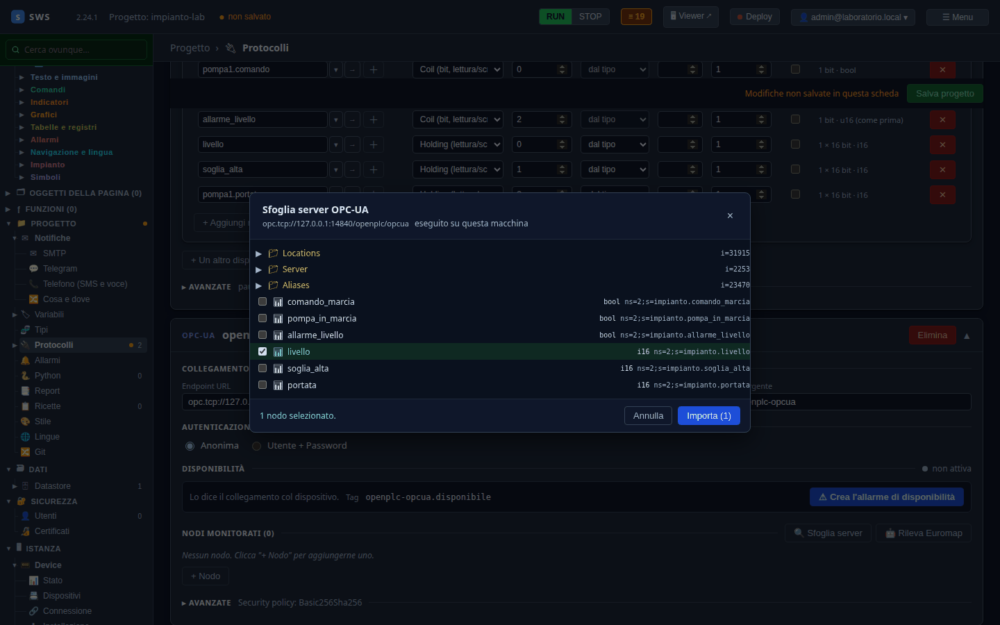
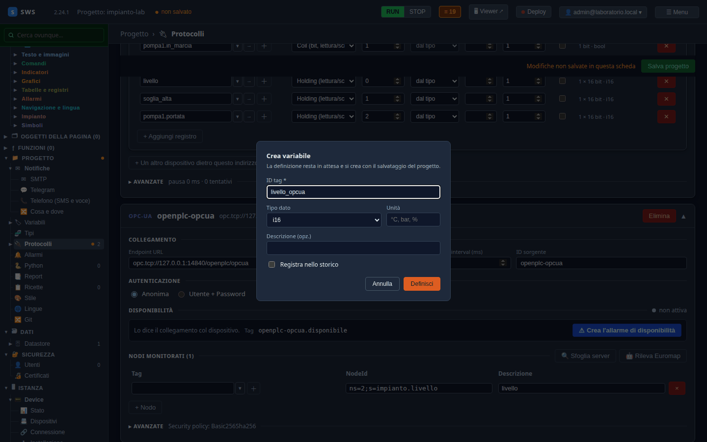
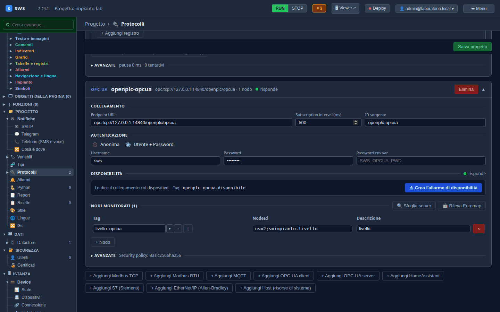
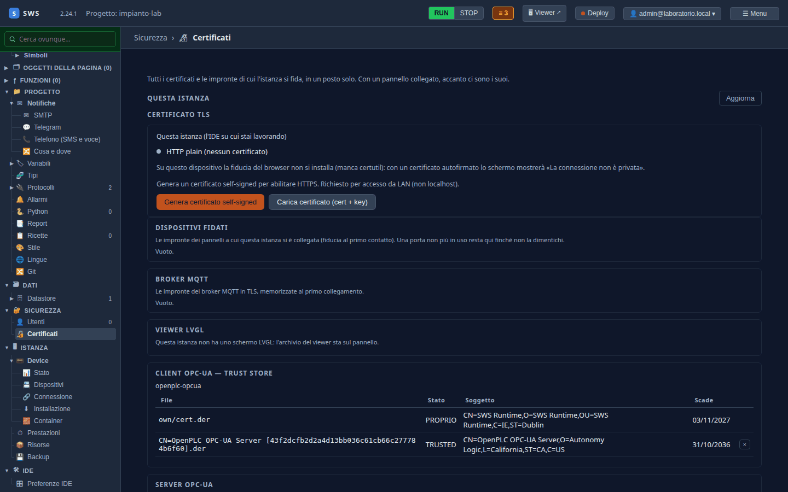
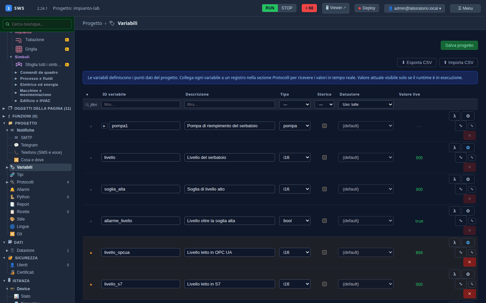

← [Indice](MAIN.md) | [← Modbus TCP](T04_modbus.md) | [S7 →](T06_s7.md)

---

# T05 — OPC UA verso OpenPLC: certificati e fiducia al primo contatto

> **Parte II — Tutorial.** Lo stesso livello del serbatoio, letto questa volta in OPC UA, su un canale firmato e
> cifrato. Il capitolo è soprattutto sui **certificati**: chi si fida di chi, e cosa succede quando un certificato
> cambia. Eseguito il 03-11-2026 con SWS 2.24.1 (più la correzione del client OPC UA di quel giorno) e OpenPLC Runtime
> v4.3.1.

---

## Perché una variabile in più

Le variabili dell'impianto le riempie già il Modbus del [T04](T04_modbus.md). Qui OPC UA legge `livello` in una
variabile gemella, `livello_opcua`: alla fine del capitolo i due numeri sono uguali, arrivati per due strade diverse.
In un impianto vero si sceglie un protocollo per dispositivo; qui serve a vederli tutti contro lo stesso PLC.

## Cosa espone il laboratorio

| | |
|---|---|
| Endpoint | `opc.tcp://127.0.0.1:14840/openplc/opcua` |
| Sicurezza | `Basic256Sha256`, **firmato e cifrato** (SignAndEncrypt) |
| Utente | `sws` / `laboratorio`, ruolo *operator* |
| Nodi | `ns=2;s=impianto.<variabile>`, uno per variabile del programma |

## 1. La sorgente

**Progetto → Protocolli → + Aggiungi OPC-UA client**:

| Campo | Valore |
|---|---|
| Endpoint URL | `opc.tcp://127.0.0.1:14840/openplc/opcua` |
| ID sorgente | `openplc-opcua` |
| Autenticazione | **Utente + Password**: `sws`, `laboratorio` |

In **Avanzate** la *Security policy* è già `Basic256Sha256 (raccomandato)`, e la casella **Accetta qualsiasi
certificato del server (sconsigliato)** è spenta: lasciale così.

> **Dove finisce la password.** Non in `project.yaml`: al salvataggio va in `secrets.yaml`, accanto, che non si
> esporta e non va nel git del progetto. In alternativa, **Password env var** prende la password da una variabile
> d'ambiente del runtime.

## 2. Sfogliare il server e scegliere i nodi

**🔍 Sfoglia server** si collega al server e ne mostra lo spazio degli indirizzi. Sotto `Objects` ci sono le sei
variabili del programma, ciascuna col suo tipo e il suo NodeId:



Spunta `livello` e **Importa**. Nella tabella **Nodi monitorati** compare una riga col NodeId
`ns=2;s=impianto.livello` e il tag ancora vuoto.

> **La prima volta ci mette qualche secondo.** Per parlare cifrato il runtime genera la sua coppia di chiavi RSA.

## 3. La variabile, dal nodo

Il **＋** accanto al tag vuoto crea la variabile. Il tipo è già proposto: è quello che il server ha dichiarato per
quel nodo (`i16`).



ID `livello_opcua`, unità `mm`, **Definisci**. Poi **Salva progetto**.

## 4. La fiducia al primo contatto

Al primo collegamento SWS non conosce il certificato di OpenPLC. Non lo rifiuta e non lo accetta a occhi chiusi: lo
**memorizza**, si ricollega e da lì in poi accetta solo quello. Nel log:

```text
Certificate CN=OpenPLC OPC-UA Server [f496a7b8…].der is unknown and untrusted so it will be stored in rejected directory
opcua: certificato del server memorizzato al primo contatto
opcua: connected, creating subscription
opcua: subscribed   count=1
```

La sorgente diventa verde, **risponde**:



Il certificato memorizzato si vede in **Sicurezza → Certificati → Client OPC-UA — trust store**, sorgente per
sorgente: quello di SWS (`own/cert.der`, **PROPRIO**) e quello del server (**TRUSTED**).



## 5. Quando il certificato cambia

Un certificato che cambia può essere un server reinstallato o qualcuno che si mette in mezzo. SWS non sa distinguere,
quindi **si ferma e chiede**. È successo davvero durante l'esecuzione di questo capitolo: rigenerato il certificato
di OpenPLC, il log ha detto

```text
opcua: certificato del server cambiato, non accettato
sessione caduta: certificato del dispositivo cambiato: il server presenta un certificato diverso da quello
memorizzato (CN=OpenPLC OPC-UA Server [43f2dcfb…].der). Se il cambio è atteso, fidati del nuovo dal trust store
della sorgente
```

e nel trust store il certificato nuovo è comparso come **REJECTED**, con accanto **Fidati**. Se il cambio è atteso:
**×** sul vecchio, **Fidati** sul nuovo. La sorgente si ricollega da sola al tentativo successivo.

## 6. I valori

In **Variabili**, `livello_opcua` mostra lo stesso numero di `livello`: lo stesso registro del PLC, una volta in
Modbus e una in OPC UA.



---

## Se non si collega

| Nel log | Cosa vuol dire |
|---|---|
| `il server non offre Basic256Sha256 con SignAndEncrypt; offre: …` | la policy scelta non c'è: l'elenco dice quali ci sono |
| `BadUserAccessDenied` | utente o password, o il server non accetta quel modo di entrare (vedi sotto) |
| `BadCertificateUriInvalid` | il certificato del server non porta l'URI con cui il server si presenta: va sistemato sul server |
| `certificato … cambiato, non accettato` | il §5 qui sopra |

> **Due cose di OpenPLC 4.3.1, se configuri il tuo.** Su un canale cifrato tratta **ogni** sessione come
> autenticazione col certificato, anche quella anonima: con la sola anonima si ottiene `BadUserAccessDenied`, quindi
> serve un utente con password. E il server si presenta sempre come `urn:freeopcua:python:server`: con un altro
> `applicationUri` nella configurazione il suo certificato porta l'URI sbagliato e i client lo rifiutano. Il
> laboratorio ha già le due correzioni in `impianto/devices/servers/opcua.json`.

Il riferimento completo — policy, server OPC UA di SWS, Euromap — è nel [06 — Protocolli](06_protocols.md).

---

## Cosa c'è su disco

```yaml
# project.yaml
- kind: opcua_client
  id: openplc-opcua
  endpoint_url: opc.tcp://127.0.0.1:14840/openplc/opcua
  security_policy: Basic256Sha256
  auth:
    kind: username_password
    username: sws
  subscription_interval_ms: 500
  nodes:
  - tag: livello_opcua
    node_id: ns=2;s=impianto.livello
    description: livello
  trust_all_certs: false
```

```yaml
# secrets.yaml
sources.openplc-opcua.auth_password: laboratorio
```

```text
opcua-pki/openplc-opcua/
├── own/cert.der        # il certificato di SWS per questa sorgente
├── private/private.pem
├── trusted/            # i certificati dei server di cui si fida
└── rejected/           # quelli visti e non (ancora) accettati
```

---

← [Indice](MAIN.md) | [← Modbus TCP](T04_modbus.md) | [S7 →](T06_s7.md)
