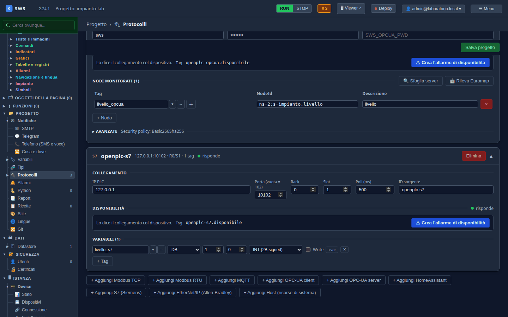

← [Indice](MAIN.md) | [← OPC UA](T05_opcua.md) | [MQTT →](T07_mqtt.md)

---

# T06 — S7 verso OpenPLC

> **Parte II — Tutorial.** Il terzo protocollo verso lo stesso PLC: S7, quello dei PLC Siemens (S7-300/400/1200/1500),
> che OpenPLC emula con Snap7. Il livello arriva in una terza variabile gemella, `livello_s7`. Eseguito il
> 03-11-2026 con SWS 2.24.1 e OpenPLC Runtime v4.3.1.

---

## Come ragiona S7

Modbus ha registri numerati, OPC UA ha nodi con un nome. S7 ha **aree di memoria** e **offset in byte**: un intero
non sta «al registro 0» ma «nel DB1, a partire dal byte 0, lungo 2 byte». Le aree:

| Area | Cosa | Nel laboratorio |
|---|---|---|
| **DB** | blocchi dati, numerati | DB1 (gli interi), DB2 (i booleani) |
| **M** | merker, la memoria interna | |
| **I** / **Q** | ingressi e uscite | |

OpenPLC espone le sue uscite in due DB, come dice `impianto/devices/servers/s7.json`:

| Variabile | DB | Offset | Tipo S7 |
|---|---|---|---|
| `livello` | 1 | byte 0 | INT (2 byte, con segno) |
| `soglia_alta` | 1 | byte 2 | INT |
| `portata` | 1 | byte 4 | INT |
| `comando_marcia` | 2 | bit 0.0 | BOOL |
| `pompa_in_marcia` | 2 | bit 0.1 | BOOL |
| `allarme_livello` | 2 | bit 0.2 | BOOL |

## 1. La sorgente

**Progetto → Protocolli → + Aggiungi S7 (Siemens)**:

| Campo | Valore | Perché |
|---|---|---|
| IP PLC | `127.0.0.1` | |
| Porta | `10102` | vuota vuol dire 102, la porta standard; nel laboratorio è spostata |
| Rack / Slot | `0` / `1` | la CPU di un S7-1200/1500; un S7-300/400 la ha nello slot `2`. OpenPLC accetta qualunque coppia |
| Poll (ms) | `500` | |
| ID sorgente | `openplc-s7` | |

## 2. La variabile

**+ Tag** aggiunge una riga: tag, area, numero del DB, offset, tipo.

| Tag | Area | DB | Offset | Tipo |
|---|---|---|---|---|
| `livello_s7` | DB | 1 | 0 | INT (2B signed) |

`livello_s7` non esiste ancora: il **＋** tratteggiato accanto al nome apre la finestra per crearla, col tipo che
corrisponde al tipo S7 già proposto (`INT` → `i16`) e l'unità `mm`.

La casella **Write** abilita la scrittura su quella riga; di default una riga S7 è in sola lettura.



**Salva progetto.** La sorgente si collega subito:

```text
starting S7 task   source=openplc-s7 ip=127.0.0.1
S7 connected       source=openplc-s7 ip=127.0.0.1 port=10102
```

## 3. I valori

In **Variabili** ci sono ora tre gemelle — `livello`, `livello_opcua`, `livello_s7` — con lo stesso numero, arrivato
in Modbus, OPC UA e S7. Le si vedrà muoversi insieme dal [T08](T08_pagine.md), quando la pompa partirà.

---

## Se non si collega

| Sintomo | Dove guardare |
|---|---|
| Rifiuto subito | la porta: un PLC vero sta sulla 102, il laboratorio sulla 10102 |
| Collega e poi cade | rack e slot: su un S7-300/400 la CPU è nello slot 2, su un 1200/1500 nello slot 1 |
| Valori assurdi | l'offset (in **byte**: il secondo INT del DB sta al byte 2, non 1) o il tipo |
| `S7 1200/1500`: accesso negato | sulla CPU va abilitato l'accesso PUT/GET e tolto «optimized block access» dal DB |

Il riferimento completo è nel [06 — Protocolli](06_protocols.md).

---

## Cosa c'è su disco

```yaml
- kind: s7
  id: openplc-s7
  ip: 127.0.0.1
  port: 10102
  rack: 0
  slot: 1
  poll_interval_ms: 500
  tags:
  - tag: livello_s7
    area: db
    db_num: 1
    byte_offset: 0
    bit_offset: 0
    data_type: int
```

---

← [Indice](MAIN.md) | [← OPC UA](T05_opcua.md) | [MQTT →](T07_mqtt.md)
