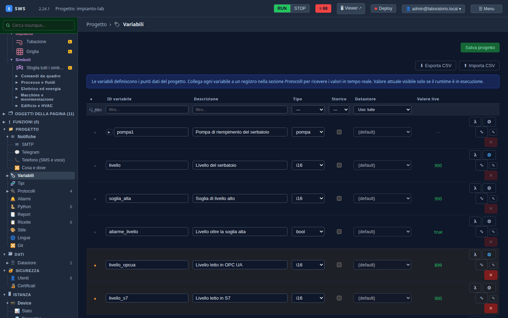
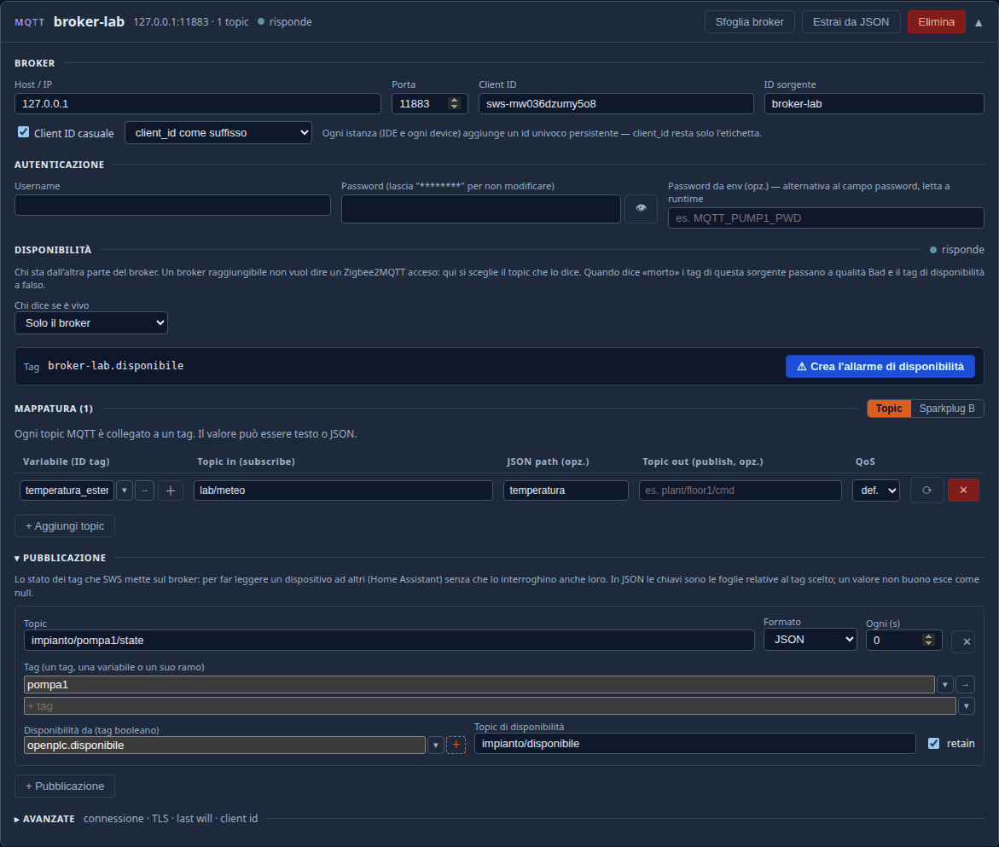

← [Indice](MAIN.md) | [← S7](T06_s7.md) | [Le pagine →](T08_pagine.md)

---

# T07 — MQTT: leggere un sensore e pubblicare l'impianto

> **Parte II — Tutorial.** OpenPLC non parla MQTT, e va bene così: in un impianto MQTT è il modo in cui arrivano i
> sensori sparsi (un termometro Wi-Fi, un modulo Shelly, Zigbee2MQTT) e il modo in cui SWS passa i dati ad altri (Home
> Assistant, un MES, un database). Il capitolo fa tutte e due le cose col broker del laboratorio. Eseguito il
> 03-11-2026 con SWS 2.24.1 (più le correzioni di quel giorno) e NanoMQ 0.25.7.

---

## Le due direzioni

| Direzione | Nel capitolo |
|---|---|
| **Dal broker a SWS** — un topic diventa una variabile | un termometro finto pubblica su `lab/meteo`, SWS lo legge in `temperatura_esterna` |
| **Da SWS al broker** — variabili pubblicate su un topic | lo stato di `pompa1` esce in JSON su `impianto/pompa1/state` |

## 1. La sorgente

**Progetto → Protocolli → + Aggiungi MQTT**:

| Campo | Valore |
|---|---|
| Host / IP | `127.0.0.1` |
| Porta | `11883` |
| ID sorgente | `broker-lab` |
| Client ID casuale | acceso (il default): ogni istanza — l'IDE, ogni pannello — si presenta al broker con un id suo |

Il broker del laboratorio è anonimo: utente e password restano vuoti. Su un broker vero vanno lì, e la password finisce
in `secrets.yaml` come quella di OPC UA ([T05](T05_opcua.md)).

**Chi dice se è vivo**: *Solo il broker*. Per un Zigbee2MQTT o un Tasmota il menu propone il topic con cui il
dispositivo dice da sé se è acceso: un broker raggiungibile non vuol dire un sensore acceso.

## 2. Leggere un sensore

Nella **Mappatura**, una riga per topic:

| Variabile | Topic in (subscribe) | JSON path |
|---|---|---|
| `temperatura_esterna` | `lab/meteo` | `temperatura` |

Il sensore manda un JSON, `{"temperatura": 21.5}`: il *JSON path* dice quale campo prendere. Un payload che è solo un
numero non ha bisogno di path.

La variabile non esiste ancora: il **＋** accanto al nome apre la finestra per crearla. Tipo `f64` (il default),
unità `°C`, **Definisci**.

Dal terminale, la parte del sensore:

```bash
./laboratorio.sh pubblica lab/meteo '{"temperatura": 21.5}'
```

e in **Variabili** `temperatura_esterna` vale **21.5 °C**.



> **Sfoglia broker** ascolta per qualche secondo tutto quello che passa e propone i topic che vede, e **Estrai da
> JSON** crea una riga per ogni campo di un payload incollato: sono le strade corte quando i topic sono tanti.

## 3. Pubblicare l'impianto

Sotto, **Pubblicazione → + Pubblicazione**:

| Campo | Valore | Perché |
|---|---|---|
| Topic | `impianto/pompa1/state` | |
| Formato | **JSON** | le chiavi sono le parti della variabile; *Valore nudo* manda un numero solo |
| Ogni (s) | `0` | solo quando qualcosa cambia; un numero lo ripubblica anche fermo |
| Tag | `pompa1` | un tag, una variabile intera o un suo ramo |
| Disponibilità da | `openplc.disponibile` | |
| Topic di disponibilità | `impianto/disponibile` | `online` / `offline`, *retain*: chi si collega dopo lo sa subito |

> **Il campo Tag.** Scrivi `pompa1` e conferma con **Tab**: i suggerimenti propongono le parti (`pompa1.comando`…),
> e Invio prenderebbe la prima.



**Salva progetto**, e dal terminale:

```bash
./laboratorio.sh ascolta 'impianto/#'
```

```text
impianto/disponibile: online
impianto/pompa1/state: {"comando":false,"in_marcia":false,"portata":0}
```

Un messaggio di stato, e uno nuovo solo quando la pompa cambia. È quello che legge, per esempio, Home Assistant con un
sensore MQTT sul topic `impianto/pompa1/state` e `value_json.portata`: SWS resta l'unico a interrogare il PLC, e chi
vuole i dati li prende dal broker. Il caso vero, con un inverter, è nel [HOWTO, §31](../HOWTO.md).

---

## Cosa c'è su disco

```yaml
- kind: mqtt
  id: broker-lab
  host: 127.0.0.1
  port: 11883
  topics:
  - tag: temperatura_esterna
    topic: lab/meteo
    json_path: temperatura
  random_client_id:
    enabled: true
    position: suffix
  pubblica:
  - topic: impianto/pompa1/state
    tags:
    - pompa1
    disponibilita:
      topic: impianto/disponibile
      tag: openplc.disponibile
```

---

← [Indice](MAIN.md) | [← S7](T06_s7.md) | [Le pagine →](T08_pagine.md)
