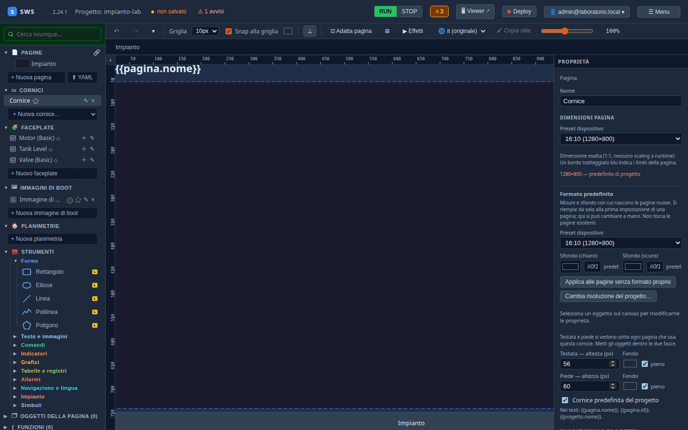
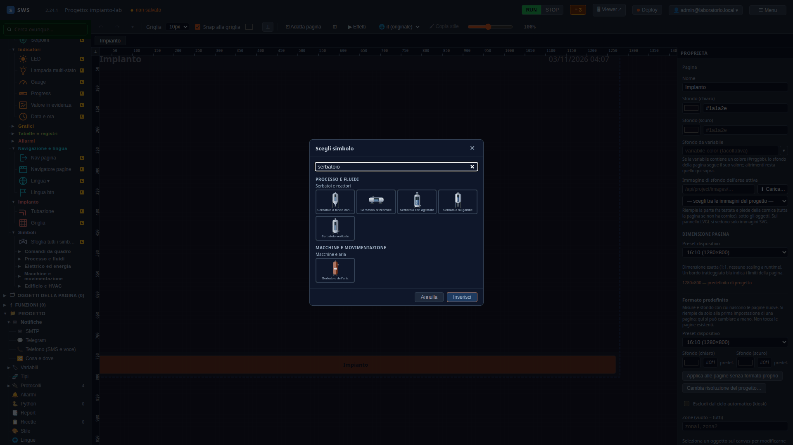
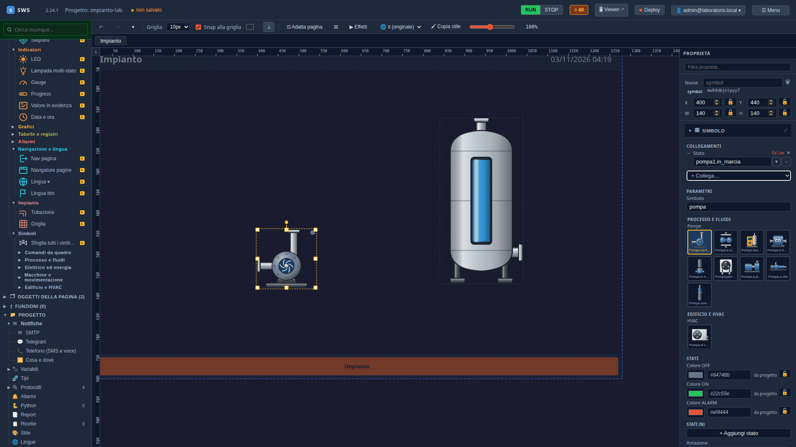
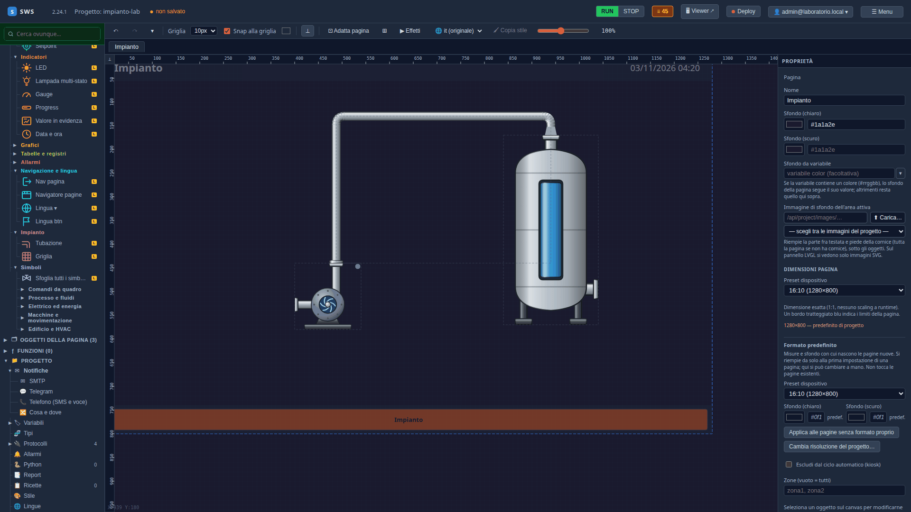
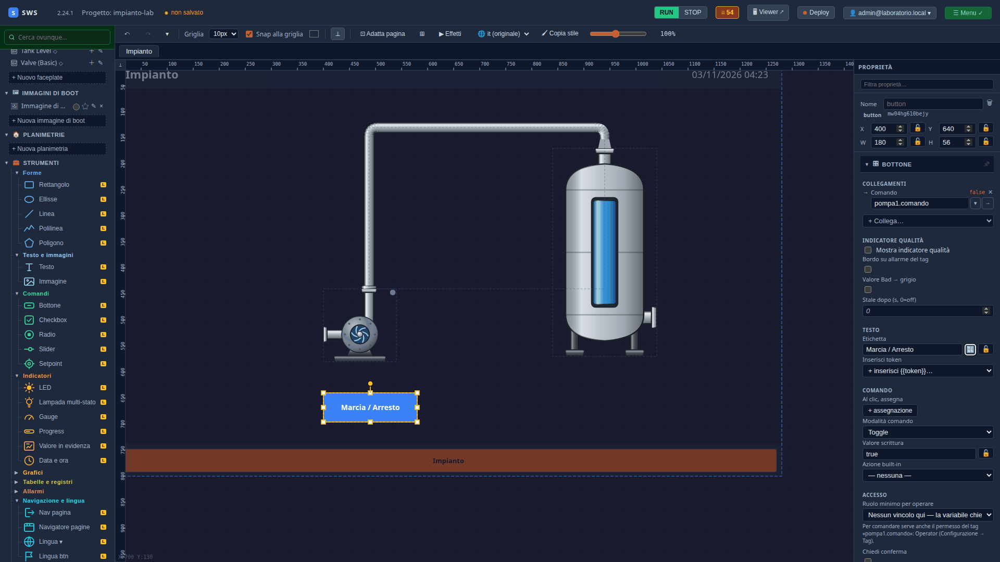
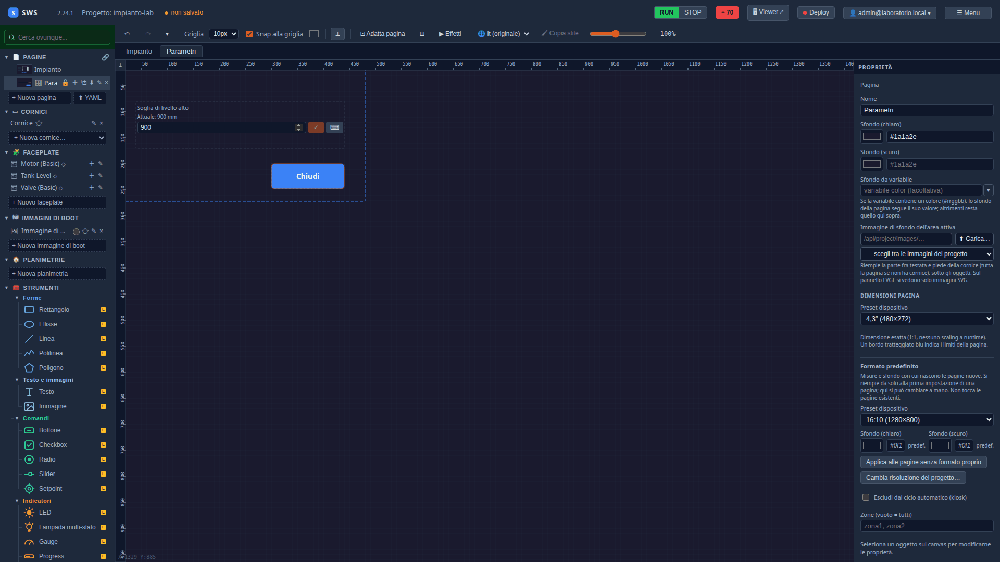
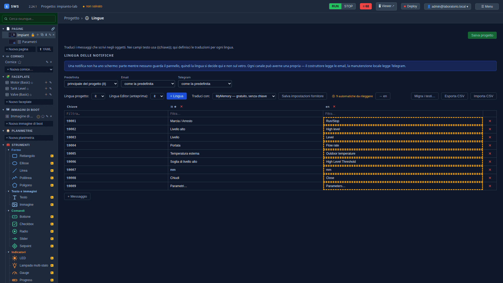
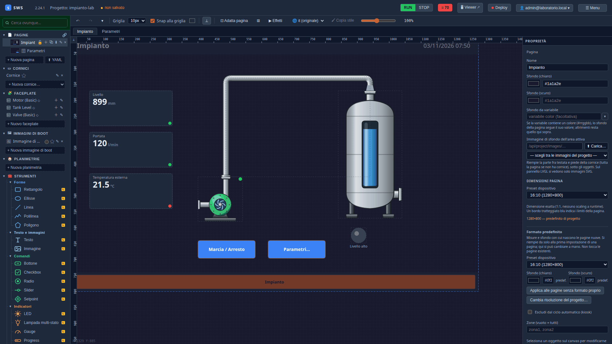

← [Indice](MAIN.md) | [← MQTT](T07_mqtt.md) | [Allarmi e storico →](T09_allarmi_e_storico.md)

---

# T08 — Le pagine: cornice, simboli, tubo, comandi e una finestra

> **Parte II — Tutorial.** Il disegno dell'impianto: una cornice comune, il serbatoio che si riempie, la pompa che
> gira, il tubo con il flusso, il pulsante di marcia, tre valori in evidenza e una finestra per la soglia. Eseguito il
> 03-11-2026 con SWS 2.24.1 (più le correzioni di quel giorno), laboratorio acceso.

---

## Come si lavora sul canvas

Gli oggetti stanno nella palette a sinistra, sotto **Strumenti**, divisi per gruppo (Forme, Testo e immagini, Comandi,
Indicatori, Navigazione e lingua, Impianto, Simboli…). **Un clic** su uno strumento lo mette nella pagina aperta e lo
seleziona; a destra il pannello **Proprietà** ne mostra posizione e misure (X, Y, W, H), i **Collegamenti** con le
variabili e il resto.

Quello che vedi sul canvas è quello che vedrà il pannello: i valori sono quelli veri, che arrivano dal PLC mentre
disegni. Gli effetti che si muovono — rotazioni, flusso nei tubi, lampeggi — si accendono col pulsante **▶ Effetti**
della barra, spento di default.

Si salva con **Ctrl+S**, come sempre.

## 1. La cornice

Una **cornice** è la testata e il piede comuni a tutte le pagine: si disegnano una volta sola. In **Cornici → + Nuova
cornice…** scegli **Testata con titolo, data e ora + navigazione in basso**:



Nasce «Cornice», già predefinita per il progetto: il titolo è `{{pagina.nome}}` (il nome della pagina, tradotto), a
destra data e ora, in basso il navigatore delle pagine. Testata 56 px, piede 60 px: gli oggetti delle pagine stanno
fra le due. **Ctrl+S.**

## 2. Il serbatoio

**Strumenti → Simboli → Sfoglia tutti i simboli** apre la libreria. Cerca `serbatoio` e scegli **Serbatoio
verticale**, poi **Inserisci**:



In **Proprietà**: X `840`, Y `170`, W `200`, H `400` (le proporzioni del disegno: il pannello lo propone con
«Adatta le proporzioni al disegno»).

Il vetro del serbatoio mostra il **livello**: seleziona il serbatoio e in **Collegamenti → + Collega… → ← Livello**
scegli `livello`. Il simbolo riempie il vetro secondo l'**intervallo** della variabile, 0–1000 mm, dichiarato al
[T03](T03_tag_e_tipi.md): a 900 mm il vetro è pieno al 90%.

> **Scala del livello.** Senza intervallo sulla variabile il livello si legge come una percentuale (0–100). Se il
> dispositivo dà già una frazione, sulla tubazione la **Scala tag** si sceglie a mano: «0.0 – 1.0».

## 3. La pompa

Dalla libreria, `pompa` → **Pompa centrifuga**. X `400`, Y `440`, W `140`, H `140`. In **Collegamenti**:

- **← Stato**: `pompa1.in_marcia`. La pompa si colora quando gira (verde, il colore ON del progetto);
- nei parametri, **Rotazione: Quando lo stato è ON**: la girante gira davvero.



## 4. Il tubo

**Strumenti → Impianto → Tubazione**. Il tubo si disegna punto per punto: un clic per ogni angolo, **doppio clic**
sull'ultimo per finire (Esc annulla). Parti dalla bocca di mandata della pompa, in alto, sali, vai a destra e scendi
sulla bocca in cima al serbatoio. Agganciato alle due bocche, il tubo segue i simboli se li sposti, e mette da sé
curve e raccordi:



Selezionalo e in **Collegamenti**:

- **← Stato**: `pompa1.in_marcia`;
- **+ Collega… → ← Flusso**: `pompa1.portata`. Con la portata diversa da zero, nel tubo scorre il fluido; il segno
  della portata dice il verso.

## 5. Il comando

**Strumenti → Comandi → Bottone**. X `400`, Y `640`, W `180`, H `56`.

| Campo | Valore |
|---|---|
| Collegamenti → **→ Comando** | `pompa1.comando` |
| Testo → Etichetta | `Marcia / Arresto` |
| Comando → Modalità comando | **Toggle**: ogni pressione inverte il valore |



Le altre modalità: **Scrivi valore** (un valore fisso), **Momentaneo** (vero finché lo tieni premuto), **Set** e
**Reset**, **Incrementa** e **Decrementa**. In **Accesso** si sceglie il ruolo minimo per premerlo e se chiedere conferma:
li useremo al [T10](T10_utenti_e_ruoli.md).

## 6. Gli indicatori

- **LED** (Indicatori): X `880`, Y `600`, W `48`, H `48`; **← Valore** `allarme_livello`; etichetta `Livello alto`.
- Tre **Valore in evidenza** (Indicatori), W `260`, H `110`, uno sotto l'altro a X `60`:

| Y | ← Valore | Etichetta |
|---|---|---|
| 170 | `livello` | Livello |
| 300 | `pompa1.portata` | Portata |
| 430 | `temperatura_esterna` | Temperatura esterna |

Unità e decimali arrivano dalla variabile: `livello` ha 0 decimali e mostra «899 mm». Dove la variabile non li
dichiara se ne mostra uno; per la portata scrivi **Decimali** `0` sull'oggetto (o, meglio, sul membro `portata` del
tipo, e varrà per tutte le pompe).

## 7. La finestra dei parametri

Una **finestra** è una pagina che si apre sopra un'altra, da un bottone.

1. **Pagine → + Nuova pagina**: nasce «Page 2». Nome `Parametri`, **Si apre come finestra** (modale), preset
   **4,3" (480×272)**.
2. Un **Setpoint** (Comandi): X `40`, Y `80`, W `400`, H `90`; **⇄ Valore e comando** `soglia_alta`; Min `100`, Max
   `1000`, Step `10`, Decimali `0`, unità `mm`, etichetta `Soglia di livello alto`. Il setpoint mostra il valore
   attuale e scrive quello nuovo solo alla conferma (✓).
3. Un **Bottone** `Chiudi`, con **Azione built-in → Chiudi finestra**.
4. Sulla pagina **Impianto**, un **Bottone** `Parametri…` (X `620`, Y `640`) con **Azione built-in → Apri finestra**
   e la finestra `Parametri`.



> **Una finestra per tante cose uguali.** In **Parametri** della finestra (+ Parametro) si dichiarano dei nomi; nei
> campi si scrive `{nome}` e il bottone che apre la finestra ne passa il valore. Così la stessa finestra serve per la
> pompa 1 e la pompa 2.

## 8. Le lingue dei testi

Ogni testo scritto in un oggetto è diventato una **chiave** di traduzione: l'etichetta del bottone nel file è
`{{t0001}}`, e la tabella di **Progetto → Lingue** ha la riga `t0001 · Marcia / Arresto`. Con l'inglese dichiarato al
[T02](T02_progetto_vuoto.md), **→ en** traduce in un colpo le voci mancanti col servizio scelto in *Traduci con*:



Le traduzioni automatiche restano segnate «da rileggere» finché non le correggi o le confermi: «Marcia / Arresto»
diventa «Run/Stop», «Soglia di livello alto» «High Level Threshold». **Salva progetto.**

## 9. La pagina finita



Con la pompa in marcia il canvas mostra quello che farà il pannello: la pompa verde che gira, il fluido nel tubo, il
serbatoio che sale, livello e portata che cambiano. Il bottone, sul canvas, si seleziona e non comanda: il comando
lo si prova sul pannello, al [T11](T11_pannello.md).

---

## Cosa c'è su disco

```text
impianto-lab/
├── cornici/cornice.yaml        # testata e piede
└── synoptics/
    ├── Impianto.yaml           # 9 oggetti
    └── Parametri.yaml          # la finestra, 480×272
```

```yaml
# synoptics/Impianto.yaml, il serbatoio e il bottone
- type: symbol
  symbol_id: lib:process/vertical-tank
  x: 840.0
  y: 170.0
  width: 200.0
  height: 400.0
  fill_level_tag: livello
- type: button
  tag: pompa1.comando
  label: '{{t0001}}'
  button_mode: toggle
```

---

← [Indice](MAIN.md) | [← MQTT](T07_mqtt.md) | [Allarmi e storico →](T09_allarmi_e_storico.md)
