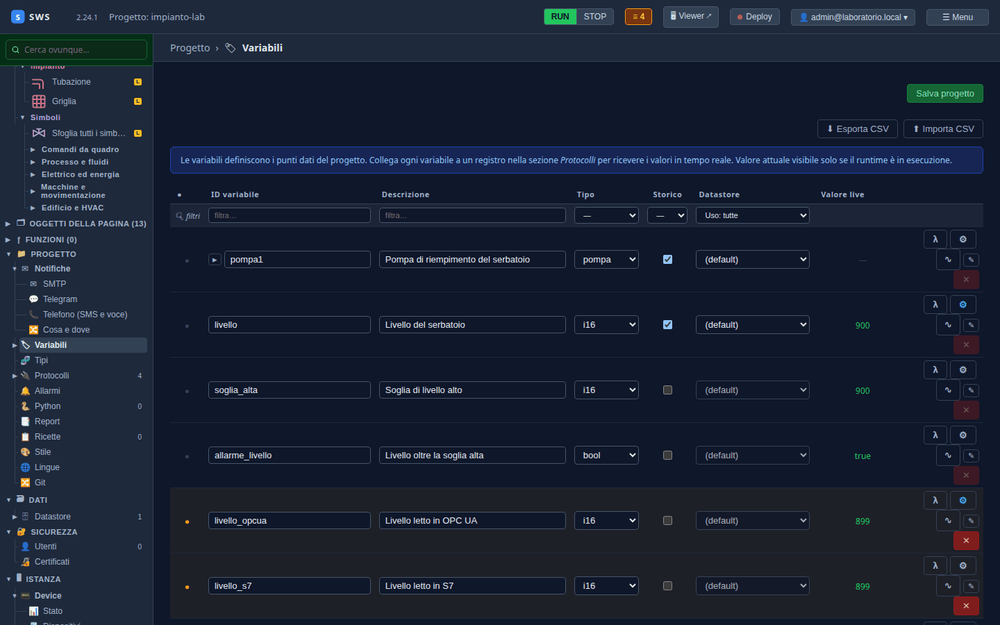
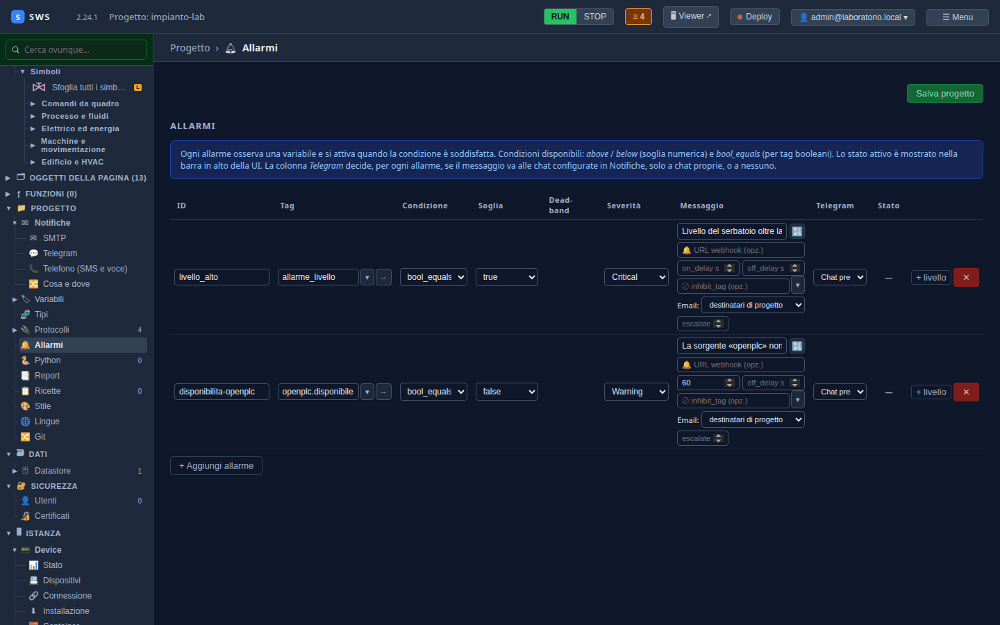
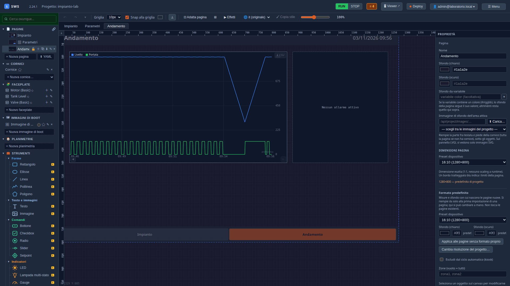

← [Indice](MAIN.md) | [← Le pagine](T08_pagine.md) | [Utenti e ruoli →](T10_utenti_e_ruoli.md)

---

# T09 — Allarmi e storico

> **Parte II — Tutorial.** Il serbatoio che arriva alla soglia diventa un **allarme**, il PLC che non risponde un
> altro; livello, pompa e temperatura entrano nello **storico**, e una pagina «Andamento» li mostra nel tempo accanto
> agli allarmi attivi. Eseguito il 03-11-2026 con SWS 2.24.1 (più le correzioni di quel giorno).

---

## 1. Lo storico

In **Progetto → Variabili**, la colonna **Storico** accende la registrazione variabile per variabile. Accendila per:

| Variabile | Cosa registra |
|---|---|
| `pompa1` | le tre parti della pompa: `comando`, `in_marcia`, `portata` |
| `livello` | il livello del serbatoio |
| `temperatura_esterna` | la temperatura dal broker |



Per un'istanza l'interruttore è sulla variabile: i membri lo seguono (al [T03](T03_tag_e_tipi.md) il tipo `pompa` li ha
tutti con `history: true`, e un membro si può escludere dal tipo). **Salva progetto.**

Lo storico va nel **datastore** predefinito, un file SQLite nel progetto (`history/historian.db`): si registra un punto
quando il valore cambia, e i grafici lo rileggono. Altri datastore (PostgreSQL, ODBC) e la conservazione sono nel
[08 — Historian e trend](08_historian.md).

## 2. L'allarme di livello alto

**Progetto → Allarmi → + Aggiungi allarme**:

| Campo | Valore | Perché |
|---|---|---|
| ID | `livello_alto` | |
| Tag | `allarme_livello` | il PLC calcola già la condizione |
| Condizione | `bool_equals` · `true` | scatta quando la variabile è vera |
| Severità | **Critical** | |
| Messaggio | `Livello del serbatoio oltre la soglia alta` | come il resto dei testi, diventa una chiave tradotta |



Con una variabile numerica si userebbe `above` / `below` con una **soglia** e una **banda morta** (dead-band), così un
valore che balla sulla soglia non accende e spegne l'allarme a ogni lettura. **on_delay** e **off_delay** ritardano
attivazione e rientro; **+ livello** aggiunge un secondo livello (per esempio Warning a 800, Critical a 900).

## 3. L'allarme di disponibilità

Un allarme che non arriva perché il PLC è spento è peggio di nessun allarme. In **Protocolli**, nella sorgente
`openplc`, il riquadro **Disponibilità** ha **⚠ Crea l'allarme di disponibilità**: prepara un allarme sul tag
`openplc.disponibile`, falso per un minuto (`on_delay` 60 s), e porta nella scheda Allarmi dove lo si rivede e si salva.

Lo stesso pulsante c'è in ogni sorgente: OPC UA, S7, MQTT.

**Salva progetto.**

## 4. La pagina Andamento

Una pagina nuova, `Andamento`, che il navigatore della cornice mostra da solo accanto a «Impianto»:

1. **Grafici → Trend**: X `40`, Y `80`, W `820`, H `420`. In **Serie → Tracce** due righe: `livello` (nome
   «Livello») e `pompa1.portata` (nome «Portata»); **Finestra** `600` s, gli ultimi dieci minuti. Y min e Y max
   vuoti: la scala si adatta ai dati.
2. **Allarmi → Allarmi**: X `880`, Y `80`, W `360`, H `420`: l'elenco degli allarmi attivi, con la conferma (ACK).



Il trend parte dallo storico (una richiesta all'apertura) e poi segue i valori dal vivo: livello che sale con la pompa
in marcia, scende quando si ferma, e oscilla sulla soglia quando l'allarme ferma e riavvia la pompa.

> **Notifiche.** Un allarme può anche partire per email, Telegram, SMS o chiamata: in **Progetto → Notifiche** si
> configurano i canali, e la colonna Telegram/Email di ogni allarme decide dove va. È nel [07 — Allarmi](07_alarms.md).

---

## Cosa c'è su disco

```yaml
alarms:
- id: livello_alto
  tag: allarme_livello
  levels:
  - condition: { kind: bool_equals, value: true }
    severity: Critical
    message: '{{t0010}}'
- id: disponibilita-openplc
  tag: openplc.disponibile
  levels:
  - condition: { kind: bool_false }
    severity: Warning
    message: La sorgente «openplc» non risponde da un minuto
  on_delay_s: 60.0
```

```yaml
# synoptics/Andamento.yaml, il trend
- type: trend
  window_s: 600.0
  trend_tags:
  - { label: Livello, tag: livello }
  - { label: Portata, tag: pompa1.portata }
```

---

← [Indice](MAIN.md) | [← Le pagine](T08_pagine.md) | [Utenti e ruoli →](T10_utenti_e_ruoli.md)
