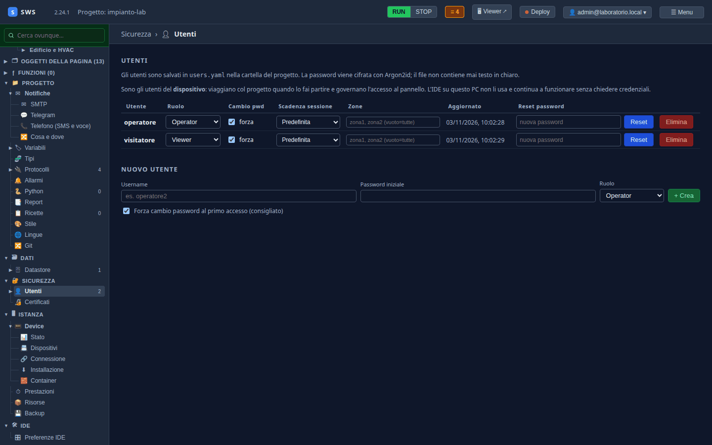
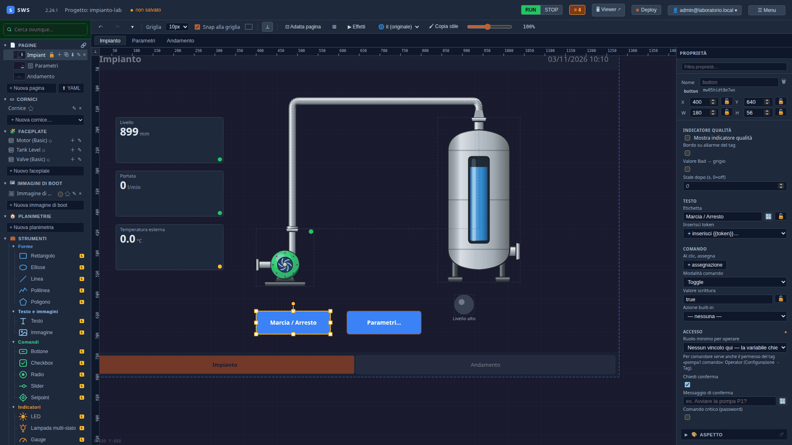

← [Indice](MAIN.md) | [← Allarmi e storico](T09_allarmi_e_storico.md) | [Il pannello →](T11_pannello.md)

---

# T10 — Utenti e ruoli

> **Parte II — Tutorial.** Chi può guardare, chi può comandare la pompa, chi può cambiare la soglia. Gli utenti del
> pannello si definiscono nel progetto, i permessi sui singoli oggetti. Eseguito il 03-11-2026 con SWS 2.24.1 (più
> le correzioni di quel giorno); la prova vera si fa sul pannello, al [T11](T11_pannello.md).

---

## Utenti dell'IDE e utenti del pannello

Sono due cose diverse, ed è la prima cosa da sapere:

| | Dove stanno | A cosa servono |
|---|---|---|
| **Utenti dell'IDE** | nell'installazione dell'IDE (al [T02](T02_progetto_vuoto.md) hai creato l'amministratore) | entrare nell'IDE e lavorare ai progetti |
| **Utenti del pannello** | nel progetto, `users.yaml` | entrare nel pannello: chi guarda, chi comanda |

I secondi viaggiano col progetto e arrivano al pannello col deploy. L'IDE non li usa.

## 1. I ruoli

| Ruolo | Cosa può fare sul pannello |
|---|---|
| **Viewer** | guardare |
| **Operator** | comandare: pulsanti, setpoint, conferma degli allarmi |
| **Supervisor** | quello che fa l'operatore, più quello che gli oggetti riservano a lui (soglie, parametri) |
| **Admin** | tutto, compresa la gestione del pannello |

## 2. Gli utenti

**Sicurezza → Utenti → Nuovo utente**, due volte:

| Username | Password iniziale | Ruolo |
|---|---|---|
| `operatore` | `operatore1` | Operator |
| `visitatore` | `visitatore1` | Viewer |

Lascia accesa **Forza cambio password al primo accesso**: la password iniziale la sai tu, quella vera solo chi la
userà. La password è cifrata con Argon2id; nel file non c'è mai in chiaro.



Gli utenti si salvano subito, senza «Salva progetto».

## 3. Chi può comandare cosa

Ogni variabile ha già un ruolo per la scrittura: di default **Operator**. Gli oggetti possono chiedere di più, o
chiedere una conferma.

- **Marcia / Arresto**: nel pannello Proprietà, in **Accesso**, il ruolo resta «Nessun vincolo qui — la variabile
  chiede Operator»; accendi **Chiedi conferma**. Il pannello chiederà conferma prima di ogni comando.
- **Il setpoint della soglia**, nella finestra Parametri: **Ruolo minimo per operare → Supervisor**. L'operatore vede
  la soglia ma non la cambia.



**Comando critico (password)** chiede di ridigitare la password a ogni comando: per i comandi che non si vogliono
dare per sbaglio (un reset, una ricetta che svuota un serbatoio).

> **Le zone.** Un utente può essere limitato a un'area dell'impianto: le pagine dichiarano le loro zone e l'utente
> vede solo quelle. È nel [09 — Autenticazione e ruoli](09_auth_rbac.md).

---

## Cosa c'è su disco

```yaml
# users.yaml (le password sono hash Argon2id, accorciati qui)
users:
- username: visitatore
  password_hash: $argon2id$v=19$…
  role: Viewer
  must_change_password: true
- username: operatore
  password_hash: $argon2id$v=19$…
  role: Operator
  must_change_password: true
```

```yaml
# synoptics/Impianto.yaml, il bottone
- type: button
  tag: pompa1.comando
  button_mode: toggle
  require_confirm: true
```

---

← [Indice](MAIN.md) | [← Allarmi e storico](T09_allarmi_e_storico.md) | [Il pannello →](T11_pannello.md)
