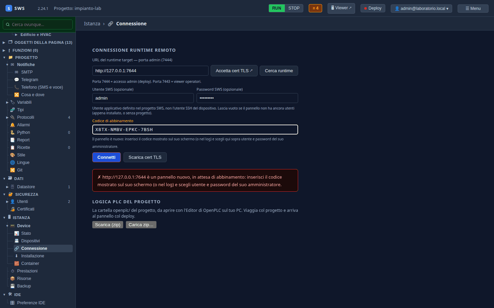
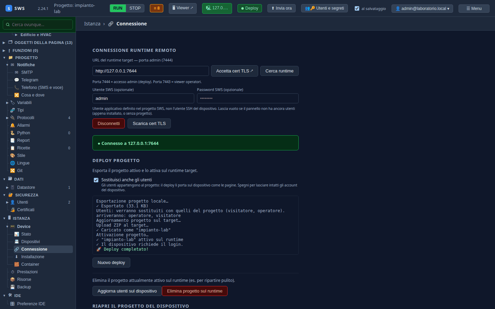
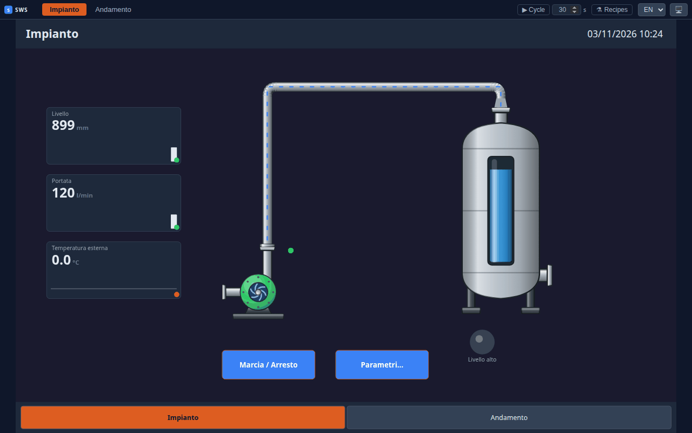
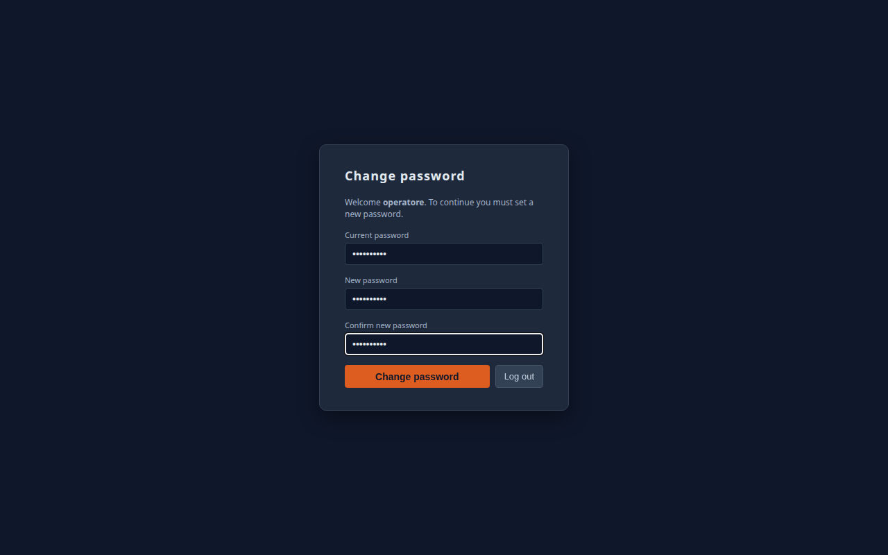

← [Indice](MAIN.md) | [← Utenti e ruoli](T10_utenti_e_ruoli.md) | [Il pannello dal cloud →](T12_cloud.md)

---

# T11 — Il pannello: abbinamento, deploy, e chi comanda

> **Parte II — Tutorial.** Il progetto lascia l'IDE e va su un pannello: l'abbinamento col codice, il deploy, e
> sul pannello l'operatore che entra, cambia la password e avvia la pompa. Eseguito il 03-11-2026 con SWS 2.24.1 (più
> le correzioni di quel giorno), contro un runtime di prova sullo stesso PC che fa da pannello.

---

## Il pannello

Un pannello è un runtime SWS con lo schermo davanti: un TC620, un WP630, un PC in reparto. Si installa col container
([02 — Quick Start](02_quickstart.md)): appena acceso **non ha utenti**, non lascia entrare nessuno, e stampa un
**codice di abbinamento** sul suo schermo e nel log:

```text
pannello in attesa di abbinamento: nessun utente, non entra nessuno.
Codice di abbinamento: X8TX-NMBV-EPKC-7BSH — inseriscilo nell'IDE («Connetti») o nella pagina di questo pannello
per creare l'amministratore
```

Nel tutorial il pannello è un runtime avviato sullo stesso PC, con il viewer sulla **7643** e la gestione sulla
**7644** (un pannello vero usa 7443 e 7444). Legge il PLC del laboratorio da sé, come farebbe in reparto.

## 1. L'abbinamento

**Istanza → Device → Connessione**:

1. **URL del runtime**: `http://127.0.0.1:7644` — la porta di **gestione**, non quella del viewer. Su un pannello
   vero è `https://<indirizzo>:7444`, e **Accetta cert TLS ↗** apre la pagina per fidarsi del suo certificato.
2. **Connetti**: l'IDE riconosce un pannello nuovo e chiede il **codice di abbinamento**.
3. Scegli **utente e password dell'amministratore del pannello** (qui `admin`) e scrivi il codice.



**Connetti** di nuovo: «abbinato: «admin» è il suo amministratore», e il pallino diventa **Connesso**.

L'amministratore dell'abbinamento è un **utente del dispositivo**: resta sul pannello qualunque progetto ci arrivi.
Gli utenti del progetto ([T10](T10_utenti_e_ruoli.md)) gli si affiancano.

## 2. Il deploy

Sotto, **Deploy progetto**: **Sostituisci anche gli utenti** è acceso (gli utenti del progetto vanno sul pannello),
poi **Deploy progetto attivo ▸**.

```text
✓ Esportato (33.1 KB)
Utenti: verranno sostituiti con quelli del progetto (visitatore, operatore).
✓ Caricato come "impianto-lab"
✓ "impianto-lab" attivo sul runtime
✓ Il dispositivo richiede il login.
🚀 Deploy completato!
```



Il progetto viaggia intero: pagine, cornice, variabili, sorgenti, allarmi, storico, lingue, utenti e i certificati
OPC UA di cui si fida. Il pannello si collega da sé al PLC e al broker.

## 3. Sul pannello

Il viewer (`http://127.0.0.1:7643`, sul pannello vero lo schermo stesso) mostra la pagina a chiunque, in sola
lettura, con i valori veri:



Premendo **Marcia / Arresto** senza essere entrati, il pannello chiede di entrare. Con `operatore` / `operatore1`:

1. il pannello chiede di **cambiare la password** (la casella del [T10](T10_utenti_e_ruoli.md)), e finché non la
   cambia l'operatore vede ma non comanda;
2. nuova password, **Change password**;
3. **Marcia / Arresto**: la conferma («Confirm the command? Value to be written: true»), **OK**, e la pompa parte.



Con `visitatore` (Viewer) lo stesso bottone non comanda: il pannello chiede di entrare con un utente che ne abbia il
permesso, e la pompa resta com'è. Il setpoint della soglia, nella finestra **Parametri…**, lo cambia solo un
Supervisor o l'amministratore.

---

## Se qualcosa non va

| Sintomo | Cosa guardare |
|---|---|
| «Connetti» non risponde | la porta: la **7444** (gestione), non la 7443; con HTTPS, prima **Accetta cert TLS** |
| Il codice è rifiutato | il codice cambia a ogni riavvio del pannello: rileggilo dal log o dallo schermo |
| Il deploy chiede conferma | sta per sostituire progetti o utenti diversi: leggi cosa e conferma |
| Il pannello non legge il PLC | dal pannello, l'indirizzo del PLC deve essere raggiungibile (`127.0.0.1` vale solo se stanno sulla stessa macchina) |

Le porte, i certificati e cosa passa sulla rete sono nel [18 — Container e comunicazione](18_container_e_comunicazione.md).

---

← [Indice](MAIN.md) | [← Utenti e ruoli](T10_utenti_e_ruoli.md) | [Il pannello dal cloud →](T12_cloud.md)
